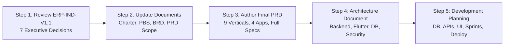

# India-First Modular Super App Platform

An enterprise-grade, multi-vertical digital super app ecosystem designed specifically for the Indian market across Tier 1, Tier 2, Tier 3, and semi-urban cities.

---

## 1. Project Overview

The **India-First Modular Super App Platform** brings **nine commercial business verticals** together under a single, unified technology and operational ecosystem:

1. **Food Delivery** (Restaurant discovery, KDS, prep timers, hot-bag validation, FSSAI display)
2. **Grocery Delivery** (Dark store catalog, 10-minute stock reservation, produce weight tolerance, substitutions)
3. **E-commerce** (Multi-seller storefronts, multi-cart, 3PL aggregator AWB generation, doorstep QC returns, 7-day escrow)
4. **Ride Booking & Mobility** (Bike Taxi, Auto, Mini, Sedan, SUV/XL, upfront dynamic fare, 4-digit start OTP, FASTag automated tolls)
5. **Logistics & Parcel** (Hyperlocal point-to-point courier, inter-city freight, volumetric calculator, QR waybills, recipient OTP)
6. **Home Services** (Standard rate cards, technician background checks, in-app digital extra quotes, 30-day warranty)
7. **Healthcare Services** (Doctor directory, live clinic queue tokens, WebRTC teleconsultation, home blood sample collection, ABDM/ABHA integration)
8. **Education & Tutoring** (Tutor/coaching directory, demo classes, recurring fee installments via UPI Autopay / e-NACH, attendance SMS alerts)
9. **Hotel & Accommodation Booking** (Geo-radius search, real-time room inventory hold, seasonal dynamic pricing, configurable KYC, BoI/FRRO Form C)

---

## 2. Application Ecosystem Architecture

The platform operates across **4 Unified Applications** supported by a modular shared core:

| Application | Platform / Framework | Core Architecture & Responsibility |
|---|---|---|
| **1. Customer Mobile App** | Flutter (iOS & Android) | BLoC State Management + Clean Architecture. Access to all 9 verticals, unified checkout, UPI Intent, live tracking, digital wallet, and 24x7 helpdesk. |
| **2. Unified Workforce App** | Flutter (iOS & Android) | **ONE Single Unified App** with Dynamic Capability Gating:<br>• **Transit Shell:** On-demand radar, shift switcher (Delivery vs. Ride Mode), and turn-by-turn navigation for riders and cab drivers.<br>• **Specialist Shell:** Scheduled appointment calendar, digital extra spare parts quote builder, and photo QC for technicians and phlebotomists. |
| **3. Merchant Partner App** | Flutter (iOS & Android) | BLoC State Management + Clean Architecture. Real-time order intake, KDS, catalog/inventory toggle, clinic tokens, hotel extranet, and T+1 financial settlements. |
| **4. Super Admin Web Portal** | Next.js 14+ / TypeScript | Global operations command center, live fleet GIS heatmaps, merchant/driver KYC review queues, dispute resolution desk, and GSTR-8 / Section 194-O statutory tax console. |

---

## 3. Core Architectural Standards

- **Strict Clean Architecture:** Feature-first separation under `features/<feature_name>/` containing `data/`, `domain/`, and `presentation/` (`bloc/`, `pages/`, `widgets/`). Zero UI code in root `lib/`.
- **State Management:** Standardized universally on **BLoC (`flutter_bloc`)**.
- **1,000,000+ Concurrency Scaling:** High-priority **FCM Data Messages** for background/terminated wake-up; `WidgetsBindingObserver` for automatic WebSocket reconnect with **Decorrelated Full Jitter** and non-blocking **HTTP/2 delta synchronization**; local caching (Hive/SQLite) to prevent backend traffic storms. Continuous HTTP polling is strictly prohibited.
- **Financial Precision:** 100% of monetary transactions, ledger entries, commissions, and taxes are represented as 64-bit integers in minor units (**Paise**). Zero floating-point rounding errors.
- **Persistent Idempotency & Concurrency:** Two-tier protection using Redis atomic Lua script leases with Monotonic Fencing Tokens (`DISPATCH_LOCK_EX30`) backed by a persistent PostgreSQL `idempotency_records` table and row-level pessimistic locking (`SELECT ... FOR UPDATE`).

---

## 4. Documentation Repository & Master File Index

All enterprise planning, architectural baselines, audits, and remediation plans are organized under the `docs/` directory:

```text
docs/
├── 01_project_charter/
│   └── master_project_charter.md           # Master Project Charter (MPC-IND-V1.0)
├── 02_product_breakdown_structure/
│   └── product_breakdown_structure.md      # Product Breakdown Structure (PBS-IND-V1.0)
├── 03_business_requirements_document/
│   └── business_requirements_document.md   # Business Requirements Document (BRD-IND-V1.0)
├── 04_product_requirements_document/
│   └── prd_scope_and_outline.md            # PRD Scope & Structure Blueprint (PRD-SCOPE-IND-V1.0)
├── 05_remediation_plan/
│   ├── enterprise_remediation_plan.md      # Remediation Plan Revision 1 (ERP-IND-V1.0 - Superseded)
│   └── enterprise_remediation_plan_v1.1.md # Remediation Plan Revision 2 (ERP-IND-V1.1 - Authoritative)
└── 06_visual_hierarchy_and_flows/
    └── high_level_visual_hierarchy.md      # Master Visual Hierarchy & System Flow Blueprint (VHB-IND-V1.0)
```

### Detailed Document Breakdown:

### 1. Master Project Charter (Version 1.0)
* **Path:** [`docs/01_project_charter/master_project_charter.md`](file:///Users/firozmohammad/DigiEmperor/all_in_one/docs/01_project_charter/master_project_charter.md)
* **Purpose:** Establishes the strategic business mandate, market positioning, target audience, long-term 100M user vision, revenue models across all 9 verticals, hybrid delivery strategy, risk governance, and core technical stack baseline.

### 2. Product Breakdown Structure (Version 1.0)
* **Path:** [`docs/02_product_breakdown_structure/product_breakdown_structure.md`](file:///Users/firozmohammad/DigiEmperor/all_in_one/docs/02_product_breakdown_structure/product_breakdown_structure.md)
* **Purpose:** Provides a 4-level hierarchical deliverable breakdown (PBS-1.0 to PBS-1.12) decomposing the entire Super App platform into shared core foundations (IAM, Payments, H3 GIS, Notifications), client application modules (BLoC components), vertical feature sets, and a cross-application traceability matrix.

### 3. Business Requirements Document (Version 1.0)
* **Path:** [`docs/03_business_requirements_document/business_requirements_document.md`](file:///Users/firozmohammad/DigiEmperor/all_in_one/docs/03_business_requirements_document/business_requirements_document.md)
* **Purpose:** Comprehensive enterprise business specifications covering operational policies, take rates, commercial commission matrices, dual-mode workforce shift logic, bi-directional ratings, emergency SOS safety shield, and Indian regulatory compliance (DPDP Act 2023, Section 194-O TDS, Motor Vehicle Aggregator Guidelines).

### 4. PRD Scope & Structure Outline (Version 1.0)
* **Path:** [`docs/04_product_requirements_document/prd_scope_and_outline.md`](file:///Users/firozmohammad/DigiEmperor/all_in_one/docs/04_product_requirements_document/prd_scope_and_outline.md)
* **Purpose:** Formal scope proposal outlining the 10 planned sections of the upcoming Product Requirements Document (PRD), user flow matrix across all 4 apps, wireframe layout specifications (15+ core screens), non-functional requirements (NFRs), and Given-When-Then acceptance criteria framework.

### 5. Enterprise Architectural Remediation Plan (Revision 1 — Superseded)
* **Path:** [`docs/05_remediation_plan/enterprise_remediation_plan.md`](file:///Users/firozmohammad/DigiEmperor/all_in_one/docs/05_remediation_plan/enterprise_remediation_plan.md)
* **Purpose:** Initial remediation proposal addressing the 10 audit gaps (B-01 to B-04, T-01 to T-03, Q-01 to Q-03). *Note: This document has been superseded by Revision 2 (ERP-IND-V1.1).*

### 6. Enterprise Architectural Remediation Plan (Revision 2 — Authoritative Baseline)
* **Path:** [`docs/05_remediation_plan/enterprise_remediation_plan_v1.1.md`](file:///Users/firozmohammad/DigiEmperor/all_in_one/docs/05_remediation_plan/enterprise_remediation_plan_v1.1.md)
* **Purpose:** Authoritative technical and regulatory remediation plan incorporating all Revision 2 audit corrections:
  1. **GST TCS Correction:** Aligned Section 52 TCS to the statutory **0.5% rate** effective July 10, 2024 (Notification 15/2024-CT).
  2. **Section 9(5) Registration Exceptions:** Established dual-invoicing rules for Hotels and Home Services (Platform is deemed supplier ONLY if the provider is unregistered; registered providers issue tax invoices directly; subject to CA written sign-off).
  3. **Disaggregated COD Accounting:** Bifurcated food cost, delivery fee, platform fee, and customer debt across genuine refusal vs. fraudulent refusal scenarios ($\le 50\text{m}$ GPS + mandatory IVR call log).
  4. **Configurable Hotel KYC:** Made domestic guest KYC configurable per state police law; restricted Form C strictly and exclusively to foreign passport holders under BoI/FRRO rules.
  5. **India-Specific Healthcare Jurisprudence:** Removed all US HIPAA references; grounded healthcare strictly in the DPDP Act 2023, Telemedicine Practice Guidelines 2020, SPDI Rules 2011, ABDM M1-M3 integration schemas, and IT Act Section 79 safe harbor.
  6. **WebSocket Decorrelated Jitter:** Implemented RFC-standard full jitter backoff with HTTP/2 delta-sync fallback; realistic gateway capacity parameters.
  7. **Durable Redis Concurrency:** Added Martin Kleppmann Monotonic Fencing Tokens, durable PostgreSQL outbox persistence, and BullMQ dead-letter recovery workers.
  8. **Persistent Database Idempotency:** Added a PostgreSQL `idempotency_records` table with engine-level unique constraints and row-level pessimistic locking (`SELECT ... FOR UPDATE`) in 64-bit integer Paise.

### 7. High-Level Visual Hierarchy & System Flow Blueprint (Version 1.0)
* **Path:** [`docs/06_visual_hierarchy_and_flows/high_level_visual_hierarchy.md`](file:///Users/firozmohammad/DigiEmperor/all_in_one/docs/06_visual_hierarchy_and_flows/high_level_visual_hierarchy.md)
* **Purpose:** Complete visual architectural blueprint featuring GitHub-native Mermaid diagrams for:
  1. Macro System Topology (Apps -> Edge Gateway -> Core Engines -> 9 Verticals -> Data Tier -> Indian Integrations).
  2. Component Breakdown across all 4 applications (including single Unified Workforce App with Transit vs. Specialist dynamic shells).
  3. Clean Architecture & BLoC reactive event-state data flows (offline-first read pattern vs. mutating transaction pattern).
  4. End-to-end operational workflows for all 9 business verticals (Food, Grocery, E-commerce, Rides, Logistics, Home Services, Healthcare, Education, Hotels).
  5. Double-entry financial treasury flow (Paise precision, Sec 9(5) vs. Sec 52 dual-invoicing, GSTR-8, T+1 settlements).
  6. High-scale concurrency, 4-tier GPS anti-spoofing, and persistent database idempotency lifecycles.

---

## 5. Current Project Status & Immediate Next Step

* **Current Stage:** Phase 1 (Discovery, Audit & Remediation Sign-Off).
* **Pending Milestone:** Executive review and approval of Decisions `DEC-01` through `DEC-07` in [`ERP-IND-V1.1`](file:///Users/firozmohammad/DigiEmperor/all_in_one/docs/05_remediation_plan/enterprise_remediation_plan_v1.1.md).

---

## 6. Master 5-Step Execution Roadmap

The project follows a strict 5-step delivery pipeline:



### Step 1: Final Review & Approval of Remediation Plan V1.1
Review and approve all 7 Executive Decisions (`DEC-01` to `DEC-07`) in [`ERP-IND-V1.1`](file:///Users/firozmohammad/DigiEmperor/all_in_one/docs/05_remediation_plan/enterprise_remediation_plan_v1.1.md) one by one:
- **DEC-01 (GST):** 0.5% TCS rate and Section 9(5) registration exceptions for Hotels and Home Services.
- **DEC-02 (Healthcare):** India DPDP Act 2023, Telemedicine 2020 rules, signed PDF locker, and external pharmacy handoff.
- **DEC-03 (COD):** Disaggregated accounting for food cost, delivery fee, platform loss, and customer debt.
- **DEC-04 (Hotel KYC):** Configurable domestic guest KYC and foreign-only Form C submission.
- **DEC-05 (Workforce App):** Single unified Flutter app with Transit vs. Specialist dynamic shells.
- **DEC-06 (Real-Time):** Full Jitter reconnect backoff and HTTP/2 delta-sync priority.
- **DEC-07 (Data Concurrency):** Redis Lua fencing tokens, PostgreSQL outbox, and persistent `idempotency_records` table.

### Step 2: Update Original Foundational Documents
Synchronize the approved decisions into the original documents:
- Update `master_project_charter.md`, `product_breakdown_structure.md`, and `business_requirements_document.md`.
- Maintain complete traceability between original requirements and new decisions.

### Step 3: Author the Complete Final PRD
Produce the exhaustive **Product Requirements Document (PRD)** covering:
- All 9 business verticals in full depth.
- All 4 applications (Customer, Workforce, Merchant, Super Admin).
- User roles, journeys, feature matrices, edge cases, and business validation rules.
- Screen wireframe layouts and Given-When-Then (Gherkin) acceptance criteria.

### Step 4: Author the System Architecture Document (SAD)
Produce the comprehensive **System Architecture Document (SAD)** covering:
- Modular Monolith backend architecture (NestJS / TypeScript).
- Flutter mobile architecture (Clean Architecture + BLoC).
- Next.js 14+ Super Admin portal architecture.
- PostgreSQL domain schema design (Paise integer ledger, domain isolation).
- REST and WebSocket API specifications.
- Dispatch engine, payment routing, FCM notification pipelines, and zero-trust security.

### Step 5: Development Planning & Execution
Structured delivery roadmap:
- **Phase A:** Database Design & Migration Scripts (PostgreSQL DDL).
- **Phase B:** API Contracts & OpenAPI 3.1 Documentation.
- **Phase C:** UI/UX Design System & Component Library.
- **Phase D:** Sprint Planning & Backlog Grooming.
- **Phase E:** Core Platform & Vertical Engineering (Test-Driven Clean Architecture).
- **Phase F:** QA Automation, Performance Stress Testing & Security Penetration Testing.
- **Phase G:** Staging Pilot & Multi-City Production Deployment.

