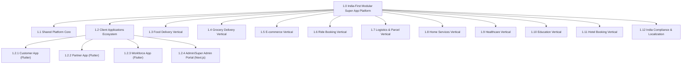

# PRODUCT BREAKDOWN STRUCTURE (PBS)
## India-First Modular Super App Platform

**Document Identifier:** PBS-IND-V1.0  
**Project Category:** Multi-Vertical Digital Super App Ecosystem  
**Target Market:** India (Tier 1, Tier 2, Tier 3, Semi-Urban)  
**Parent Document:** Master Project Charter (MPC-IND-V1.0)  
**Document Type:** Product Breakdown Structure & Functional Taxonomy  
**Status:** Approved Product Baseline  
**Prepared By:** Senior Enterprise Product Management & Solution Architecture Team  
**Scale Target:** 100 Million Registered Users (High-Concurrency Architecture)

---

## 1. Executive Summary & Purpose

The **Product Breakdown Structure (PBS)** delivers an exhaustive, hierarchical, deliverable-oriented decomposition of the physical, digital, and functional products comprising the **India-First Modular Super App Platform**.

While a Work Breakdown Structure (WBS) defines the *activities* required to deliver a project, this PBS defines the **entire hierarchy of the system deliverables themselves**—every application, platform module, vertical engine, subsystem, and micro-component required to operate nine integrated business verticals across India.

### 1.1 Structural Taxonomy & Coding Convention
The PBS is indexed using a 4-level strict hierarchical numbering format:
- **Level 1 (PBS-1.0):** The Entire Super App Digital Ecosystem
- **Level 2 (PBS-1.X):** Primary Product Domains (Client Apps, 9 Verticals, Core Backend Platform, Integrations, Compliance)
- **Level 3 (PBS-1.X.Y):** Subsystems / Functional Modules
- **Level 4 (PBS-1.X.Y.Z):** Specific Product Components & Deliverable Feature Sets

---

## 2. High-Level PBS Visual Hierarchy



---

## 3. Product Breakdown Structure: Detailed Breakdown

```text
1.0 INDIA-FIRST MODULAR SUPER APP PLATFORM
 ├── 1.1 SHARED PLATFORM CORE & FOUNDATION MODULES
 │    ├── 1.1.1 Unified Identity, Authentication & Access Control (IAM)
 │    ├── 1.1.2 Centralized Payments, Ledger & Treasury Engine
 │    ├── 1.1.3 Location Intelligence, Mapping & Routing Subsystem
 │    ├── 1.1.4 Omnichannel Notification & Event Streaming Engine
 │    ├── 1.1.5 Dynamic Catalog, Search & Recommendations Engine
 │    ├── 1.1.6 Cart, Cross-Vertical Checkout & Pricing Calculation Engine
 │    ├── 1.1.7 Promotions, Loyalty, Referrals & Gamification
 │    ├── 1.1.8 Real-Time Chat, Customer Support & Ticketing Engine
 │    ├── 1.1.9 Trust, Safety, Bi-Directional Ratings & Fraud Prevention
 │    └── 1.1.10 Platform Telemetry, Business Intelligence & Reporting
 │
 ├── 1.2 CLIENT APPLICATIONS ECOSYSTEM
 │    ├── 1.2.1 Unified Customer Mobile Application (Flutter - iOS/Android)
 │    ├── 1.2.2 Unified Business Partner Mobile Application (Flutter - iOS/Android)
 │    ├── 1.2.3 Dual-Mode Workforce Application: Delivery & Driver (Flutter)
 │    └── 1.2.4 Enterprise Web Administration & Operations Portal (Next.js)
 │
 ├── 1.3 VERTICAL 1: FOOD DELIVERY
 ├── 1.4 VERTICAL 2: GROCERY DELIVERY
 ├── 1.5 VERTICAL 3: E-COMMERCE
 ├── 1.6 VERTICAL 4: RIDE BOOKING
 ├── 1.7 VERTICAL 5: LOGISTICS & PARCEL
 ├── 1.8 VERTICAL 6: HOME SERVICES
 ├── 1.9 VERTICAL 7: HEALTHCARE
 ├── 1.10 VERTICAL 8: EDUCATION
 ├── 1.11 VERTICAL 9: HOTEL BOOKING
 └── 1.12 INDIA COMPLIANCE, TAXATION & LOCALIZATION ENGINE
```

---

## 4. Deep-Dive Decomposition: Shared Platform Core (PBS-1.1)

### PBS-1.1.1: Unified Identity, Authentication & Access Control (IAM)
* **PBS-1.1.1.1 Mobile Number & OTP Gateway:** Zero-password onboarding using Indian telecom carriers (SMS & WhatsApp OTP fallback), auto-read via SMS Retriever API.
* **PBS-1.1.1.2 Multi-Persona Account Federation:** Single user identity supporting multiple role profiles (Customer, Merchant Owner, Delivery Rider, Ride Driver, Admin).
* **PBS-1.1.1.3 Session & Device Token Manager:** Multi-device session invalidation, JWT token rotation with Redis blacklist, device fingerprinting for anti-abuse.
* **PBS-1.1.1.4 Fine-Grained Role-Based Access Control (RBAC):** Permission matrix supporting hierarchical branch-level, city-level, and operational admin access controls.
* **PBS-1.1.1.5 KYC & Document Verification Vault:** AES-256 encrypted storage for Aadhaar (masked), PAN, GSTIN, Driving Licenses, Vehicle RC, and FSSAI licenses.

### PBS-1.1.2: Centralized Payments, Ledger & Treasury Engine
* **PBS-1.1.2.1 Multi-Gateway Payment Router:** Dynamic failover routing between Indian payment aggregators (Razorpay, Cashfree, PayU).
* **PBS-1.1.2.2 India-First Payment Methods Suite:** UPI Intent (GPay, PhonePe, Paytm, CRED), UPI Autopay / Mandates, RuPay & International Cards, NetBanking (50+ Indian banks), COD with cash-collection limits.
* **PBS-1.1.2.3 Customer Digital Closed Wallet:** Stored-value closed wallet conforming to RBI prepaid instrument guidelines for instant refunds and cashbacks.
* **PBS-1.1.2.4 Immutable Double-Entry Financial Ledger:** Transaction records stored exclusively in integer minor units (**Paise**) with balanced debits/credits to eliminate floating-point drift.
* **PBS-1.1.2.5 Automated Merchant Settlement & Payout Engine:** Daily/weekly automated payout batches via IMPS/NEFT/RTGS with automated TDS (Section 194O) deductions and GST TCS reconciliation.
* **PBS-1.1.2.6 Dynamic Commission & Convenience Fee Calculator:** Configurable commission matrix supporting percentage, fixed, tiered, and surge-based platform fees per category and city.

### PBS-1.1.3: Location Intelligence, Mapping & Routing Subsystem
* **PBS-1.1.3.1 India Geocoding & Address Standardization Engine:** Multi-line address parser tailored for Indian addressing nuances (landmarks, apartment names, lane numbers, pincode validation).
* **PBS-1.1.3.2 Dynamic Geofencing & Serviceability Polygon Engine:** Geo-spatial polygon indexing (Uber H3 / PostGIS) defining city limits, operational zones, dark store radiuses, and non-serviceable containment areas.
* **PBS-1.1.3.3 Distance Matrix & ETA Calculation Service:** Real-time distance and transit duration calculator tuned for Indian traffic conditions across two-wheeler, three-wheeler, and four-wheeler profiles.
* **PBS-1.1.3.4 High-Frequency Telemetry Ingestion Hub:** Real-time WebSocket / MQTT ingestion pipeline handling driver/rider coordinates every 3-5 seconds with Dead Reckoning and snap-to-road filtering.

### PBS-1.1.4: Omnichannel Notification & Event Streaming Engine
* **PBS-1.1.4.1 High-Scale Push Notification Subsystem:** Firebase Cloud Messaging (FCM) using priority **Data Messages** for silent background wake-up and CallKit/local alert invocation during terminated/background app states.
* **PBS-1.1.4.2 Transactional SMS & WhatsApp Business Hub:** DLT-registered template dispatch (MSG91/Gupshup) with WhatsApp Business API failover for receipts, OTPs, and booking confirmations.
* **PBS-1.1.4.3 In-App Notification Center:** Synchronized in-app inbox supporting markdown notifications, deep-linking, rich banners, and read-state synchronization across devices.

### PBS-1.1.5: Dynamic Catalog, Search & Recommendations Engine
* **PBS-1.1.5.1 Multi-Vertical Unified Search Service:** ElasticSearch / Meilisearch cluster indexing products, dishes, doctors, courses, hotels, and services with phonetic typo-tolerance in Indian English and Hinglish.
* **PBS-1.1.5.2 Universal Taxonomy & Attribute Engine:** Hierarchical category tree supporting vertical-specific attributes (Veg/Non-Veg, Halal, Expiry dates, Batch numbers, Doctor specialties, Vehicle categories).
* **PBS-1.1.5.3 Geo-Ranked Personalization & Discovery Engine:** Real-time ranking based on user location, store operational status, past ordering habits, preparation time, and delivery distance.

### PBS-1.1.6: Cart, Cross-Vertical Checkout & Pricing Calculation Engine
* **PBS-1.1.6.1 Domain-Isolated Cart State Engine:** Vertical-specific cart validation rules (e.g., Food cart allows only 1 restaurant; E-commerce cart allows multi-seller checkout; Grocery cart enforces minimum order value).
* **PBS-1.1.6.2 Indian Taxation Engine (GST):** Automated calculation of CGST, SGST, IGST, and cess per HSN/SAC code, with compliant GST-ready tax invoice generation for customers and merchants.
* **PBS-1.1.6.3 Surge & Dynamic Pricing Engine:** Rule-based surge pricing calculator driven by real-time rain flags, festival spikes, night-time delivery premiums, and driver demand-supply ratios.

### PBS-1.1.7: Promotions, Loyalty, Referrals & Gamification
* **PBS-1.1.7.1 Centralized Coupon Engine:** Configurable coupon rules (percentage off, flat discount, merchant-funded vs. platform-funded, first-order only, bank-specific BIN discounts).
* **PBS-1.1.7.2 Unified Super App Coins & Rewards Subsystem:** Universal loyalty currency earned across any vertical and redeemable across any other vertical to drive cross-vertical adoption.
* **PBS-1.1.7.3 Two-Sided Referral Engine:** Referral link generation, device fraud detection (anti-emulator checks), and automatic reward credit upon first qualifying transaction.

### PBS-1.1.8: Real-Time Chat, Customer Support & Ticketing Engine
* **PBS-1.1.8.1 Context-Aware Helpdesk & Ticket Lifecycle Manager:** Automated ticket routing based on vertical, order ID, issue severity, and customer SLA tier.
* **PBS-1.1.8.2 In-App WebSocket Chat Engine:** Encrypted peer-to-peer and peer-to-agent chat with automated quick replies, photo attachment uploads, and masked phone calling integration.
* **PBS-1.1.8.3 Automated Refund Dispute Arbitrator:** Rules-driven instant refund decision engine for missing items, spoiled food, driver no-shows, and cancellation charges.

### PBS-1.1.9: Trust, Safety, Bi-Directional Ratings & Fraud Prevention
* **PBS-1.1.9.1 Bi-Directional Review Subsystem:** Star ratings (1-5) and feedback tags for Customers, Merchants, Drivers, and Service Providers with review moderation and spam filters.
* **PBS-1.1.9.2 Safety & Emergency Toolkit (SOS):** In-trip SOS button with real-time location streaming to emergency contacts and automated webhook dispatch to local law enforcement.
* **PBS-1.1.9.3 Anti-Fraud & Abuse Shield:** GPS spoofing detection, fake-order velocity limits, multiple account creation prevention on single IMEI/MAC, and merchant collusive ordering detection.

### PBS-1.1.10: Platform Telemetry, Business Intelligence & Reporting
* **PBS-1.1.10.1 Real-Time Analytics Pipeline:** Kafka / BullMQ event stream transforming raw operational events into business metrics (GMV, AOV, Fill Rates, Cancellation Rates, Driver Utilization).
* **PBS-1.1.10.2 City & Micro-Market Heatmap Generator:** Visual geospatial representation of live order densities, driver locations, unfulfilled demand, and delivery delays.
* **PBS-1.1.10.3 Regulatory Audit Log Vault:** Immutable audit log capturing all financial adjustments, status overrides, sensitive PII access, and admin policy updates for 7-year regulatory compliance.

---

## 5. Deep-Dive Decomposition: Client Applications Ecosystem (PBS-1.2)

All mobile applications are delivered using **Flutter** following **Strict Clean Architecture** (`data`, `domain`, `presentation`) with **BLoC (flutter_bloc)** state management. All web administration applications are delivered via **Next.js (App Router) & TypeScript**.

### PBS-1.2.1: Unified Customer Mobile Application (Flutter)
```text
PBS-1.2.1 Customer Mobile Application
 ├── PBS-1.2.1.1 Onboarding & Authentication Module (AuthBloc)
 ├── PBS-1.2.1.2 Global Home & Universal Discovery Portal (HomeBloc)
 ├── PBS-1.2.1.3 Food Delivery Feature Module (FoodBloc)
 ├── PBS-1.2.1.4 Grocery Delivery Feature Module (GroceryBloc)
 ├── PBS-1.2.1.5 E-commerce Feature Module (EcommerceBloc)
 ├── PBS-1.2.1.6 Ride Booking Feature Module (RideBloc)
 ├── PBS-1.2.1.7 Logistics & Parcel Feature Module (ParcelBloc)
 ├── PBS-1.2.1.8 Home Services Feature Module (HomeServicesBloc)
 ├── PBS-1.2.1.9 Healthcare Feature Module (HealthcareBloc)
 ├── PBS-1.2.1.10 Education Feature Module (EducationBloc)
 ├── PBS-1.2.1.11 Hotel Booking Feature Module (HotelBloc)
 ├── PBS-1.2.1.12 Unified Checkout & Razorpay/Cashfree Payment Module
 ├── PBS-1.2.1.13 Live Order & Trip Tracking Module (WebSockets / Google Maps)
 ├── PBS-1.2.1.14 Unified Orders, Bookings & Trips History Module
 ├── PBS-1.2.1.15 Digital Wallet, Rewards & Referral Screen
 ├── PBS-1.2.1.16 Customer Profile, Address Book & Multi-Language Settings
 └── PBS-1.2.1.17 24x7 Help Center, Live Chat & SOS Safety Toolkit
```

### PBS-1.2.2: Unified Business Partner Mobile Application (Flutter)
A dynamic, multi-tenant mobile management application adapting to the merchant's approved business type:
* **PBS-1.2.2.1 Merchant Onboarding & Digital KYC:** Step-by-step submission of GSTIN, FSSAI, bank account verification (penny drop API), and store storefront images.
* **PBS-1.2.2.2 Real-Time Order Management Console:** High-priority audible chime alerts for new orders, one-tap accept/reject, preparation time selector, and dispatch staging.
* **PBS-1.2.2.3 Digital Catalog & Inventory Manager:** Item toggle (In Stock / Out of Stock), variant pricing, add-on groups, menu photos, and mass stock update.
* **PBS-1.2.2.4 Storefront Configuration & Hours Manager:** Operating hours, scheduled holidays, minimum order value, delivery radiuses, and temporary store closure (snooze mode).
* **PBS-1.2.2.5 Financial Settlement & Invoicing Dashboard:** Daily sales tally, commission deductions, net payout estimation, weekly settlement breakdown, and tax reports.
* **PBS-1.2.2.6 Customer Review & Rating Response Portal:** View customer feedback and post verified merchant replies.

### PBS-1.2.3: Dual-Mode Workforce Application: Delivery & Driver (Flutter)
A unified application designed for two-wheelers, three-wheelers, and four-wheelers, featuring a hardware-accelerated **Operational Mode Switcher**:
* **PBS-1.2.3.1 Workforce Onboarding & Vehicle Verification:** Upload of Driving License, Aadhaar, PAN, Vehicle Registration Certificate (RC), Commercial Permits, and Police Clearance.
* **PBS-1.2.3.2 Operational Capability Switcher:** Dynamically toggle between `Delivery Mode`, `Ride Mode`, or `Dual Mode` (subject to vehicle eligibility and city regulations).
* **PBS-1.2.3.3 Floating Overlay & Job Dispatch Radar:** Incoming task cards showing pickup location, drop-off location, estimated fare/earnings, distance, and 30-second acceptance countdown timer.
* **PBS-1.2.3.4 Turn-by-Turn Navigation & In-App Route Guidance:** Mapbox / Google Maps SDK integration with Indian traffic re-routing and offline tile caching.
* **PBS-1.2.3.5 Proof-of-Fulfillment Engine:** Delivery validation via Customer OTP verification, geo-tagged photo capture, and signature pad.
* **PBS-1.2.3.6 Daily Earnings, Incentives & Cashout Hub:** Live earnings counter, target milestone trackers (e.g., complete 15 deliveries for ₹400 bonus), cash collected reconciliation, and instant bank payout button.
* **PBS-1.2.3.7 Emergency SOS & Roadside Assistance Hub:** Quick-dial to 112, live route sharing with supervisor, and accident reporting.

### PBS-1.2.4: Enterprise Web Administration & Operations Portal (Next.js)
```text
PBS-1.2.4 Enterprise Web Administration Portal
 ├── PBS-1.2.4.1 Super Admin Global Control Console
 │    ├── Multi-City & Service Area Geographic Boundaries (GIS GeoJSON Editor)
 │    ├── Vertical Activation/Deactivation Master Switches
 │    ├── Global Commission & Fee Matrix Editor
 │    ├── Platform Financial Overview & Treasury Ledger
 │    └── RBAC Admin Roles & Audit Log Viewer
 ├── PBS-1.2.4.2 Operations & Dispatch Command Center
 │    ├── Live Map of Active Trips, Deliveries, and Fleet Clusters
 │    ├── Manual Dispatch Overrides & Stuck Task Reassignment
 │    └── Dynamic Surge Pricing Activation Console
 ├── PBS-1.2.4.3 Merchant & Provider Management Module
 │    ├── Document Verification & KYC Approval Queue
 │    ├── Catalog Compliance & Image Quality Inspection
 │    └── Merchant Suspensions & Warning Notifications
 ├── PBS-1.2.4.4 Workforce Governance & Fleet Operations
 │    ├── Driver/Rider Background Verification & Approval Queue
 │    ├── Fleet Equipment & Bag/T-shirt Allocation Tracker
 │    └── Driver Incident & Behavioral Dispute Investigation
 ├── PBS-1.2.4.5 Customer Support & Escalation Workbench
 │    ├── Multi-Agent Live Chat Console
 │    ├── Manual Refund Approval & Financial Reversal Workflow
 │    └── User Account Blocking & Fraud Flags Management
 └── PBS-1.2.4.6 Financial Reconciliation, GST & Reporting Hub
      ├── Automated Gateway Settlement Reconciliation vs. Bank Statements
      ├── GST Invoicing (GSTR-1, GSTR-8 for E-commerce operators)
      └── Merchant Payout Approval & IMPS Batch Generation
```

---

## 6. Deep-Dive Decomposition: 9 Business Verticals

---

### 1.3 Vertical 1: Food Delivery (PBS-1.3)
```text
1.3 FOOD DELIVERY VERTICAL
 ├── 1.3.1 Restaurant Discovery & Storefront Subsystem
 │    ├── 1.3.1.1 Location-based restaurant feed with cuisine, dietary (Veg/Jain/Halal) & distance filters
 │    ├── 1.3.1.2 Rich digital menu viewer with item descriptions, calories, allergens & spice levels
 │    ├── 1.3.1.3 Menu variant & customization engine (sizes, toppings, crust, combos, instructions)
 │    └── 1.3.1.4 FSSAI license & hygiene rating badge display
 ├── 1.3.2 Food Ordering & Kitchen Lifecycle Management
 │    ├── 1.3.2.1 Real-time order placement with instant kitchen acknowledgment
 │    ├── 1.3.2.2 Kitchen Display System (KDS) & food preparation countdown timer
 │    ├── 1.3.2.3 Scheduled order placement for future delivery slots
 │    └── 1.3.2.4 Food order state machine (Placed → Accepted → Preparing → Ready → Out for Delivery → Delivered)
 ├── 1.3.3 Food Delivery Dispatch & Fulfillment
 │    ├── 1.3.3.1 Automated dispatch matching rider arrival to kitchen food-ready timestamp
 │    ├── 1.3.3.2 Insulated hot-bag verification and tamper-evident seal confirmation
 │    └── 1.3.3.3 Contactless delivery drop-off with photo proof
 └── 1.3.4 Post-Delivery & Customer Delight
      ├── 1.3.4.1 Item-level rating (taste, portion) and delivery partner tip disbursement
      └── 1.3.4.2 Automated refund workflows for spilled, cold, or missing items
```

---

### 1.4 Vertical 2: Grocery Delivery (PBS-1.4)
```text
1.4 GROCERY DELIVERY VERTICAL
 ├── 1.4.1 Grocery Store & Dark Store Catalog Subsystem
 │    ├── 1.4.1.1 Category navigation (Fruits & Vegetables, Dairy, Staples, Personal Care, Household)
 │    ├── 1.4.1.2 Packaged item variant selector (weight, volume, multi-packs)
 │    ├── 1.4.1.3 Dynamic inventory synchronization & out-of-stock badge
 │    └── 1.4.1.4 Fresh produce variable-weight pricing & tolerance calculation
 ├── 1.4.2 Order Assembly & Substitution Engine
 │    ├── 1.4.2.1 Real-time inventory reservation during checkout lock-in (10-minute hold)
 │    ├── 1.4.2.2 Dark store picker app integration with barcode scanning & route-optimized picking
 │    ├── 1.4.2.3 Customer out-of-stock substitution preference manager (Call me / Auto-substitute / Refund)
 │    └── 1.4.2.4 Order bagging & barcode tote labeling
 ├── 1.4.3 Delivery Scheduling & Slots
 │    ├── 1.4.3.1 Instant express fulfillment (15-30 minute delivery)
 │    ├── 1.4.3.2 Slot-based delivery scheduling (Morning, Afternoon, Evening windows)
 │    └── 1.4.3.3 Cold-chain ice-pack tracking for frozen foods and dairy
 └── 1.4.4 Returns & Adjustments
      ├── 1.4.4.1 Instant doorstep returns for damaged fruits/vegetables
      └── 1.4.4.2 Weight variance price delta auto-refund to digital wallet
```

---

### 1.5 Vertical 3: E-commerce (PBS-1.5)
```text
1.5 E-COMMERCE VERTICAL
 ├── 1.5.1 Multi-Seller Marketplace & Storefronts
 │    ├── 1.5.1.1 Seller profile & ratings page
 │    ├── 1.5.1.2 Product listings with image galleries, zoom, video demos & detailed specifications
 │    ├── 1.5.1.3 SKU matrix manager (Color, Size, Material variants with independent pricing & stock)
 │    └── 1.5.1.4 Pincode-based delivery estimate & cash-on-delivery availability checker
 ├── 1.5.2 Multi-Seller Cart & Checkout Management
 │    ├── 1.5.2.1 Multi-seller unified shopping cart with split shipment notifications
 │    ├── 1.5.2.2 Seller-specific shipping fee and minimum free-delivery threshold calculator
 │    └── 1.5.2.3 Customer invoice generation compliant with Indian E-commerce GST rules
 ├── 1.5.3 Shipment, Fulfillment & 3PL Integration
 │    ├── 1.5.3.1 Merchant packing slip, shipping label, and automated Waybill (AWB) generation
 │    ├── 1.5.3.2 3PL logistics provider aggregator integration (Delhivery, Shiprocket, BlueDart, Ecom Express)
 │    └── 1.5.3.3 End-to-end shipment milestone tracking (Packed → Dispatched → In Transit → Out for Delivery → Delivered)
 └── 1.5.4 Post-Purchase Lifecycle: Returns, Exchanges & Escrow
      ├── 1.5.4.1 Return/Exchange window manager with pickup scheduling
      ├── 1.5.4.2 Reverse logistics tracking and QC inspection at seller doorstep
      └── 1.5.4.3 7-day payment escrow release to seller following return-window expiration
```

---

### 1.6 Vertical 4: Ride Booking (PBS-1.6)
```text
1.6 RIDE BOOKING VERTICAL
 ├── 1.6.1 Vehicle Category & Fare Estimation Subsystem
 │    ├── 1.6.1.1 Multi-tier vehicle catalog: Bike Taxi, Auto Rickshaw, Mini/Hatchback, Sedan, SUV/XL
 │    ├── 1.6.1.2 Upfront transparent fare calculator (Base fare + Per-km rate + Per-minute rate + Tolls)
 │    ├── 1.6.1.3 Dynamic surge multiplier visualization compliant with State Aggregator Rules
 │    └── 1.6.1.4 Multiple stopover route planning (Up to 3 stops)
 ├── 1.6.2 Ride Matching & Dispatch Engine
 │    ├── 1.6.2.1 Geo-radius driver search with proximity and acceptance rate scoring
 │    ├── 1.6.2.2 Cascading broadcast dispatch with 15-second individual driver response windows
 │    ├── 1.6.2.3 Secure ride start validation via 4-digit Customer Start OTP
 │    └── 1.6.2.4 Real-time driver vehicle telemetry on customer map with animated bearing
 ├── 1.6.3 In-Trip Safety & Telemetry Monitoring
 │    ├── 1.6.3.1 Route deviation and abnormal standstill automated anomaly detection
 │    ├── 1.6.3.2 Share live ride status link via WhatsApp / SMS
 │    └── 1.6.3.3 Emergency SOS trigger with central monitoring desk alert
 └── 1.6.4 Trip Completion, Tolls & Payments
      ├── 1.6.4.1 Automated FASTag electronic toll collection pass-through to customer invoice
      ├── 1.6.4.2 Digital payment auto-debit (UPI Autopay / Wallet) upon trip completion
      └── 1.6.4.3 Driver cancellation fee management with dispute mitigation
```

---

### 1.7 Vertical 5: Logistics & Parcel (PBS-1.7)
```text
1.7 LOGISTICS & PARCEL VERTICAL
 ├── 1.7.1 Parcel Booking & Quotation Engine
 │    ├── 1.7.1.1 Service mode selector: Hyperlocal Intra-City (2-wheeler) vs. Inter-City Cargo
 │    ├── 1.7.1.2 Package dimension & volumetric weight calculator (L x W x H vs. Actual Weight)
 │    ├── 1.7.1.3 Category declaration & restricted items screening checklist
 │    └── 1.7.1.4 Scheduled pickup time-slot selector
 ├── 1.7.2 Pickup, Handling & Waybill Processing
 │    ├── 1.7.2.1 QR-code digital waybill generation and parcel labeling
 │    ├── 1.7.2.2 Sender pickup verification with parcel packaging photo validation
 │    └── 1.7.2.3 Hyperlocal point-to-point courier assignment engine
 ├── 1.7.3 Tracking & Secure Delivery Validation
 │    ├── 1.7.3.1 Milestone tracking with live GPS for hyperlocal parcels
 │    ├── 1.7.3.2 End-to-end chain-of-custody logging across transit hubs
 │    └── 1.7.3.3 High-value parcel delivery via Secure Delivery OTP sent to recipient
 └── 1.7.4 B2B Enterprise Logistics Accounts
      ├── 1.7.4.1 Bulk parcel booking via CSV/Excel upload
      ├── 1.7.4.2 Corporate monthly billing and postpaid credit accounts
      └── 1.7.4.3 API connectors for third-party e-commerce merchant shipping
```

---

### 1.8 Vertical 6: Home Services (PBS-1.8)
```text
1.8 HOME SERVICES VERTICAL
 ├── 1.8.1 Service Catalog & Transparent Rate Cards
 │    ├── 1.8.1.1 Categories: Electrician, Plumber, AC Repair & Service, Cleaning, Painting, Pest Control, Appliance Repair, Salon & Grooming
 │    ├── 1.8.1.2 Standardized rate card display (Inspection fee, hourly charges, standard service scope)
 │    ├── 1.8.1.3 Service customization (e.g., number of rooms, split vs. window AC, appliance brand)
 │    └── 1.8.1.4 Multi-slot booking calendar with real-time technician availability
 ├── 1.8.2 Service Professional Matching & Dispatch
 │    ├── 1.8.2.1 Skill-based matching engine filtering verified, background-checked professionals
 │    ├── 1.8.2.2 Technician dispatch tracking with estimated arrival time (ETA)
 │    └── 1.8.2.3 Job start verification via Customer Start OTP
 ├── 1.8.3 Service Execution & Extra Job Estimates
 │    ├── 1.8.3.1 In-app digital quotation generator for extra spare parts or additional work scope
 │    ├── 1.8.3.2 Customer real-time digital approval/rejection of extra quotation on their app
 │    └── 1.8.3.3 Work completion checklist with before-and-after photo upload
 └── 1.8.4 Warranty, Post-Service Care & Payouts
      ├── 1.8.4.1 30-day service warranty card auto-generated in customer app
      ├── 1.8.4.2 Free re-work scheduling in case of service dissatisfaction
      └── 1.8.4.3 Professional commission deduction and payout disbursement
```

---

### 1.9 Vertical 7: Healthcare (PBS-1.9)
```text
1.9 HEALTHCARE VERTICAL
 ├── 1.9.1 Clinic & Doctor Appointment Booking Subsystem
 │    ├── 1.9.1.1 Verified doctor directory with specialty, qualifications, experience, languages & consultation fees
 │    ├── 1.9.1.2 Real-time clinic slot selector with live digital queue token (e.g., Token #14, Expected time: 11:30 AM)
 │    ├── 1.9.1.3 In-clinic visit vs. Video Teleconsultation booking options
 │    └── 1.9.1.4 Telemedicine consultation room with WebRTC video calling and encrypted chat
 ├── 1.9.2 Diagnostic Tests & Home Sample Collection
 │    ├── 1.9.2.1 Lab test catalog (Blood tests, Lipid profile, Full body checkups) with fasting requirements
 │    ├── 1.9.2.2 Certified Phlebotomist home-visit scheduling and live tracking
 │    ├── 1.9.2.3 Sample barcode scan, temperature-controlled transit tracking & lab handover confirmation
 │    └── 1.9.2.4 Digital diagnostic report generation and instant PDF delivery to customer app
 ├── 1.9.3 Digital Health Records & Prescriptions
 │    ├── 1.9.3.1 Encrypted digital prescription pad for doctors with approved drug database
 │    ├── 1.9.3.2 Patient digital health locker for storing past medical history and test results
 │    └── 1.9.3.3 Consent management module for sharing health records with consulting physicians
 └── 1.9.4 Regulatory & Privacy Safeguards (ABHA / NDHM Alignment)
      ├── 1.9.4.1 Ayushman Bharat Health Account (ABHA) creation and M1/M2/M3 compliance foundation
      ├── 1.9.4.2 Strict medical data isolation separating PHI (Personal Health Information) from commercial logs
      └── 1.9.4.3 Medical disclaimer: Explicit emergency disclaimers directing critical patients to emergency services (108)
```

---

### 1.10 Vertical 8: Education (PBS-1.10)
```text
1.10 EDUCATION VERTICAL
 ├── 1.10.1 Tutor & Educational Institute Discovery
 │    ├── 1.10.1.1 Directory of verified tutors, coaching centers, music/arts academies, and preschools
 │    ├── 1.10.1.2 Filtering by class/grade (K-12), board (CBSE, ICSE, State Boards), competitive exams (JEE, NEET, UPSC), and subjects
 │    ├── 1.10.1.3 Teacher credentials, demo class videos, student reviews, and past performance track records
 │    └── 1.10.1.4 Free/Paid demo class slot scheduling
 ├── 1.10.2 Course Enrollment, Fee Schedules & Subscriptions
 │    ├── 1.10.2.1 Modular course package builder (Monthly tuition, Full course term, Crash courses)
 │    ├── 1.10.2.2 Automated recurring fee collection via UPI Autopay / e-NACH mandates
 │    ├── 1.10.2.3 Multi-child profile management under single parent account
 │    └── 1.10.2.4 Official tax-exempt / GST educational receipt generation
 ├── 1.10.3 Classroom Management & Learning Delivery
 │    ├── 1.10.3.1 In-app live class schedule, zoom/native video class integration, and timetable sync
 │    ├── 1.10.3.2 Student attendance tracker with automated SMS alert to parents for absentees
 │    └── 1.10.3.3 Study notes, homework assignment upload, and digital evaluation feedback
 └── 1.10.4 Assessments, Progress Reports & Parent Engagement
      ├── 1.10.4.1 Online quiz and mock test examination module with automated scoring
      ├── 1.10.4.2 Student performance analytics and term progress report cards
      └── 1.10.4.3 Direct parent-teacher messaging with administrative monitoring
```

---

### 1.11 Vertical 9: Hotel Booking (PBS-1.11)
```text
1.11 HOTEL BOOKING VERTICAL
 ├── 1.11.1 Hotel Discovery & Location-Based Search
 │    ├── 1.11.1.1 City, landmark, and geo-radius hotel search with check-in / check-out date picker
 │    ├── 1.11.1.2 Guest count configuration (Number of adults, children, and room requirements)
 │    ├── 1.11.1.3 Multi-parameter filters: Price range, Star rating, Amenities (WiFi, AC, Swimming Pool, Parking), Couple-friendly
 │    └── 1.11.1.4 High-resolution photo galleries, 360-degree room tours, and verified guest reviews
 ├── 1.11.2 Room Inventory & Dynamic Rate Engine
 │    ├── 1.11.2.1 Real-time room inventory availability and hold engine
 │    ├── 1.11.2.2 Room tier selector (Standard, Deluxe, Suite) with bed type (King/Twin) and meal plans (EP, CP, MAP, AP)
 │    ├── 1.11.2.3 Dynamic pricing engine factoring weekday/weekend rates, local festivals, and seasonal tariffs
 │    └── 1.11.2.4 Transparent tax breakdown conforming to Indian Hotel GST brackets (12% vs. 18%)
 ├── 1.11.3 Booking Confirmation, Guest KYC & Vouchers
 │    ├── 1.11.3.1 Instant booking confirmation with SMS, WhatsApp, and downloadable PDF hotel voucher
 │    ├── 1.11.3.2 Pre-arrival digital guest KYC submission (Aadhaar/Passport/Driving License upload)
 │    └── 1.11.3.3 Pay at Hotel vs. Prepaid booking options
 └── 1.11.4 Hotel Partner Extranet & Front-Desk Subsystem
      ├── 1.11.4.1 Hotelier channel manager & inventory allocation portal
      ├── 1.11.4.2 Front-desk guest check-in / check-out terminal with ID validation
      └── 1.11.4.3 Tiered cancellation policies (Free cancellation up to 24 hrs, non-refundable slots) and instant refund execution
```

---

## 7. Deep-Dive Decomposition: India Compliance & Localization (PBS-1.12)

```text
1.12 INDIA COMPLIANCE, TAXATION & LOCALIZATION ENGINE
 ├── 1.12.1 Digital Personal Data Protection (DPDP) Act 2023 Compliance Subsystem
 │    ├── 1.12.1.1 Multilingual, explicit Consent Management Architecture with granular opt-ins
 │    ├── 1.12.1.2 Data Principal Rights Portal: Right to Access, Right to Correction, Right to Erasure
 │    ├── 1.12.1.3 Child Data Protection Guard: Age gating with verifiable parental consent for education users < 18
 │    └── 1.12.1.4 Data minimization & purpose limitation enforcement filters across backend APIs
 ├── 1.12.2 Taxation, GST & Regulatory Financial Engine
 │    ├── 1.12.2.1 Automated GSTIN verification via Government GST API
 │    ├── 1.12.2.2 Section 52 GST TCS (Tax Collected at Source) deduction and monthly GSTR-8 return export
 │    ├── 1.12.2.3 Section 194-O Income Tax TDS deduction at 1% for e-commerce/marketplace transactions
 │    └── 1.12.2.4 Compliant B2B E-Invoicing integration (IRN and signed QR code generation)
 ├── 1.12.3 Vertical-Specific Indian Regulatory Modules
 │    ├── 1.12.3.1 FSSAI 14-digit license validation and hygiene rating integration (Food)
 │    ├── 1.12.3.2 Motor Vehicle Aggregator Guidelines compliance (Driver working hour caps, panic buttons)
 │    ├── 1.12.3.3 Telemedicine Practice Guidelines compliance (Doctor qualification checks, restricted drugs exclusion)
 │    └── 1.12.3.4 Hotel Form-C foreign guest registration compatibility & local police verification formats
 └── 1.12.4 Indian Regionalization & Accessibility Engine
      ├── 1.12.4.1 Indic Language Localization: English, Hindi, Tamil, Telugu, Kannada, Bengali, Marathi, Gujarati
      ├── 1.12.4.2 Indian Numbering System formatting (Lakhs & Crores, ₹ currency symbol, DD/MM/YYYY dates)
      └── 1.12.4.3 Low-Bandwidth Mode: WebP image optimization, aggressive local caching, and offline-first degraded mode for Tier 2/3 networks
```

---

## 8. Cross-Application Traceability Matrix

The following matrix maps the major Product Breakdown components across our **4 Primary Application Surfaces**:

| PBS Code | Functional Component | Customer App (Flutter) | Partner App (Flutter) | Workforce App (Flutter) | Admin Portal (Next.js) |
|:---|:---|:---:|:---:|:---:|:---:|
| **1.1.1** | Identity & Multi-Role IAM | Full (OTP/Auth) | Full (KYC/Auth) | Full (KYC/Auth) | Full (RBAC/MFA) |
| **1.1.2** | Payments & Ledger Engine | Checkout / UPI | Settlement View | Cash Collection | Full Audit / Payouts |
| **1.1.3** | Maps & Location Subsystem | Address / Tracking | Geofence View | Navigation / Radar | GIS Zone Editor |
| **1.1.4** | Notification Engine | In-App / Push / WA | Audio Chimes / Push | Loud Ring Alerts | Template Manager |
| **1.3** | Food Delivery | Browse, Cart, Track | Menu, KDS, Prep | Food Pickup / Drop | Menu Audit / Disputes |
| **1.4** | Grocery Delivery | Catalog, Slots, Sub | Inventory, Picking | Bulk / Tote Delivery | Stock Monitoring |
| **1.5** | E-commerce | Multi-cart, Returns | Orders, Dispatch | 3PL Handover | Seller Settlement |
| **1.6** | Ride Booking | Fare, SOS, Telemetry | N/A | Trip Radar, Nav | Fare Rules / Safety |
| **1.7** | Logistics & Parcel | Booking, Waybill | B2B Portal View | Parcel Pickup / OTP | Route Management |
| **1.8** | Home Services | Catalog, Extra Quote | Job Calendar / Est. | Job OTP, Photos | Quality & Warranty |
| **1.9** | Healthcare | Doctor / Lab Booking | Clinic Slot Console | Phlebotomist Mode | Doctor KYC / Reports |
| **1.10** | Education | Course, Demo, Pay | Teacher Timetable | N/A | Institute Approval |
| **1.11** | Hotel Booking | Search, Room, KYC | Hotel Extranet | N/A | Property Onboarding |
| **1.12** | India Compliance & GST | Consent / Invoices | GSTIN / FSSAI | DL / RC / Police Verif. | GSTR-8 / DPDP Desk |

---

## 9. Alignment with High-Concurrency & Clean Architecture Standards

To ensure zero architectural drift as development initiates, every software deliverable defined in this PBS directly adheres to our engineering mandate:

1. **Flutter Mobile Layer:**
   - Every feature decomposed in Sections 1.3–1.11 maps directly to an independent feature package in `features/<feature_name>/` containing `data/`, `domain/`, and `presentation/`.
   - All reactive presentation components utilize `BlocBuilder` / `BlocConsumer` listening to immutable state streams emitted by feature BLoCs (`presentation/bloc/`).
   - Routing is centrally mapped using a declarative routing engine (`go_router`) without direct raw `Navigator` calls.
2. **1M+ Concurrency & Background Lifecycle:**
   - Push notifications across the 9 verticals utilize FCM **Data Messages** enabling background processing and CallKit/local notifications even when apps are terminated.
   - The Flutter mobile apps implement `WidgetsBindingObserver` to execute immediate WebSocket reconnects, missed message synchronization, and delta-refresh when transitioning from background to `resumed`.
   - Local state is backed by Hive/SQLite with immediate cached render followed by non-blocking delta fetch. Polling is strictly forbidden.
3. **Monetary Precision:**
   - All ledger, pricing, discount, and commission components in PBS-1.1.2 and PBS-1.12.2 operate strictly on 64-bit integer minor units (Paise), eliminating rounding discrepancies across GST calculations and multi-party settlements.

---

## 10. Document Sign-Off & Next Steps

This Product Breakdown Structure establishes the authoritative product scope across all business verticals and applications.

* **Current Status:** Approved Product Baseline (PBS-IND-V1.0)
* **Immediate Next Deliverable:** **Product Requirements Document (PRD)** detailing end-to-end user journeys, functional requirements, API contracts, and edge cases for the initial implementation phases.

