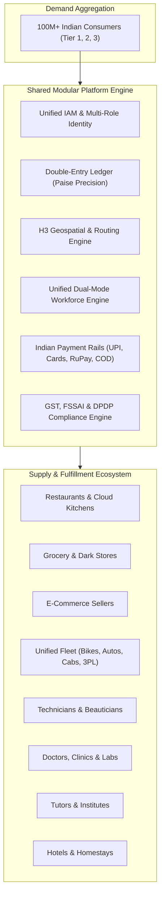
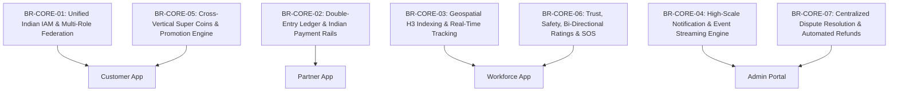
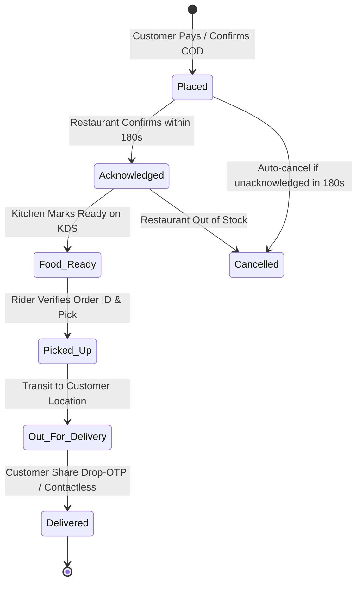
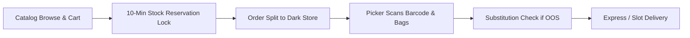
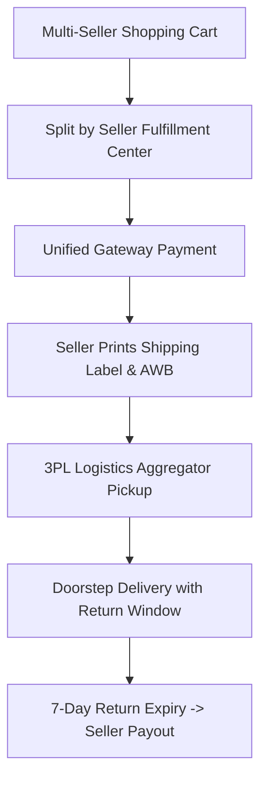
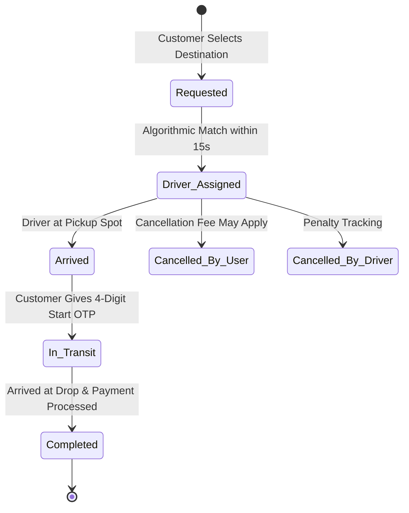
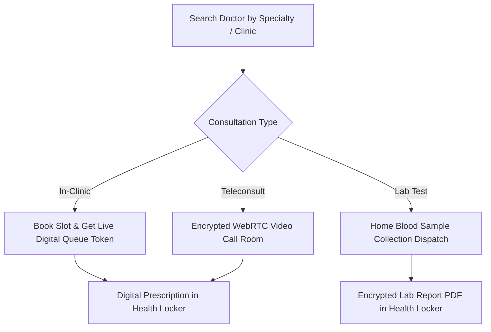
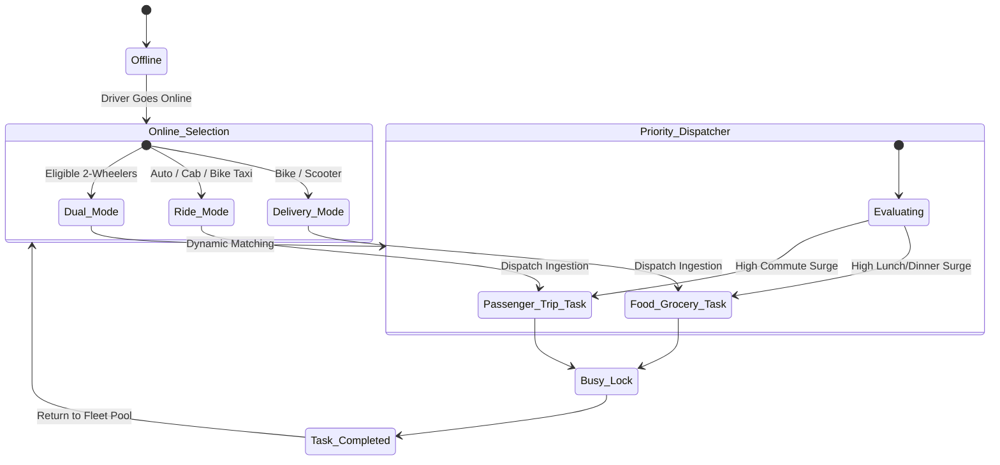
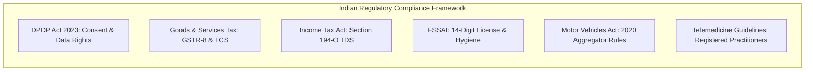

# BUSINESS REQUIREMENTS DOCUMENT (BRD)
## India-First Modular Super App Platform

**Document Identifier:** BRD-IND-V1.0  
**Project Category:** Multi-Vertical Digital Super App Ecosystem  
**Target Market:** India (Tier 1, Tier 2, Tier 3, Semi-Urban)  
**Parent Documents:** Master Project Charter (MPC-IND-V1.0), Product Breakdown Structure (PBS-IND-V1.0)  
**Document Type:** Enterprise Business Requirements Document (BRD)  
**Status:** Baseline Document — Under Formal Stakeholder Review  
**Prepared By:** Senior Business Analyst, Enterprise Business Consultant, Product Strategist & Business Process Architect  
**Engineering Concurrency Target:** 1,000,000+ Concurrent Active Users / 100 Million Registered Lifecycle

---

## 1. Document Control & Executive Summary

### 1.1 Document Information
| Field | Value |
|---|---|
| **Document Title** | Business Requirements Document (BRD) — Modular Super App Platform |
| **Document ID** | BRD-IND-V1.0 |
| **Version** | 1.0.0 |
| **Classification** | Enterprise Confidential / Proprietary |
| **Target Launch Region** | India (Multi-City Phased Rollout) |
| **Authoring Team** | Product Management, Solution Architecture & Business Operations |
| **Target Readership** | Product Sponsors, Engineering Leads, Operations Directors, Compliance Officers, Product Managers |

### 1.2 Executive Summary
The **India-First Modular Super App Platform** is an enterprise-scale digital marketplace designed to consolidate **nine major commercial verticals**—Food Delivery, Grocery Delivery, E-commerce, Ride Booking, Logistics & Parcel, Home Services, Healthcare, Education, and Hotel Booking—into a unified digital ecosystem.

By leveraging a **shared horizontal foundation** (Identity, Double-Entry Paise Ledger, Geospatial Intelligence, Dual-Mode Workforce Fleet, and Indian Payment Rails) paired with **strictly decoupled domain verticals**, the platform eliminates redundant customer acquisition costs (CAC), optimizes delivery fleet utilization across dayparts, and provides local businesses with an end-to-end digital sales channel.

---

## 2. Business Context & Strategic Drivers

### 2.1 Problem Statement
The Indian digital consumer ecosystem exhibits extreme fragmentation and structural inefficiencies:
1. **App Fatigue & Storage Constraints:** The average Indian smartphone user in Tier 2/3 cities operates devices with 32GB–64GB storage, forcing frequent app uninstalls between food, ride, and grocery apps.
2. **Sub-Optimal Fleet Utilization:** Standalone delivery platforms suffer from severe fleet downtime outside lunch (12:00–15:00) and dinner (19:30–23:00) peaks. Ride-hailing drivers face idle deadhead miles during mid-day troughs.
3. **High Merchant Disintermediation & Commission Friction:** Local kiranas, independent clinics, regional hoteliers, and coaching centers lack affordable, enterprise-grade digital tools to compete against monopolistic single-vertical aggregators.
4. **Fragmented Customer Identity & Loyalty:** Customers lose value across isolated loyalty silos without cross-vertical utility.

### 2.2 Strategic Solution & Competitive Moat
The Super App delivers a multi-sided ecosystem connecting **Customers**, **Merchants/Providers**, **Workforce Partners**, and **Platform Operators**:

### 2.3 Value Proposition by Stakeholder
* **For Customers:** Single login, single KYC, universal address book, cross-vertical loyalty coins (earn on food, spend on cab/doctor), and sub-2-second responsive app performance on low-tier networks.
* **For Merchants & Service Providers:** Single unified partner app with dynamic capabilities (KDS for food, inventory reservation for grocery, extranet for hotels, timetable for tutors), transparent next-day settlements (T+1), and configurable commission tiers.
* **For Workforce Partners (Riders & Drivers):** Dual-mode operational flexibility—execute rides during morning commute hours, deliver food during lunch/dinner, and transport hyperlocal parcels during afternoon lulls, maximizing daily earnings and eliminating idle downtime.
* **For Platform Owners:** Diversified revenue streams, blended take-rate optimization, shared infrastructure overhead, and lower blended CAC across 9 verticals.

---

## 3. Business Objectives & Key Performance Indicators (KPIs)

### 3.1 Commercial & Operational Objectives
| ID | Business Objective | Target Metric | Timeframe |
|---|---|---|---|
| **BO-01** | Unified Ecosystem Launch | 9 fully functional verticals live in pilot launch city | Month 6 post-architecture signoff |
| **BO-02** | High-Scale User Acquisition | 10M registered users (Year 1); 100M target | Growth lifecycle |
| **BO-03** | Workforce Asset Utilization | Rider idle time reduced from 42% (industry avg) to < 18% | Month 3 of operations |
| **BO-04** | Payment Reliability | > 96.5% UPI Intent success rate; 100% reconciliation | Day 1 of launch |
| **BO-05** | Merchant Retention | > 88% merchant 90-day retention rate | Ongoing |
| **BO-06** | Fulfillment SLA Adherence | Food < 35 min; Express Grocery < 20 min; Cab pickup < 6 min | Core cities |
| **BO-07** | Financial Accuracy | Zero ledger drift; 100% compliant GST TCS & TDS deductions | Day 1 of launch |

### 3.2 Target Unit Economics (Contribution Margin Model)
The platform is designed to achieve positive **Contribution Margin 3 (CM3)** by cross-leveraging logistics and user acquisition:
- **Blended Take Rate Target:** 14.5% – 18.0% across all verticals.
- **Delivery Fleet Cost per Order:** Reduced by 28% through batched multi-order delivery (e.g. food + grocery pickup along the same transit corridor).
- **Blended CAC:** Decreased by 45% compared to single-purpose apps through cross-vertical promotional loops.

---

## 4. Stakeholder Personas & Access Boundaries

| Persona ID | Stakeholder Group | Primary Goals | Core Application Surface |
|---|---|---|---|
| **PER-01** | **Consumer / Customer** | Seamless service discovery, rapid checkout via UPI, real-time live tracking, fair pricing, instant customer support. | Customer Mobile App (Flutter) |
| **PER-02** | **Restaurant / Kitchen Merchant** | Order intake, kitchen ticket printing (KDS), menu configuration, rush-hour snooze, fast T+1 payouts. | Business Partner App (Flutter) |
| **PER-03** | **Kirana / Dark Store Merchant** | Real-time inventory synchronization, weight-based produce pricing, order picking and bagging. | Business Partner App (Flutter) |
| **PER-04** | **Retail / E-commerce Seller** | Multi-variant SKU catalog, shipping label/AWB generation, return inspection, escrow payouts. | Business Partner App (Flutter) |
| **PER-05** | **Delivery Partner (Two-Wheeler)** | Maximized deliveries per hour, clear task cards, transparent tip/incentive ledger, turn-by-turn navigation. | Unified Workforce App (Flutter) |
| **PER-06** | **Ride Driver (Auto / Cab)** | Fast ride matching, low deadhead transit, upfront fare transparency, immediate daily earnings cash-out. | Unified Workforce App (Flutter) |
| **PER-07** | **Home Service Professional** | Structured appointment bookings, digital spare-part quote approvals, guaranteed payments. | Unified Workforce App (Flutter) |
| **PER-08** | **Healthcare Practitioner / Lab** | Clinic token management, teleconsultation room, home blood collection dispatch, diagnostic report delivery. | Business Partner App (Flutter) |
| **PER-09** | **Educator / Institute Admin** | Batch timetabling, fee installment tracking, live classroom sync, student attendance reporting. | Business Partner App (Flutter) |
| **PER-10** | **Hotelier / Front-Desk Manager** | Room inventory allocation, guest digital KYC verification, dynamic rate updates, check-in processing. | Business Partner App (Flutter) |
| **PER-11** | **City Operations Manager** | Live geo-tracking of fleet, surge pricing trigger, stuck-order manual reassignment, local dispute resolution. | Admin Web Panel (Next.js) |
| **PER-12** | **Super Administrator / CFO** | Global commission configuration, platform treasury ledger, tax return generation (GSTR-8), compliance audit. | Super Admin Web Panel (Next.js) |

---

## 5. Cross-Platform Shared Business Requirements (BR-CORE)

Every vertical operates on top of standardized, enterprise-grade horizontal platform capabilities:

### BR-CORE-01: Unified Indian IAM & Multi-Role Identity Federation
- **BR-CORE-01.1 Passwordless Mobile Onboarding:** User authentication must occur exclusively via 10-digit Indian mobile numbers with 4/6-digit SMS OTP (auto-retrieved via Android SMS Retriever API) with WhatsApp fallback.
- **BR-CORE-01.2 Multi-Persona Account Linking:** A single mobile number must seamlessly bridge multiple operational roles without separate credentials. A user can act as a Customer, switch to their Merchant Storefront, or activate their Driver profile.
- **BR-CORE-01.3 Session Security & Device Control:** JWT access tokens (15-min lifespan) paired with cryptographically secure Refresh Tokens stored in device secure storage (Keychain / EncryptedSharedPreferences). Immediate multi-device session revocation upon security trigger.
- **BR-CORE-01.4 KYC Vault & PII Masking:** Digital vault complying with DPDP Act 2023. Aadhaar numbers must be truncated/masked to last 4 digits. PAN and GSTIN must be validated via Government sandbox APIs before vendor account activation.

### BR-CORE-02: Centralized Payments, Double-Entry Ledger & Treasury Engine
- **BR-CORE-02.1 Integer-Only Monetary Precision:** Floating-point monetary representation is strictly forbidden. All monetary transactions, discounts, taxes, and fees across database tables and APIs must be recorded as 64-bit integers in minor units (**Paise**, where ₹1.00 = 100 paise).
- **BR-CORE-02.2 Indian Payment Aggregator Multi-Routing:** Dual-active routing engine between primary gateways (Razorpay, Cashfree) with automatic circuit breakers and dynamic health checks.
- **BR-CORE-02.3 Indian Payment Rails Integration:**
  - UPI Intent (Google Pay, PhonePe, Paytm, CRED, BHIM) with zero-redirect in-app execution.
  - UPI Mandates / Autopay for recurring education fees, subscriptions, and post-trip cab debits.
  - RuPay Credit Cards on UPI, Visa, Mastercard, NetBanking across 50+ Indian banks.
  - Cash on Delivery (COD) with dynamic customer risk-scoring limits (disabled for abusive accounts).
- **BR-CORE-02.4 Double-Entry Balanced Ledger:** Every financial movement must generate balanced debit and credit entries across platform liability, asset, and revenue accounts.
- **BR-CORE-02.5 Merchant & Driver Automated Settlement (T+1):** Daily automated payout disbursement via IMPS/NEFT with automated statutory deductions:
  - 1% TDS under Section 194-O of the Income Tax Act.
  - 1% GST TCS (Tax Collected at Source) under Section 52 of the CGST Act.
- **BR-CORE-02.6 Closed-Loop Customer Wallet:** Stored-value closed wallet conforming to RBI PPI master directions for instantaneous instant refunds, driver cash collections, and promotional cashbacks.

### BR-CORE-03: Geospatial Intelligence, H3 Indexing & Telemetry
- **BR-CORE-03.1 Indian Address Structuring:** Structured multi-tier address parser capturing House/Flat No, Apartment/Building, Floor, Landmark (compulsory for Tier 2/3 cities), Locality, City, State, and 6-digit Postal Pincode.
- **BR-CORE-03.2 Uber H3 Spatial Indexing:** Operational zoning, merchant discovery, driver radar clustering, and surge boundaries mapped using Uber H3 hexagonal spatial hierarchy (Resolution 7 for city zones, Resolution 9 for micro-delivery radiuses).
- **BR-CORE-03.3 Telemetry Ingestion & Dead Reckoning:** Ingestion of driver GPS packets every 3–5 seconds over persistent WebSockets/MQTT. Client apps must implement Dead Reckoning and Kalman filtering to project smooth map movement during transient cellular dead zones.
- **BR-CORE-03.4 Serviceability Polygons:** Real-time containment validation preventing orders if customer coordinates lie outside approved merchant/store geofences.

### BR-CORE-04: Omnichannel Event & Notification Engine
- **BR-CORE-04.1 Priority FCM Data Messages:** Real-time push delivery must utilize FCM **Data Messages** (not simple notification display payloads). The client app background handler must intercept the payload silently to trigger local audible alerts, vibration rhythms, or CallKit incoming trip alerts.
- **BR-CORE-04.2 DLT-Compliant SMS & WhatsApp Hub:** Automated routing of transactional templates via registered DLT headers (MSG91/Gupshup) with instant WhatsApp Business API fallback for order receipts and booking vouchers.
- **BR-CORE-04.3 WebSocket Event Bus:** Bidirectional real-time state synchronization for active orders, chat messages, driver positions, and kitchen ticket status.

### BR-CORE-05: Cross-Vertical Promotions & Super Coins
- **BR-CORE-05.1 Universal Super Coins:** Customers earn 1 Super Coin per ₹100 spent across any vertical. Coins can be redeemed across any vertical (e.g. 100 coins earned on groceries redeemable for ₹100 discount on a cab ride or doctor appointment).
- **BR-CORE-05.2 Flexible Coupon Architecture:** Rule-driven promo engine supporting:
  - Multi-condition triggers: Cart value threshold, specific payment method (e.g. RuPay card discount), first-time vertical trial, and geographic zone.
  - Sponsorship tagging: Clearly segregating Platform-funded vs. Merchant-funded discounts in the financial ledger.

### BR-CORE-06: Trust, Safety, Bi-Directional Ratings & SOS
- **BR-CORE-06.1 Dual-Sided Star Ratings:** 1-to-5 star ratings with mandatory tag selections for low scores (< 3 stars). Customer rates Merchant & Driver; Driver rates Customer.
- **BR-CORE-06.2 In-App Telemetry Safety Shield (Ride/Logistics):** Anomaly detection triggers automated safety checks if a vehicle stops for > 5 minutes in an unplanned area or deviates > 20% from the designated route.
- **BR-CORE-06.3 One-Touch SOS Emergency Integration:** Red panic button in active ride/service screens initiating:
  - Instant SMS broadcast with live tracking URL to registered emergency contacts.
  - Webhook dispatch to the platform's 24x7 Safety Command Center and local police emergency response (112).
- **BR-CORE-06.4 Number Masking (Cloud Telephony):** Direct customer-driver phone calls routed through virtual masked numbers (Exotel/Knowlarity) to protect personal phone privacy.

### BR-CORE-07: Centralized Helpdesk & Dispute Resolution
- **BR-CORE-07.1 Omnichannel Ticket Lifecycle:** Centralized ticket engine with strict SLA tracking (First response < 60 seconds for active orders; < 4 hours for completed services).
- **BR-CORE-07.2 Automated Evidence-Based Refund Arbitrator:** Automated algorithmic refunds for high-confidence failure scenarios (e.g. driver cancelled after accepting payment, kitchen cancelled order). Photo upload verification required for damaged goods or cold food.

---

## 6. Business Requirements by Vertical

---

### 6.1 Vertical 1: Food Delivery (BR-FOOD)

* **BR-FOOD-01 Restaurant Onboarding & Compliance:** Mandatory validation of 14-digit FSSAI license, GSTIN, kitchen hygiene declaration, and menu classification (100% Pure Veg badge, Halal certification, Jain food tags).
* **BR-FOOD-02 Digital Menu & Customization:** Hierarchical menu management (Category → Dish → Portion/Variant → Add-on Groups). Mandatory constraints (e.g., choose exactly 1 crust, up to 3 toppings).
* **BR-FOOD-03 Kitchen Preparation & Dispatch Synchronization:**
  - Two-stage confirmation: Restaurant receives audio-visual alert on Partner App with a 180-second acceptance SLA countdown.
  - Dispatch algorithm computes rider pickup time based on restaurant prep time (e.g. 15 min), preventing riders from waiting idly outside restaurants.
* **BR-FOOD-04 Food Safety & Tamper Prevention:** Rider must confirm hot-bag status; bag must utilize tamper-evident tape; optional photo validation upon pickup.
* **BR-FOOD-05 Live Delivery Tracking & Delivery OTP:** Turn-by-turn map view showing restaurant location, rider location, estimated arrival time (ETA), and drop-off validation via 4-digit customer delivery OTP.

---

### 6.2 Vertical 2: Grocery Delivery (BR-GROC)

* **BR-GROC-01 Dark Store & Kirana Inventory Sync:** Real-time stock reservation system. When an item is added to cart, inventory is reserved for **10 minutes** to prevent double-selling of high-velocity items.
* **BR-GROC-02 Variable Weight & Fresh Produce Handling:**
  - Fresh fruits, vegetables, and meats sold by weight allow a **±10% billing tolerance**.
  - Final price is adjusted upon packing: if weight is lower, difference is auto-credited to the customer's closed wallet in real time.
* **BR-GROC-03 Smart Substitution Engine:** If an item is discovered out of stock during picking, the partner app triggers the customer's pre-configured substitution preference:
  - Option A: Auto-substitute with closest premium brand.
  - Option B: Instant phone call alert to customer.
  - Option C: Drop item and immediately refund amount.
* **BR-GROC-04 Express vs. Scheduled Slot Fulfillment:** Support for 15–30 minute ultra-fast express delivery from micro-fulfillment dark stores alongside scheduled 2-hour delivery windows for bulky staples.

---

### 6.3 Vertical 3: E-commerce Marketplace (BR-ECOM)

* **BR-ECOM-01 Multi-Seller Storefront & SKU Matrix:** Support for independent merchants managing multidimensional SKUs (Size, Color, Material, Brand, Warranty).
* **BR-ECOM-02 Unified Multi-Seller Cart:** Single customer checkout across items from multiple sellers. The backend automatically splits the master order into discrete sub-orders per seller with independent shipping fee calculations.
* **BR-ECOM-03 Automated Shipping Label & Waybill Generation:** Integration with 3PL carrier aggregators (Delhivery, Shiprocket, BlueDart, Ecom Express). Generating automated Air Waybills (AWB), manifest printouts, and automated pickup dispatch.
* **BR-ECOM-04 Doorstep Returns, Exchanges & QC:** Customer-initiated returns within 7 days. Rider/3PL courier executes on-the-spot physical QC (barcode scan, tag check, visual damage check) before accepting the return package.
* **BR-ECOM-05 Seller Escrow & Settlement Hold:** Payment funds for completed orders are held in platform escrow for 7 days post-delivery to cover return/refund windows before releasing funds to the seller's bank account.

---

### 6.4 Vertical 4: Ride Booking & Mobility (BR-RIDE)

* **BR-RIDE-01 Vehicle Category Matrix:** Support for Bike Taxi, Auto Rickshaw, Hatchback/Mini, Sedan, SUV/XL, and Outstation Rentals.
* **BR-RIDE-02 Upfront Dynamic Pricing & Fare Rules:**
  - Upfront fare guaranteed to customer prior to booking based on:  
    $$\text{Fare} = \text{Base Fare} + (\text{Distance} \times \text{Per-Km Rate}) + (\text{Duration} \times \text{Per-Min Rate}) + \text{Tolls} + \text{Surge Multiplier}$$
  - Dynamic surge pricing capped strictly in compliance with the **Motor Vehicle Aggregator Guidelines 2020** (maximum 1.5x of base fare).
* **BR-RIDE-03 Dispatch Algorithm & 4-Digit Secure Ride OTP:** Proximity-based broadcast dispatch. Trip cannot initiate until the driver inputs the customer's unique 4-digit ride OTP on the Workforce App.
* **BR-RIDE-04 Automated Electronic Toll Pass-Through:** In-trip FASTag toll integration automatically calculates toll plaza charges along the transit route and appends them to the final customer invoice.
* **BR-RIDE-05 Ride Safety & Telemetry Monitoring:** Central safety desk listener tracking driver speeding, route deviation (> 20%), and vehicle standstill in desolate areas.

---

### 6.5 Vertical 5: Logistics & Parcel Delivery (BR-LOGI)

* **BR-LOGI-01 Dual Logistics Modes:**
  - **Hyperlocal Point-to-Point (Intra-City):** On-demand two-wheeler courier picking up documents, forgotten keys, small packages, or lunchboxes (up to 15 kg).
  - **Inter-City / Heavy Cargo:** Integration with commercial logistics fleets (three-wheelers, Tata Ace, large trucks) for bulk cargo.
* **BR-LOGI-02 Volumetric & Actual Weight Calculation:** System charges based on the higher of actual gross weight or volumetric dimensional weight:  
  $$\text{Volumetric Weight (kg)} = \frac{\text{Length (cm)} \times \text{Width (cm)} \times \text{Height (cm)}}{5000}$$
* **BR-LOGI-03 Restricted Goods Declaration:** Mandatory sender digital checkbox declaration confirming exclusion of cash, jewelry, flammable liquids, contraband, or illegal narcotics.
* **BR-LOGI-04 Chain-of-Custody & Secure Recipient OTP:** Photographic proof of parcel condition upon pickup; package hand-off to recipient validated strictly via Recipient Delivery OTP.
* **BR-LOGI-05 B2B Corporate Shipping Dashboard:** Enterprise accounts supporting batch CSV parcel booking, automated monthly invoicing, and pre-negotiated corporate rate cards.

---

### 6.6 Vertical 6: On-Demand Home Services (BR-HOME)

* **BR-HOME-01 Standardized Rate Cards & Transparent Scope:** Categories include Electricians, Plumbers, AC Repair/Servicing, Home Deep Cleaning, Appliance Repair, Carpentry, Painting, and Grooming/Salon. Upfront inspection charges with standardized rate cards for labor.
* **BR-HOME-02 Service Professional Verification:** Mandatory police background clearance, trade skill certification, and identity verification before onboarding.
* **BR-HOME-03 In-App Extra Spare Part Quotation:** If the technician identifies damaged parts requiring replacement:
  - Technician enters the spare part cost and labor delta in the Workforce App.
  - Customer receives an instant push notification and modal prompt in the Customer App to approve or reject the additional quote.
  - Work cannot proceed on the add-on without explicit digital customer approval.
* **BR-HOME-04 Proof of Workmanship:** Mandatory upload of "Before" and "After" photos by the technician on the Workforce App prior to closing the job.
* **BR-HOME-05 30-Day Service Guarantee & Free Rework:** Automated 30-day digital warranty certificate issued in customer app. Free technician re-dispatch in the event of quality failure within warranty window.

---

### 6.7 Vertical 7: Healthcare Services (BR-HLTH)

* **BR-HLTH-01 Doctor Directory & Live Digital Clinic Queue:** Discovery filtered by medical specialty, experience, languages spoken, and clinic location. In-clinic bookings issue a **Live Digital Queue Token** (e.g. "Your Token: #12, Current Token: #8, Estimated Wait: 25 mins") to minimize clinic waiting room crowding.
* **BR-HLTH-02 Telemedicine Video Consultations:** Secure, HIPAA/NDHM-compliant end-to-end encrypted WebRTC video consultation room embedded in the Customer and Partner Apps, adhering strictly to the **Telemedicine Practice Guidelines 2020**.
* **BR-HLTH-03 Home Diagnostic Tests & Phlebotomist Dispatch:** Booking full body checkups, blood tests, and COVID panels. Automated dispatch of certified phlebotomists with temperature-controlled sample carriers, barcoded collection tubes, and chain-of-custody tracking to accredited partner labs.
* **BR-HLTH-04 Digital Health Locker & ABHA Alignment:** Centralized storage of digital prescriptions, diagnostic lab reports, and medical history. Architecture foundation built for seamless integration with the **Ayushman Bharat Health Account (ABHA)** ecosystem.
* **BR-HLTH-05 Emergency Exclusion:** Prominent, non-dismissible banner stating: *"This service is not for emergency care. In case of life-threatening emergencies, call 108 immediately."*

---

### 6.8 Vertical 8: Education & Tutoring (BR-EDUC)

* **BR-EDUC-01 Tutor & Coaching Institute Marketplace:** Search filtered by class grade (Class 1–12), educational board (CBSE, ICSE, State Boards), competitive exams (JEE, NEET, UPSC, CA), and extracurricular skills (Music, Coding, Languages).
* **BR-EDUC-02 Demo Class Booking Engine:** Capability for parents/students to schedule 1 free or paid demo session before committing to full course enrollments.
* **BR-EDUC-03 Course Subscriptions & Installment Plans:** Support for one-time upfront course fees or monthly installment mandates managed via **UPI Autopay / e-NACH**.
* **BR-EDUC-04 Classroom Scheduling & Attendance Telemetry:** Integrated timetable view for batches. Teacher marks digital attendance in Partner App; absent status triggers automated instant SMS notification to parents.
* **BR-EDUC-05 Student Evaluation & Parent-Teacher Messaging:** In-app assignment submissions, digital report card publishing, and structured messaging channel between parents and teachers with administrative moderation.

---

### 6.9 Vertical 9: Hotel & Accommodation Booking (BR-HOTL)

* **BR-HOTL-01 Geo-Radius Hotel Discovery:** Search by City, Pincode, Landmark, or "Near Me" with check-in/check-out calendar pickers and guest count selector (Adults, Children, Rooms).
* **BR-HOTL-02 Real-Time Room Inventory & Dynamic Tariff Engine:** Real-time hold on room inventory during checkout. Dynamic pricing factoring weekend premiums, seasonal demand, local festivals, and meal plans (Room Only, Bed & Breakfast, All-Inclusive).
* **BR-HOTL-03 Indian Hotel GST Compliance:** Automated application of Indian hospitality tax brackets:
  - Tariff < ₹7,500/night: 12% GST.
  - Tariff ≥ ₹7,500/night: 18% GST.
* **BR-HOTL-04 Pre-Arrival Digital KYC & Form-C Compliance:** Guest uploads government-issued photo ID (Aadhaar, Passport, Driving License) in Customer App prior to arrival to enable 60-second contactless hotel check-in. Form-C capture for foreign passport holders.
* **BR-HOTL-05 Hotelier Extranet Console:** Partner portal for hotel managers to update available room inventory, adjust rates, block rooms for maintenance, and process check-ins/check-outs.

---

## 7. Unified Workforce Architecture & Dual-Mode Shift Engine

A foundational pillar of the Super App is the **Unified Workforce Fleet**, which breaks down the traditional barrier between food delivery riders and ride-hailing drivers:

### BR-WORK-01: Workforce Unified Identity & Vehicle Verification
- Workforce partners onboard through a single onboarding flow in the **Workforce App**.
- Verification of Driving License, Aadhaar, PAN, Vehicle Registration Certificate (RC), Commercial Permits (for 3/4 wheelers), and Pollution Under Control (PUC) certificate.

### BR-WORK-02: Operational Mode Switcher & Eligibility Matrix
- **Two-Wheelers (Motorcycles / Scooters):** Eligible for `Delivery Mode`, `Bike Taxi Mode`, or `Dual Mode`.
- **Three-Wheelers (Auto Rickshaws):** Dedicated to `Ride Mode` (Passenger trips) with optional `Hyperlocal Bulk Parcel Mode` during non-peak commute hours.
- **Four-Wheelers (Cabs / SUVs):** Dedicated to `Ride Mode`.
- **Electric Vehicles (EVs):** Dynamic range monitoring; assignments constrained to known battery range to prevent dead-battery stranding.

### BR-WORK-03: Collision-Free Dispatch State Lock
- When a workforce partner is engaged in an active task (e.g. food delivery or passenger ride), the backend applies an **atomic state lock**.
- The system is architecturally barred from pushing conflicting assignments until the active task status transitions to `Completed` or `Cancelled`.

---

## 8. Business Rules, Financial Policies & Commission Model

### 8.1 Commercial Commission Matrix
The platform charges commission strictly according to configurable business parameters (no hardcoded pricing in code):

| Vertical | Commercial Model | Indicative Platform Commission / Take Rate | Notes |
|---|---|:---:|---|
| **Food Delivery** | Commission + Delivery Fee + Ad listing | 18.0% – 24.0% of Order Value | Tiered by restaurant exclusivity |
| **Grocery Delivery** | Store Margin + Delivery Fee + Brand Ads | 8.0% – 14.0% of Order Value | Lower take rate, higher basket velocity |
| **E-commerce** | Seller Commission + Listing Fee | 6.0% – 15.0% by Category | Higher on fashion, lower on electronics |
| **Ride Booking** | Per-Trip Commission + Platform Booking Fee | 15.0% – 20.0% of Fare | Subject to State Aggregator Caps |
| **Logistics & Parcel** | Distance/Weight Tariff Margin | 15.0% – 20.0% of Shipment Fee | Corporate volume discounts apply |
| **Home Services** | Lead Fee + Commission on Labor | 16.0% – 22.0% of Service Value | Zero commission on replacement parts |
| **Healthcare** | Technology Platform Booking Fee | 8.0% – 12.0% per consultation / lab test | Transparent patient fee disclosure |
| **Education** | Course Enrollment Fee / Platform Charge | 10.0% – 15.0% of Tuition / Course Fee | Institutional billing options |
| **Hotel Booking** | Commission on Completed Stay | 12.0% – 18.0% of Room Tariff | Settled post-guest checkout |

### 8.2 Cancellation & Refund Policy Matrix
| Scenario | Initiated By | Stage | Financial Consequence |
|---|---|---|---|
| **Food Order** | Customer | After Restaurant Accepts | 100% cancellation fee (food is prepared); zero refund. |
| **Food Order** | Customer | Before Restaurant Accepts | 100% instant refund to Customer Wallet / UPI source. |
| **Grocery Order** | Customer | Before Dispatch | 100% instant refund; stock lock released. |
| **Ride Booking** | Customer | > 3 min after Driver Assigned | Flat ₹30–₹50 cancellation fee passed to Driver for transit. |
| **Ride Booking** | Driver | Any stage without customer consent | Penalty score recorded; repeat offenses trigger 24-hr ban. |
| **Home Service** | Customer | < 2 hrs before booked slot | Late cancellation charge (₹100) credited to Technician. |
| **Hotel Booking** | Guest | Up to 24 hrs prior to Check-in | 100% refund (Free Cancellation tier); non-refundable tier retains 100%. |

---

## 9. Regulatory, Taxation & Legal Compliance (India)

### 9.1 Digital Personal Data Protection (DPDP) Act 2023
- **Explicit Multilingual Consent:** Prior to collecting customer data, explicit, unambiguous consent notices must be displayed in the user's chosen Indian language.
- **Data Principal Rights:** Customer App must provide intuitive self-service buttons for:
  - *Right to Access Information:* Export summary of personal data held.
  - *Right to Correction & Erasure:* Automated account closure and data anonymization workflows.
- **Children's Data Protection:** Explicit age verification for education vertical; parental consent required for users below 18 years.

### 9.2 Indian Taxation Architecture (GST & Direct Tax)
- **GST Engine:** Automated bifurcation of taxes into CGST (Central), SGST (State), or IGST (Inter-State) based on customer delivery address vs. merchant registered business state.
- **E-Commerce Operator Compliance (Section 52 CGST):** Automated deduction of 1% GST TCS (0.5% CGST + 0.5% SGST or 1% IGST) on net taxable supplies, compiled into automated monthly **GSTR-8** return data.
- **Section 194-O TDS:** Mandatory 1% TDS deduction on gross sales credited to participants if annual sales exceed ₹5,00,000 for individuals, with automated Form 16A certificate generation.

### 9.3 Specialized Industry Compliance
- **FSSAI Food Compliance:** Strict prohibition of listing restaurants without verified, active 14-digit FSSAI licenses.
- **Motor Vehicle Aggregator Guidelines 2020:** Dynamic working hour caps preventing drivers from driving > 12 continuous hours; mandatory in-app driver rest periods.
- **Telemedicine Practice Guidelines 2020:** Restriction preventing teleconsultation prescription of Schedule X drugs or habit-forming narcotics.

---

## 10. High-Scale Engineering, Lifecycle & Clean Architecture Standards

To guarantee enterprise scalability to **1 Million+ Concurrent Users** and preserve modular maintainability across large engineering teams, all system implementations must satisfy these architectural rules:

### 10.1 Mobile Architecture Standard (Flutter)
- **Strict Clean Architecture:** Every feature resides exclusively within `features/<feature_name>/` structured into:
  - `data/`: `datasources/` (API calls), `models/` (JSON parsing, extending domain entities), `repositories/` (implements domain interfaces).
  - `domain/`: `entities/` (pure Dart objects), `repositories/` (abstract contracts), `usecases/` (business rules, validation, single-responsibility execution).
  - `presentation/`: `bloc/` (events, states, BLoC implementations), `pages/` (`BlocBuilder` / `BlocConsumer` views), `widgets/` (reusable UI components).
- **Zero Direct Root UI Files:** No screen or widget may reside in the root `lib/` directory.

### 10.2 Concurrency & App Lifecycle Management (1M+ Users)
- **Terminated & Background State Handling:** Silent data ingestion via FCM **Data Messages** without wake-lock battery drain. Triggers local notifications and native CallKit audio alerts when apps are terminated.
- **App Lifecycle Observers:** Client applications implement `WidgetsBindingObserver` to detect `resumed` states. Upon app foregrounding:
  - Immediately reconnect WebSockets.
  - Execute background delta-sync to pull missed messages and order state updates.
  - Silently refresh expiring auth tokens.
- **Offline-First Caching & Polling Prohibition:**
  - Client apps cache home feed, catalogs, and user profiles locally using Hive / SQLite.
  - App launch displays instant cached UI followed by background delta updates.
  - **Continuous HTTP polling is strictly prohibited.** Real-time updates must occur exclusively via WebSockets or FCM push triggers.

---

## 11. Cross-Application Functional Requirement Traceability

| Requirement ID | Capability Description | Customer App (Flutter) | Partner App (Flutter) | Workforce App (Flutter) | Admin Portal (Next.js) |
|---|---|:---:|:---:|:---:|:---:|
| **BR-CORE-01** | Identity & Passwordless OTP | Mandatory | Mandatory | Mandatory | Mandatory (MFA) |
| **BR-CORE-02** | Payments, Wallet & Paise Ledger | Checkout / UPI | Settlement Hub | Cash Collection | Payouts & Audit |
| **BR-CORE-03** | Geospatial H3 & Real-Time Tracking | Live Order Map | Delivery Radius | Radar & Nav | GIS Polygon Editor |
| **BR-CORE-04** | Omnichannel Notifications | In-App / Push | Audio Chime Alert | Loud Ride Alarm | Template Dispatcher |
| **BR-FOOD** | Food Delivery Engine | Order & Customization | KDS / Kitchen Prep | Food Pickup & Drop | Dispute Review |
| **BR-GROC** | Grocery Delivery Engine | Catalog & Sub Choice | Picking & Bagging | Bag Delivery | Stock Audit |
| **BR-ECOM** | E-commerce Marketplace | Multi-cart Checkout | AWB & Shipping | 3PL Handover | Seller Escrow |
| **BR-RIDE** | Ride Booking & Mobility | Fare & Start OTP | N/A | Trip Radar & Nav | Surge Governance |
| **BR-LOGI** | Logistics & Parcel Delivery | Booking & Waybill | B2B Bulk Dispatch | Parcel Transit | Cargo Fleets |
| **BR-HOME** | On-Demand Home Services | Slot Booking & Quote | N/A | Job OTP & Photos | Workmanship Quality |
| **BR-HLTH** | Healthcare & Lab Services | Doctor & Lab Booking | Clinic Token Desk | Phlebotomist Mode | Doctor KYC Desk |
| **BR-EDUC** | Education & Tutoring | Course & Attendance | Timetable & Classes | N/A | Institute Approval |
| **BR-HOTL** | Hotel & Hospitality Booking | Search & Digital KYC | Hotelier Extranet | N/A | Property KYC |
| **BR-WORK** | Dual-Mode Workforce Shift | N/A | N/A | Mode Switcher | Fleet Allocation |
| **BR-REG** | Indian Tax & DPDP Compliance | Consent Portal | GSTIN / FSSAI Entry | DL / RC Verification | GSTR-8 & TDS Desk |

---

## 12. Strategic Decisions, Approvals & Open Requirements Checklist

As part of standard enterprise business analysis, the following strategic decisions, architectural trade-offs, and commercial parameters require formal **Project Sponsor & Executive Sign-Off** before proceeding to the **Product Requirements Document (PRD)** phase:

### 12.1 Strategic Commercial Decisions
1. **Pilot City Selection:** Which Indian metropolitan or Tier 2 city will serve as the initial pilot launchpad (e.g. Bengaluru, Hyderabad, Pune, or Jaipur)?
2. **Launch Vertical Staging:** Will all 9 verticals go live on Day 1 in the pilot city, or will Phase 1 activate a core anchor cluster (e.g., Food + Grocery + Ride) followed by staggered activation of Healthcare, Education, and Hotels?
3. **Closed Wallet Licensing:** Will the customer digital wallet operate strictly as a closed-loop merchant refund wallet (exempt from RBI PPI authorization), or will the company apply for a Semi-Closed Prepaid Payment Instrument (PPI) license from the RBI?
4. **Fleet Ownership Stance:** Will the initial delivery fleet operate exclusively on a 100% freelance gig-economy model, or will a core guaranteed-payout fleet (minimum guarantee shift model) be hired to bootstrap initial fulfillment density?

### 12.2 Integration & Operational Choices
5. **Primary Payment Aggregator Priority:** Razorpay vs. Cashfree as the primary preferred routing partner for UPI Intent and instant merchant settlements.
6. **Mapping Services Provider:** Google Maps Platform vs. MapmyIndia (Mappls) for address autocomplete and routing (MapmyIndia offers lower API licensing costs and superior Indian house-level landmark data).
7. **Emergency SOS Integration Level:** Will the in-app SOS button trigger an automated webhook to a third-party private security agency (e.g. Topsgrup/G4S) or connect directly to state emergency dial 112 via automated SMS?
8. **Healthcare Liability Boundaries:** Formal confirmation that teleconsultation and diagnostic services operate strictly as an intermediary technology aggregator, disclaiming clinical liability under the Information Technology Act Section 79.

---

## 13. Formal Review & Sign-Off Notice

* **Document Status:** Baseline BRD Complete (BRD-IND-V1.0)
* **Next Action:** Await formal review and resolution of open strategic decisions from Project Leadership before proceeding with the **Product Requirements Document (PRD)**.

---
**End of Business Requirements Document**

