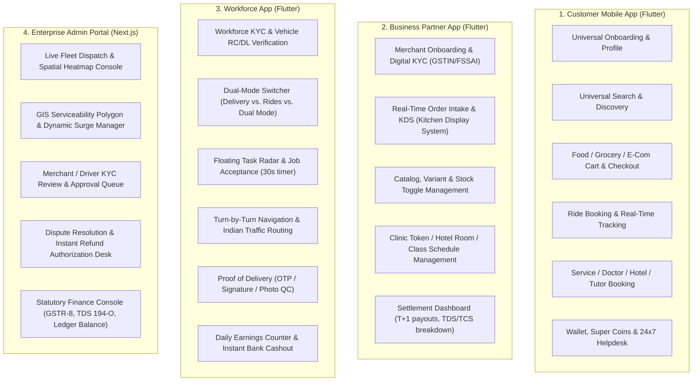

# PRODUCT REQUIREMENTS DOCUMENT (PRD) — SCOPE & STRUCTURE OUTLINE
## India-First Modular Super App Platform

**Document Identifier:** PRD-SCOPE-IND-V1.0  
**Project Category:** Multi-Vertical Digital Super App Ecosystem  
**Target Market:** India (Tier 1, Tier 2, Tier 3, Semi-Urban)  
**Parent Documents:** Master Project Charter (MPC-IND-V1.0), Product Breakdown Structure (PBS-IND-V1.0), Business Requirements Document (BRD-IND-V1.0)  
**Status:** Scope Proposed — Awaiting Executive Approval to Generate Full PRD  
**Prepared By:** Senior Product Management & Enterprise Business Analysis Team  

---

## 1. Objective of this Document

In accordance with enterprise product governance standards, this document establishes the **exhaustive scope, table of contents, user flow matrix, wireframe specifications, non-functional requirement parameters, and acceptance criteria framework** for the upcoming **Product Requirements Document (PRD)**.

No implementation or final PRD drafting will initiate until this scope proposal receives formal approval.

---

## 2. Master PRD Proposed Table of Contents

The complete PRD will be structured into the following 10 comprehensive sections:

```text
PRD-IND-V1.0: PRODUCT REQUIREMENTS DOCUMENT
 ├── 1.0 Executive Summary & Vision Baseline
 │    ├── 1.1 Product Purpose & Indian Market Problem Context
 │    ├── 1.2 Core Product Tenets & Scalability Mandate (1M+ Concurrent / 100M Lifecycle)
 │    └── 1.3 Scope Inclusions & Exclusions
 │
 ├── 2.0 User Personas & Detailed End-to-End User Journeys
 │    ├── 2.1 Consumer Personas (Tier 1 Urbanite, Tier 2 Family, Student)
 │    ├── 2.2 Merchant Personas (Restaurant, Kirana, E-Com Seller, Clinic, Hotelier)
 │    ├── 2.3 Workforce Personas (2-Wheeler Delivery Rider, 3-Wheeler/Cab Driver, Technician)
 │    └── 2.4 Administrative Personas (City General Manager, Dispatcher, Finance/Tax Ops)
 │
 ├── 3.0 Cross-Platform Core Platform Specifications (PRD-CORE)
 │    ├── 3.1 Unified IAM & Passwordless Indian Onboarding (Mobile + OTP + WhatsApp + RBAC)
 │    ├── 3.2 Central Treasury & Double-Entry Ledger (64-Bit Integer Paise Precision)
 │    ├── 3.3 Indian Payment Rails (UPI Intent, UPI Autopay, Cards, NetBanking, COD Limits)
 │    ├── 3.4 Geospatial Intelligence (Uber H3 Indexing Res 7/9, Dead Reckoning, Landmark Geocoding)
 │    ├── 3.5 Omnichannel Event & Notification Engine (FCM Priority Data Messages, DLT SMS, Sockets)
 │    ├── 3.6 Cross-Vertical Dynamic Cart, GST Calculation & Pricing Engine
 │    ├── 3.7 Universal Super Coins & Gamification Subsystem
 │    ├── 3.8 Trust, Safety, Bi-Directional Ratings & In-Trip SOS Toolkit
 │    └── 3.9 Centralized Helpdesk, Ticketing & Automated Dispute Arbitrator
 │
 ├── 4.0 Detailed Vertical Product Requirements (9 Verticals)
 │    ├── 4.1 Vertical 1: Food Delivery (Discovery, Menu Customization, KDS, Hot-Bag, FSSAI)
 │    ├── 4.2 Vertical 2: Grocery Delivery (Dark Store Inventory, 10-Min Hold, Produce Tolerance, Substitutions)
 │    ├── 4.3 Vertical 3: E-Commerce Marketplace (Multi-Seller Cart, SKU Matrix, 3PL AWB, Returns, 7-Day Escrow)
 │    ├── 4.4 Vertical 4: Ride Booking & Mobility (Bike/Auto/Cab/XL, Upfront Fare, 4-Digit OTP, FASTag Tolls)
 │    ├── 4.5 Vertical 5: Logistics & Parcel (Hyperlocal Courier, Volumetric Weight, QR Waybill, Recipient OTP)
 │    ├── 4.6 Vertical 6: On-Demand Home Services (Transparent Rate Cards, Extra Spare Quotes, 30-Day Warranty)
 │    ├── 4.7 Vertical 7: Healthcare Services (Doctor Directory, Live Clinic Queue Tokens, WebRTC Teleconsult, Labs)
 │    ├── 4.8 Vertical 8: Education & Tutoring (Tutors, Demo Classes, UPI Autopay Installments, Attendance)
 │    └── 4.9 Vertical 9: Hotel Booking (Geo-Radius Search, Room Inventory Hold, Indian GST 12/18%, Digital KYC)
 │
 ├── 5.0 Application Surfaces & Detailed User Flowcharts (4 Applications)
 │    ├── 5.1 Unified Customer Mobile App (Flutter)
 │    ├── 5.2 Unified Business Partner Mobile App (Flutter)
 │    ├── 5.3 Dual-Mode Workforce Mobile App (Flutter: Delivery & Rides)
 │    └── 5.4 Enterprise Web Administration & Super Admin Portal (Next.js)
 │
 ├── 6.0 Comprehensive Wireframe Descriptions & Component Specifications
 │    ├── 6.1 Customer App Wireframes (Home, Multi-Vertical Cart, Live Tracking, Wallet)
 │    ├── 6.2 Business Partner App Wireframes (KDS Order Intake, Catalog Toggle, Settlement)
 │    ├── 6.3 Workforce App Wireframes (Shift Mode Switcher, Job Radar Card, In-Trip Nav, Cashout)
 │    └── 6.4 Admin Portal Wireframes (Dispatch Map, GIS Polygon Editor, GSTR-8/TDS Dashboard)
 │
 ├── 7.0 Non-Functional Requirements (NFRs) & Architectural Quality Attributes
 │    ├── 7.1 Performance & Latency (Sub-2s API response, sub-100ms telemetry, 60fps Flutter UI)
 │    ├── 7.2 Scalability & Concurrency (1M+ concurrent users, horizontal scaling, partition strategy)
 │    ├── 7.3 App Lifecycle & Battery Optimization (FCM Data Messages, WidgetsBindingObserver on resume)
 │    ├── 7.4 Offline-First & Local Delta Caching (Hive/SQLite, prohibition of continuous polling)
 │    ├── 7.5 Security, Privacy & DPDP Compliance (TLS 1.3, AES-256, PII masking, token rotation)
 │    └── 7.6 Indian Regionalization & Network Degraded Mode (Indic languages, WebP, 2G/3G resiliency)
 │
 ├── 8.0 Acceptance Criteria Framework (Gherkin / Given-When-Then Format)
 │    ├── 8.1 Core Platform Acceptance Scenarios (Auth, Payments, Surge, Ledger Balancing)
 │    └── 8.2 Vertical-Specific Acceptance Scenarios (Food, Grocery, Rides, Services, Health, etc.)
 │
 ├── 9.0 System Dependencies & Third-Party Integration Matrix
 │    ├── 9.1 Payment Gateways (Razorpay / Cashfree)
 │    ├── 9.2 Maps & Navigation (Google Maps Platform / MapmyIndia)
 │    ├── 9.3 Messaging & Notifications (FCM, MSG91, Gupshup, WhatsApp Business API)
 │    └── 9.4 3PL Logistics Aggregators (Delhivery, Shiprocket, BlueDart)
 │
 └── 10.0 Assumptions, Technical Constraints & Risk Mitigation Matrix
```

---

## 3. Scope of Applications & Core User Flows Covered

The PRD will exhaustively document user journeys across **4 primary applications**:



---

## 4. Scope of Wireframe Descriptions Included in the PRD

To ensure engineering and UI/UX design teams have clear visual layout guidance, the PRD will include structural component-level layout specifications (ASCII wireframes + widget hierarchy) for:

1. **Customer App Surfaces:**
   - **Screen WF-C01:** Universal Super App Home Dashboard (Vertical grid, location bar, active order tracking pill, promotional carousels).
   - **Screen WF-C02:** Food & Grocery Storefront / Menu View (Veg/Non-Veg filter toggle, customizable dish drawer, cart summary banner).
   - **Screen WF-C03:** Unified Checkout Screen (Address selector, delivery instruction tags, bill breakdown in Paise, UPI Intent direct tray).
   - **Screen WF-C04:** Ride Booking & Vehicle Selection Screen (Map canvas, vehicle tier carousels, upfront fare, payment selector, 4-digit start OTP display).
   - **Screen WF-C05:** Live Telemetry Order/Trip Tracking Screen (Driver bearing animation, live status steps, call driver masked button, SOS emergency button).
   - **Screen WF-C06:** Digital Wallet & Super Coins Screen (Wallet balance, transaction ledger history, coin redemption slider).
2. **Business Partner App Surfaces:**
   - **Screen WF-P01:** Real-Time Order Management & Kitchen Display (Audio alert banner, 180s timer, accept/reject, preparation time selector).
   - **Screen WF-P02:** Dynamic Catalog & Inventory Controller (Instant in-stock/out-of-stock toggle, price editor, add-on groups).
   - **Screen WF-P03:** Financial Settlement & Tax Invoicing Dashboard (Daily GMV, net payout, TDS 194-O deduction, GSTR-8 view).
3. **Unified Workforce App Surfaces:**
   - **Screen WF-W01:** Driver Home & Operational Mode Switcher (Delivery vs. Ride vs. Dual mode toggle, online/offline slider, earnings ticker).
   - **Screen WF-W02:** Job Radar & Dispatch Card (Floating overlay, pickup distance, drop address, earnings estimate, 30s countdown bar).
   - **Screen WF-W03:** Active Transit & Proof-of-Fulfillment Screen (In-app navigation canvas, customer OTP entry keypad, photo QC button).
4. **Admin Portal Surfaces:**
   - **Screen WF-A01:** Global Operations Command Center (Live map with active rider/trip clusters, city filter, surge indicator).
   - **Screen WF-A02:** GIS Zone & Geofence Editor (GeoJSON polygon drawer, resolution 7/9 H3 grid viewer).
   - **Screen WF-A03:** Regulatory Compliance & Settlement Vault (T+1 payout batch release, GSTR-8 export, audit log tracker).

---

## 5. Scope of Non-Functional Requirements (NFRs) Covered

The PRD will formalize testable, enforceable engineering benchmarks:
* **Latency Benchmarks:** Sub-2.0s P95 latency for search and catalog APIs; sub-100ms P99 latency for real-time WebSocket telemetry ingestion.
* **Concurrency & Load Capacity:** 1,000,000+ concurrent active sessions during peak IPL / festival windows; horizontal scaling with zero dropped order packets.
* **App Lifecycle Optimization (Strict Rule Compliance):**
  - FCM **Data Messages** for silent wake-up, CallKit alerts, and local notifications in terminated/background state.
  - `WidgetsBindingObserver` integration on Flutter for instant WebSocket reconnect and delta sync when transitioning to `resumed`.
  - Offline-first cached rendering using Hive/SQLite with background delta refresh (prohibiting continuous HTTP polling).
* **Financial Integrity:** 100% balanced double-entry ledger with integer Paise minor units. Zero floating-point math across all calculations.
* **Security & Regulatory:** DPDP Act 2023 compliance (consent logs, user data erasure), AES-256 PII encryption, TLS 1.3, masked phone numbers, token rotation.
* **Network Degraded Mode:** Low-bandwidth optimization for 2G/3G networks in Indian Tier 2/3 cities (WebP compression, aggressive asset caching).

---

## 6. Scope of Acceptance Criteria Covered

Every functional epic will be paired with **Given-When-Then (Gherkin syntax)** acceptance criteria covering:
- Happy paths.
- Edge cases (payment timeouts, GPS signal loss, simultaneous stock depletion, restaurant rejection, driver cancellation, customer no-show).
- Error states, network failure recovery, and retry mechanisms.

---

## 7. Approval Request & Next Steps

This Scope & Structure Outline defines the exact blueprint of what will be produced in the comprehensive **Product Requirements Document (PRD)**.

* **Status:** Ready for Review.
* **Action Required:** Please review the scope outlined above and provide your approval or any specific additions/modifications. Upon your approval, the complete PRD will be generated.

