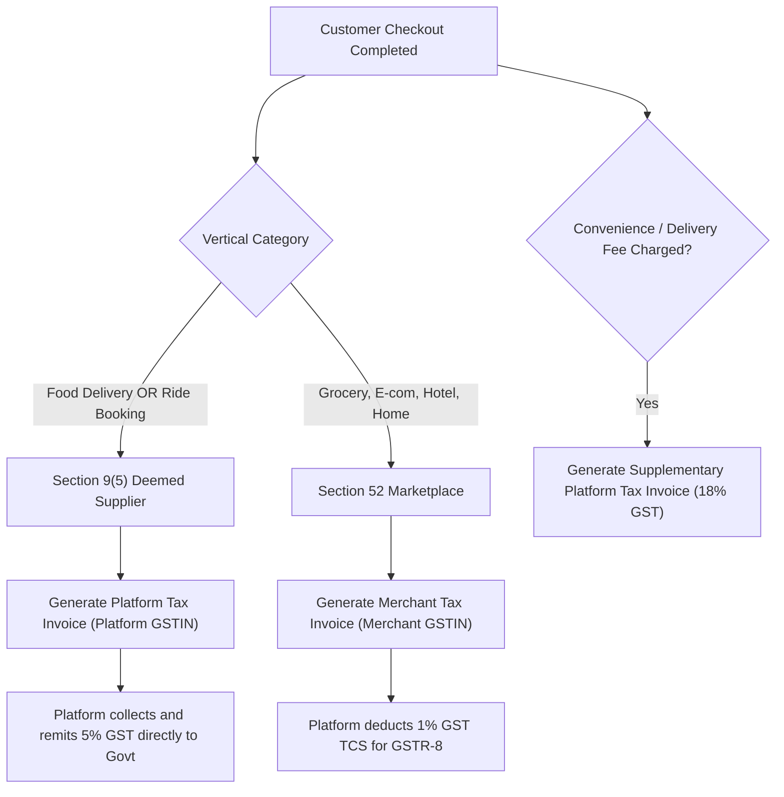
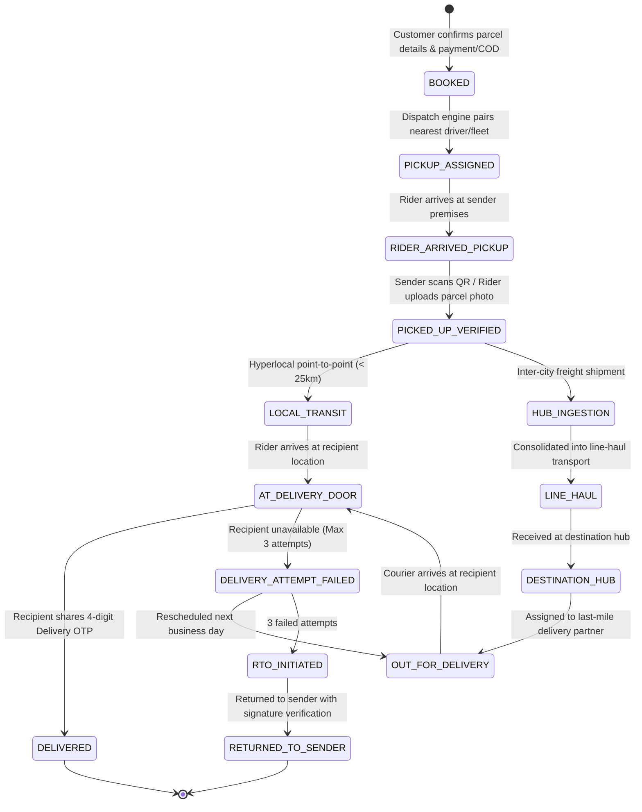
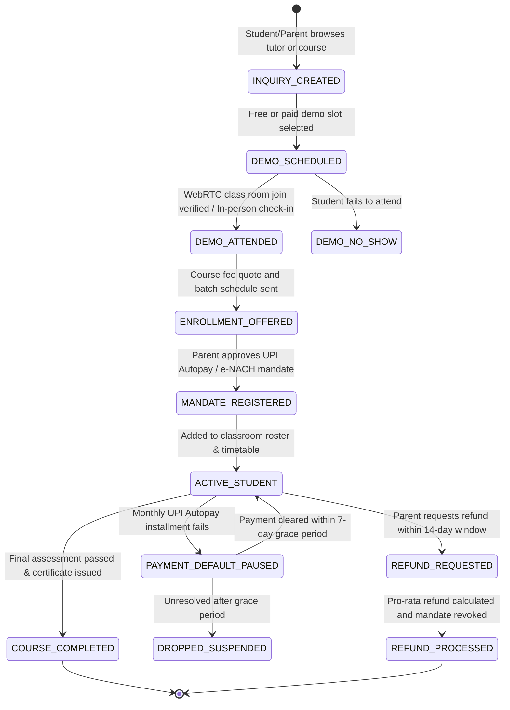
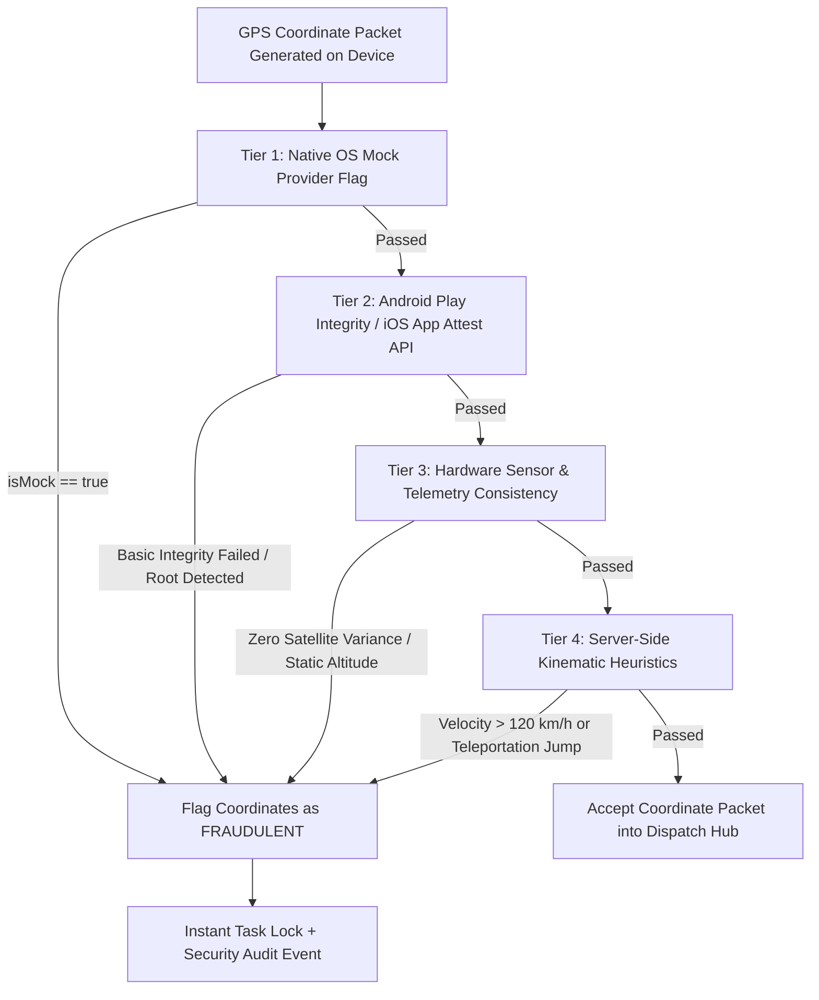
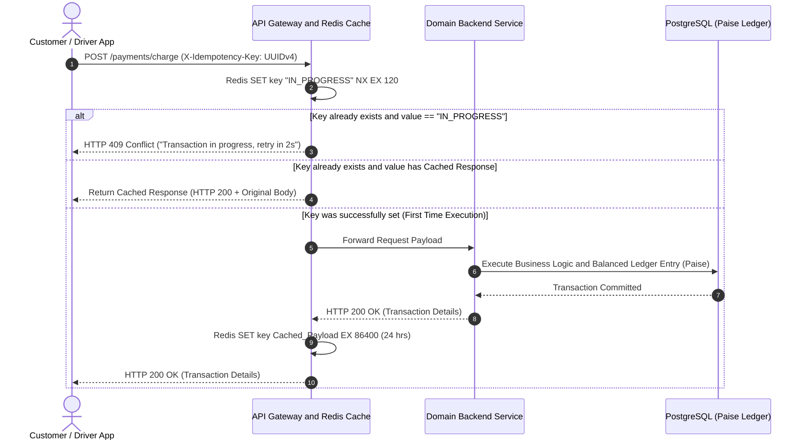
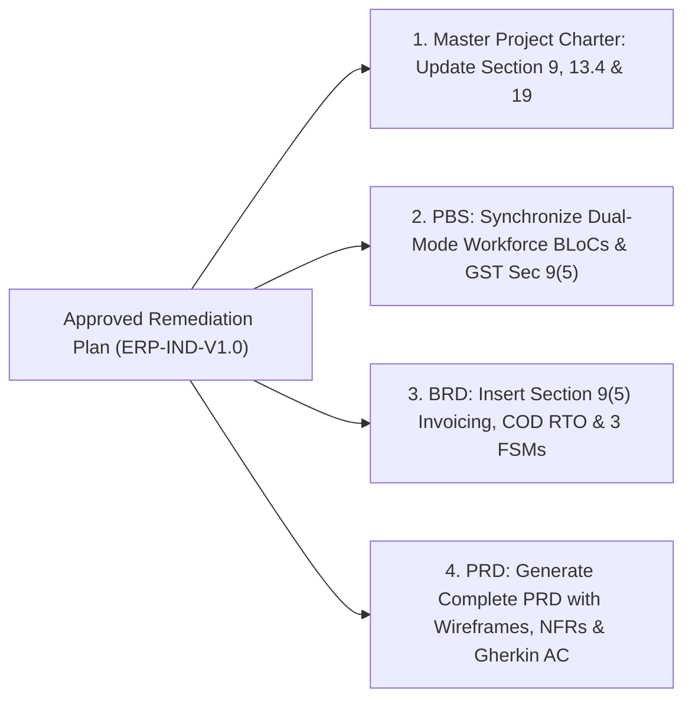

# ENTERPRISE ARCHITECTURAL REMEDIATION PLAN
## India-First Modular Super App Platform (All Verticals & Applications)

**Document Identifier:** ERP-IND-V1.0  
**Project Category:** Multi-Vertical Digital Super App Ecosystem  
**Target Market:** India (Tier 1, Tier 2, Tier 3, Semi-Urban)  
**Parent Documents:** Master Project Charter (MPC-IND-V1.0), Product Breakdown Structure (PBS-IND-V1.0), Business Requirements Document (BRD-IND-V1.0), PRD Scope Outline (PRD-SCOPE-IND-V1.0)  
**Audited Baseline:** Enterprise Project Audit Report (EPAR-IND-V1.0)  
**Document Type:** Formal Technical & Business Remediation Plan  
**Status:** Under Executive Stakeholder Review — Pending Formal Sign-Off  
**Authored By:** Senior Enterprise Business Analyst, Product Architect, Technical Architect, Security Architect & QA Lead  
**Governance Directive:** Zero Modifications to Original Documents until Formal Sign-Off

---

## 1. Executive Summary & Purpose

Following the Enterprise Project Audit, this **Remediation Plan** provides rigorous, verified, production-grade solutions for all **10 identified business, technical, compliance, and quality gaps** (B-01 through B-04, T-01 through T-03, and Q-01 through Q-03).

Every technical recommendation has been critically evaluated to eliminate architectural assumptions, align with statutory Indian legal requirements (CGST Act, DPDP Act 2023, Telemedicine Practice Guidelines, Motor Vehicles Act), and preserve the core platform directive: **Operating the Unified Rider & Delivery Partner App as ONE single Flutter application**.

---

## 2. Gap Remediation Matrix Overview

| Gap ID | Domain | Root Challenge | Remediation Architecture & Solution |
|:---|:---|:---|:---|
| **B-01** | Tax & Invoicing | Deemed supplier vs. marketplace dual-GST liability | Deterministic Split-Invoicing Engine bifurcating Sec 9(5) vs. Sec 52 supplies. |
| **B-02** | Operations & Finance | Doorstep COD refusal loss & food write-off | Tiered Pre-Order Risk Scoring + Geofenced Delivery IVR Verification Protocol. |
| **B-03** | Domain State Models | Missing finite state diagrams for 3 verticals | Formal 7-State FSMs for Logistics, Education, and Hotel Booking. |
| **B-04** | Healthcare | Drug dispensing liability & prescription handling | Zero-Dispensing Liability Model: Cryptographically Signed PDF Locker with external pharmacy inquiry. |
| **T-01** | Mobile Architecture | Workforce multi-domain role collision | Single Unified Flutter App using Dynamic Role-Gated Modular Feature Bundles. |
| **T-02** | Real-Time Scaling | WebSocket Thundering Herd on app resume | Jittered Truncated Exponential Backoff + Redis Stream Delta Synchronization. |
| **T-03** | Fleet Concurrency | Dual-mode driver dispatch race conditions | Atomic Redis Lua Script Leases (`DISPATCH_LOCK_EX30`) eliminating assignment collisions. |
| **Q-01** | Device OS Resilience | Android OEM aggressive battery killing of push alerts | Android Foreground Sticky Service (`flutter_foreground_task`) + Battery Optimization Intent. |
| **Q-02** | Trust & Security | GPS spoofing & mock location fraud by gig fleet | 4-Tier Hardware & Heuristic Telemetry Defense (Play Integrity + Native OS Hook Checks). |
| **Q-03** | Transaction QA | Network dropouts & duplicate debit risk on 2G/3G | Client UUIDv4 `X-Idempotency-Key` enforced via Redis Sliding Window Cache. |

---

## 3. Deep-Dive Remediation: Business & Regulatory Gaps (B-01 to B-04)

---

### B-01: Indian GST Dual-Invoicing Entity Model (Section 9(5) vs. Section 52)

#### 1. Critical Legal & Technical Verification
* Under Notification No. 17/2017-CT(R) and Notification No. 54/2021-CT(R) issued under **Section 9(5) of the CGST Act 2017**, an Electronic Commerce Operator (ECO) is legally deemed to be the *supplier* for:
  1. Passenger transportation services (Omnibus, Cab, Auto-Rickshaw, Bike-Taxi).
  2. Restaurant services (including cloud kitchens and takeaway), **except** where the restaurant operates from premises having hotel accommodation with declared room tariff $\ge ₹7,500$ per day.
* Under **Section 52 of the CGST Act**, for all other goods and services (Grocery kiranas, E-commerce retail, Hotels, and Home Services), the registered merchant/seller is the legal supplier. The platform must collect **1% GST TCS** (0.5% CGST + 0.5% SGST or 1% IGST) and file monthly **GSTR-8** returns.
* Furthermore, on all customer convenience fees, packing charges, and merchant platform commissions, the Super App platform itself must issue an independent Tax Invoice charging **18% GST** (SAC 9985 / 9987).

#### 2. Assumptions Requiring Legal/Tax Expert Sign-Off
1. *Assumption A1:* Cloud kitchens and local food outlets listed on the platform do not operate within 5-star hotel premises with room tariffs $\ge ₹7,500$. (If they do, Section 9(5) does not apply, and the hotel restaurant must issue the GST invoice).
2. *Assumption A2:* Third-party delivery fees charged to customers are billed by the platform as a principal service (18% GST) rather than treated as a pure agent reimbursement under Rule 33 of CGST Rules.

#### 3. End-to-End Workflow & Invoicing Rules


#### 4. Acceptance Criteria (Gherkin)
```gherkin
Scenario: Customer places a Food Delivery order from a local restaurant
  Given a customer in Mumbai orders food worth ₹500 from a restaurant in Mumbai
  And platform convenience fee is ₹20 and delivery fee is ₹40
  When the payment transaction successfully settles
  Then the system must generate a single Tax Invoice with Platform GSTIN as the Supplier
  And apply 5% GST (2.5% CGST + 2.5% SGST) on the ₹500 food value under Section 9(5)
  And apply 18% GST (9% CGST + 9% SGST) on the ₹60 platform and delivery fees
  And record ₹0 GST TCS liability in GSTR-8 ledger for this transaction.

Scenario: Customer purchases electronics from an E-commerce Seller
  Given a customer orders a smartphone worth ₹10,000 from an enrolled Delhi merchant
  When the order is marked Delivered
  Then the system must generate a Seller Tax Invoice bearing the Merchant GSTIN
  And automatically deduct 1% GST TCS (₹100) from the merchant settlement escrow
  And log the transaction in the platform GSTR-8 monthly return filing queue.
```

---

### B-02: Cash on Delivery (COD) Doorstep Refusal & Loss Allocation

#### 1. Critical Operational & Fraud Verification
Blindly absorbing food costs creates severe moral hazard and fraud vectors (collusive ordering between rogue restaurants and delivery riders). Conversely, charging riders or forcing merchants to absorb food losses leads to supply churn. A multi-layered pre-order gating and physical verification protocol is mandatory.

#### 2. Assumptions Requiring Business Leadership Sign-Off
1. *Assumption B1:* The maximum uncommitted food delivery loss absorption pool is budgeted at 0.6% of monthly Food GMV.
2. *Assumption B2:* Customers with > 1 unprovoked COD doorstep rejections are legally barred from selecting COD under platform Terms of Service.

#### 3. End-to-End Workflow & Fraud Verification Protocol

```mermaid
stateDiagram-v2
    [*] --> Arrival_At_Doorstep: Rider Arrives at Customer Coordinates
    Arrival_At_Doorstep --> Geofence_Check: System checks Rider GPS <= 50m of Drop Pin
    
    Geofence_Check --> Doorstep_Contact: Rider rings doorbell / calls customer
    Doorstep_Contact --> Delivered_Cash_Collected: Customer pays cash / scan UPI QR
    
    Doorstep_Contact --> Refusal_Or_No_Show: Customer refuses or unreachable
    
    state Refusal_Or_No_Show {
        [*] --> Mandatory_IVR: App triggers automated masked IVR call (3 retries)
        Mandatory_IVR --> Refusal_Confirmed: Customer explicitly declines on call / 10-min timeout
    }
    
    Refusal_Confirmed --> Audit_Log: Upload geo-tagged doorstep photo
    Audit_Log --> Financial_Reconciliation: System executes liability resolution
    
    state Financial_Reconciliation {
        [*] --> Food_Vertical: Prepared Food
        [*] --> Non_Food_Vertical: E-Com / Grocery / Parcels
        
        Food_Vertical --> Platform_Expense: Restaurant paid 100% of base food cost
        Food_Vertical --> Account_Penalty: Customer account locked; COD revoked
        
        Non_Food_Vertical --> RTO_Initiated: Package sealed and routed to reverse transit
        Non_Food_Vertical --> Seller_Protection: RTO freight cost shared per seller SLA
    }
```


#### 4. Acceptance Criteria (Gherkin)
```gherkin
Scenario: Customer refuses delivery of a prepared food order at doorstep
  Given a rider is at the delivery drop location with GPS distance <= 50 meters
  And the rider reports 'Customer Refused Delivery' in the Workforce App
  When the automated system executes the mandatory IVR call and confirms refusal
  And the rider uploads a timestamped photo of the house entrance
  Then the system must credit the restaurant's wallet with 100% of the agreed food cost
  And mark the order status as CANCELLED_DOORSTEP_REFUSED
  And flag the customer profile with a pending debt of the order delivery fee
  And suspend Cash on Delivery privileges for that customer until the debt is cleared online.
```

---

### B-03: Domain State Transition Models for Logistics, Education & Hotels

#### 1. Critical Workflow Verification
To achieve high-concurrency event-driven stability, Logistics, Education, and Hotel booking verticals require rigorous Finite State Machines (FSM) defining every legal state, transition trigger, and exception path.

#### 2. Finite State Models

##### A. Logistics & Parcel State Machine (Intra-City & Inter-City)


##### B. Education & Tutoring Enrollment State Machine


##### C. Hotel & Accommodation Booking State Machine

```mermaid
stateDiagram-v2
    [*] --> INVENTORY_HOLD: User enters checkout; room held for 10 minutes
    INVENTORY_HOLD --> BOOKING_CONFIRMED: Prepaid payment successful or COD verified
    INVENTORY_HOLD --> EXPIRED: 10-minute checkout timer lapses without payment
    
    BOOKING_CONFIRMED --> PRE_KYC_SUBMITTED: Guest uploads Govt ID (Aadhaar/Passport) in App
    PRE_KYC_SUBMITTED --> HOTEL_NOTIFIED: Property receives booking voucher and guest KYC
    
    HOTEL_NOTIFIED --> GUEST_CHECKED_IN: Front desk scans voucher QR & completes Form C
    GUEST_CHECKED_IN --> STAY_ACTIVE: Room allocated
    STAY_ACTIVE --> CHECKED_OUT: Folio settled; billing closed
    CHECKED_OUT --> [*]
    
    BOOKING_CONFIRMED --> CANCELLED_BY_GUEST: Guest cancels prior to arrival
    CANCELLED_BY_GUEST --> REFUND_PROCESSED: Refund calculated per room rate policy
    
    HOTEL_NOTIFIED --> NO_SHOW: Guest fails to arrive by 23:59 on check-in date
    NO_SHOW --> FORFEITED: First night tariff retained; room released to open pool
```


#### 3. Acceptance Criteria (Gherkin)
```gherkin
Scenario: Recipient receives a secure logistics parcel
  Given a parcel has reached status AT_DELIVERY_DOOR
  When the delivery partner requests the delivery verification code
  And the recipient provides the valid 4-digit Delivery OTP sent via SMS/WhatsApp
  Then the system transitions the shipment state to DELIVERED
  And marks the waybill as closed in the courier tracking database
  And dispatches an automated delivery confirmation receipt to the sender.
```

---

### B-04: Healthcare Telemedicine Prescription-to-Pharmacy Pipeline

#### 1. Critical Legal & Medical Verification
Under the **Telemedicine Practice Guidelines 2020** issued by the Ministry of Health and Family Welfare (MoHFW) and Board of Governors of the Medical Council of India:
* A Registered Medical Practitioner (RMP) can prescribe medications via telemedicine strictly under approved schedules:
  - **List O:** Over-the-counter (OTC) drugs (paracetamol, cough lozenges, ORS).
  - **List A:** First consultation for specific conditions (antihistamines, antacids) or renewal of maintenance drugs.
  - **List B:** Follow-up consultation for chronic illness.
* **Prohibited Medications:** Schedule X of Drugs and Cosmetics Rules, 1945, and any habit-forming narcotics/psychotropics under the NDPS Act are strictly prohibited via telemedicine.
* **Liability Isolation:** An aggregator platform cannot legally sell prescription drugs without a valid retail pharmacy license (Form 20/21) under the Drugs and Cosmetics Act.

#### 2. Architectural Solution: Two-Stage Zero-Liability Prescription Model
1. **Stage 1 (In-App Clinical Record):** Doctor generates an encrypted, digitally signed prescription containing Doctor Name, Qualification, Medical Council Registration Number, Clinic Address, Patient Details, Drug Generic Name, Dosage, Frequency, and Duration.
   - The prescription is saved as a secure PDF in the customer’s **Encrypted Health Locker**.
2. **Stage 2 (Opt-In External Pharmacy Dispatch):** If the customer chooses "Order Medicines", the platform does NOT directly process or dispense drugs. Instead:
   - The PDF prescription is transmitted via secure API to a licensed partner pharmacy (e.g. Apollo Pharmacy, 1mg, or licensed local chemist).
   - A registered pharmacist at the licensed partner conducts independent telephonic prescription verification prior to billing and dispensing.
   - The platform acts exclusively as a technology intermediary under **Section 79 of the Information Technology Act 2000**.

#### 3. Acceptance Criteria (Gherkin)
```gherkin
Scenario: Doctor prescribes medications during a teleconsultation
  Given an active video teleconsultation between an enrolled Doctor and a Customer
  When the doctor completes the consultation and enters prescription details
  Then the system must validate that no prescribed drug belongs to Schedule X or banned lists
  And generate a digitally signed prescription PDF containing the doctor's Council Registration ID
  And store the file in the patient's HIPAA/ABHA-compliant Encrypted Health Locker
  And display an explicit statutory disclaimer: "Platform is a technology intermediary and does not dispense prescription drugs."
```

---

## 4. Deep-Dive Remediation: Technical & Solution Architecture Gaps (T-01 to T-03)

---

### T-01: Workforce App Architecture — Preserving ONE Unified Application

#### 1. Critical Architectural Verification
The mandate is clear: **Preserve the unified Rider & Delivery Partner App as ONE application. Do not create duplicate applications.**

However, a Delivery Rider / Cab Driver performs on-demand rapid dispatch (30s timer, turn-by-turn map, live telemetry), whereas a Home Service Technician or Healthcare Phlebotomist executes scheduled bookings (calendar agenda, multi-hour jobs, digital extra spare-parts quotes, and before/after photos).

#### 2. Modular Single-App Architecture Solution
The Unified Workforce App (Flutter + BLoC) operates as **ONE application codebase and ONE single deployment artifact**, utilizing **Dynamic Role-Based Feature Injection**:

```mermaid
graph TD
    UserLogin["Workforce Partner Authenticates via Mobile + OTP"] --> JWT["Backend issues JWT with 'workforce_capabilities' claim"]
    
    JWT --> Gate{"Inspect Capabilities Array"}
    
    Gate -->|Capabilities include: RIDE_DRIVER or FOOD_DELIVERY| TransitView["Render Transit & Mobility Shell"]
    Gate -->|Capabilities include: TECHNICIAN or PHLEBOTOMIST| SpecialistView["Render Field Specialist Shell"]
    Gate -->|Dual-Eligible (e.g. Rider who is also an Electrician)| ShellSwitch["Render App Header Shift Switcher Toggle"]
    
    subgraph SingleCodebase["ONE Unified Flutter Codebase"]
        TransitView --> M1["Mobility BLoC: Floating Radar, Nav Map, Telemetry"]
        SpecialistView --> M2["Specialist BLoC: Appointment Calendar, Digital Quote, Photo QC"]
        ShellSwitch --> Common["Shared Core: Auth, Wallet Cashout, SOS, KYC, Notifications"]
    end
```

* **Zero Duplication:** Shared core modules (Authentication, Closed Wallet, Daily Earnings, KYC Document Vault, Push Notification Listener, Emergency SOS) are shared 100% across all workforce personas.
* **Dynamic Navigation Shell:** The Flutter `AppShell` evaluates the user's verified credentials and renders the relevant workspace tabs without needing separate app binaries.

#### 3. Acceptance Criteria (Gherkin)
```gherkin
Scenario: A registered two-wheeler rider logs into the Workforce App
  Given a workforce partner with verified credentials for 'FOOD_DELIVERY' and 'BIKE_TAXI'
  When the partner logs in and slides 'Go Online'
  Then the app must render the Transit Dashboard with the Shift Switcher (Delivery vs. Ride)
  And register the background location telemetry worker.

Scenario: A verified AC technician logs into the SAME Workforce App
  Given a workforce partner with verified credentials for 'HOME_SERVICES_AC_REPAIR'
  When the partner logs in
  Then the app must render the Specialist Agenda Dashboard showing today's scheduled appointments
  And provide the in-app 'Generate Spare Parts Quotation' tool
  And suppress the on-demand ride-hailing radar interface.
```

---

### T-02: WebSocket "Thundering Herd" & Reconnect Backoff on App Resume

#### 1. Critical High-Scale Verification
When 1,000,000 active users background their apps, their persistent WebSocket connections are cleanly severed. If a breaking push notification (e.g. IPL boundary, sudden flash sale, or rain surge discount) triggers 250,000 users to open their apps within a 10-second window, an unthrottled reconnect storm will exhaust server file descriptors, saturate Redis Pub/Sub, and trigger catastrophic gateway cascading failures.

#### 2. Multi-Layered Backoff & Delta Sync Protocol
1. **Client-Side Jittered Truncated Exponential Backoff:**  
   The Flutter app implements a randomized reconnect delay algorithm:
   $$T_{\text{reconnect}} = \min\left(T_{\text{max}}, T_{\text{base}} \times 2^{\text{attempt}}\right) \times (1 + \text{Uniform}(-0.3, +0.3))$$
   Where $T_{\text{base}} = 250\text{ms}$ and $T_{\text{max}} = 3500\text{ms}$. Jitter uniformly distributes connection attempts across a 3.5-second smoothing curve.
2. **Gateway-Level Rate Limiting:**  
   Kong / NGINX API Gateway enforces a Leaky Bucket algorithm limiting new WebSocket upgrade requests to a maximum of 5,000 connections/second per cluster node, returning HTTP 429 / 503 with a `Retry-After` header during extreme surges.
3. **HTTP/2 Multiplexed Delta-Sync Fallback:**  
   Upon foregrounding, the client immediately fires a lightweight non-blocking HTTP/2 request:  
   `GET /api/v1/sync/delta?last_synced_event_id=EVT_984321&timestamp=1730592800`  
   The backend retrieves only missed order updates and active chat messages from Redis Streams (O(1) lookup). If the WebSocket connection is slightly delayed by backoff, the UI is already updated via the HTTP/2 delta response.

#### 3. Acceptance Criteria (Gherkin)
```gherkin
Scenario: 100,000 users resume the Customer App simultaneously
  Given 100,000 customer devices transition from background to resumed state
  When the app triggers the connection recovery sequence
  Then each device must compute a randomized reconnect delay between 175ms and 3,500ms
  And execute an immediate non-blocking HTTP/2 delta-sync request using the last received event ID
  And ensure the WebSocket connection pool scales smoothly without exceeding gateway rate caps.
```

---

### T-03: Dual-Mode Driver Assignment Race Condition Prevention

#### 1. Critical Concurrency Verification
A two-wheeler partner operating in `Dual Mode` is eligible to receive both **Food/Grocery Delivery assignments** and **Bike Taxi passenger trip requests**. Because these two domains run in decoupled micro-modules, an assignment race condition occurs if a delivery dispatch job and a passenger ride request target the same driver at the identical millisecond.

#### 2. Atomic Redis Lease & Lua Script Protocol
A naive database read-then-write approach causes double-booking. The dispatch system enforces an **Atomic Distributed Lease** using an optimized Redis Lua script:

```lua
-- KEYS[1]: Driver State Key (e.g. "driver:state:DRV_10928")
-- ARGV[1]: Target Lock State ("OFFERED_LOCK")
-- ARGV[2]: Lock Expiry in Seconds (30)
-- ARGV[3]: Dispatch Task ID (e.g. "TASK_FOOD_49812")

local currentState = redis.call('get', KEYS[1])

if currentState == 'AVAILABLE' then
    redis.call('set', KEYS[1], ARGV[1], 'EX', ARGV[2])
    redis.call('set', KEYS[1] .. ':active_offer', ARGV[3], 'EX', ARGV[2])
    return 1 -- Lock acquired successfully
else
    return 0 -- Driver busy or already locked by another dispatch
end
```

#### 3. Execution Lifecycle:
1. Before any dispatch engine pushes a task offer to the driver's phone, it executes the atomic Lua script.
2. If return value == `1`, the driver is atomically transitioned to `OFFERED_LOCK` for 30 seconds. All other dispatch queues (Ride or Delivery) immediately evaluate the driver as unavailable.
3. The driver phone displays the 30-second countdown card.
   - **If Accepted:** The state atomically transitions to `ENGAGED_TASK` with an indefinite lock until delivery/trip completion.
   - **If Rejected or Timed Out (30s):** The state automatically rolls back to `AVAILABLE`, and the dispatch engine re-routes the task to the next closest partner.

#### 4. Acceptance Criteria (Gherkin)
```gherkin
Scenario: Simultaneous Food Delivery and Bike Taxi dispatch race condition
  Given a dual-mode rider is in 'AVAILABLE' status
  When a Food Delivery dispatch job and a Bike Taxi ride request attempt to match the rider at the exact same millisecond
  Then the Redis Lua script must atomically grant the lease to exactly one dispatch job
  And return a lock rejection (0) to the competing dispatch job
  And ensure the rider's screen displays only one task offer with zero overlapping assignments.
```

---

## 5. Deep-Dive Remediation: QA, Security & Reliability Gaps (Q-01 to Q-03)

---

### Q-01: Android Doze Mode & OEM Battery Optimization Bypass

#### 1. Critical Device OS Verification
In India, devices manufactured by Xiaomi (MIUI/HyperOS), Vivo (FunTouch), Oppo/Realme (ColorOS), and OnePlus (OxygenOS) account for $> 75\%$ of gig worker devices. These operating systems implement aggressive proprietary battery killer daemons (e.g., Xiaomi MIUI *PowerKeeper*, Vivo *iManager*) that terminate background network sockets and drop normal push notifications when the device is locked.

#### 2. Comprehensive OS Resilience Solution
1. **Workforce App Foreground Sticky Service:**  
   The Workforce App integrates `flutter_foreground_task` running an Android Native Foreground Service (`FOREGROUND_SERVICE_TYPE_LOCATION`). It binds a persistent, low-priority ongoing notification in the system drawer:  
   *"Super App Workforce Engine Active — Online for Assignments"*.  
   This notifies the Android Linux kernel that the process is interactive, preventing process termination during Doze Mode.
2. **High-Priority FCM Data Message Structure:**  
   Dispatch notifications are strictly constructed with high-priority data payloads:
   ```json
   {
     "message": {
       "token": "device_fcm_token",
       "android": {
         "priority": "high",
         "ttl": "30s"
       },
       "data": {
         "type": "NEW_DISPATCH_OFFER",
         "task_id": "TSK_88219",
         "expires_at": "1730592830",
         "priority_sound": "loud_chime.wav"
       }
     }
   }
   ```
   *Notice:* The payload contains NO display notification block (`notification: {}`). The background headless Dart isolate receives the raw data, acquires a temporary CPU wake-lock, triggers a native audio alert through an independent `AudioAttributes.USAGE_ALARM` audio stream, and displays the full-screen task modal.
3. **Mandatory Onboarding Battery Optimization Exemption:**  
   During partner onboarding, the app detects whether OEM battery optimization is active and triggers the standard platform intent:  
   `android.provider.Settings.ACTION_REQUEST_IGNORE_BATTERY_OPTIMIZATIONS`.

#### 3. Acceptance Criteria (Gherkin)
```gherkin
Scenario: Workforce partner receives a dispatch alert while phone is locked in Doze Mode
  Given a delivery partner is online with the phone screen turned off for 30 minutes on a Xiaomi MIUI device
  When the backend dispatches a high-priority FCM data message
  Then the background isolate must wake up within 800 milliseconds
  And trigger the loud dispatch audio chime via the ALARM audio stream
  And display the full-screen task acceptance radar over the lockscreen.
```

---

### Q-02: Native Mock Location & Multi-Tier GPS Spoofing Detection

#### 1. Critical Anti-Fraud Verification
Gig workers frequently utilize Android mock location apps ("Fake GPS", "GPS Joystick") or rooted devices running Magisk/Xposed frameworks to manipulate coordinates into surge zones or fake restaurant proximity to bypass wait timers. A naive check of `isFromMockProvider` is trivially bypassed by root-hiding modules.

#### 2. Multi-Layered Anti-Spoofing Architecture
The system enforces a **4-Tier Defense Pipeline**:



1. **Tier 1 (Native Platform Channel):** In Android API 31+, query `location.isMock()`. In older versions, check `location.isFromMockProvider()` and test for `Settings.Secure.ALLOW_MOCK_LOCATION`.
2. **Tier 2 (Play Integrity API):** Validate that the APK signature is unaltered, the bootloader is locked, and no Magisk/Frida hooking frameworks are running in memory.
3. **Tier 3 (Sensor Cross-Check):** Verify that GNSS raw satellite measurements show realistic Doppler shift, signal-to-noise ratios (SNR), and non-zero accelerometer movement. Mock GPS apps emit static zero-variance coordinates.
4. **Tier 4 (Backend Kinematic Heuristics):** The telemetry ingestion pipeline compares successive coordinate packets. If a partner moves faster than $120\text{ km/h}$ in an urban zone, or teleports across non-contiguous H3 hexagons in $< 3$ seconds, the packet is flagged.

#### 3. Acceptance Criteria (Gherkin)
```gherkin
Scenario: A driver uses a Mock GPS application to fake location in a high-surge area
  Given an active driver running a mock location provider in Android developer settings
  When the Workforce App captures a location update
  Then the Native Location BLoC must detect the mock provider flag
  And reject the coordinate packet from transmission to the backend
  And transition the driver to 'SUSPENDED_SECURITY_REVIEW' status
  And record a fraud security log in the Super Admin Compliance Audit console.
```

---

### Q-03: Network Degraded Mode & Idempotency Keys (2G/3G Scenarios)

#### 1. Critical Financial & Transactional Verification
In Tier 2/3 Indian cities and transit corridors (basements, flyovers, cellular dead zones), cellular connectivity frequently drops packets. If a customer taps "Pay Now" or a driver taps "Start Trip", a network timeout may occur *after* the backend processed the debit, causing the client to retry. Without strict idempotency, duplicate debits, duplicate bookings, or double-settlements occur.

#### 2. End-to-End Idempotency Key Architecture
Every state-mutating API endpoint (`POST /orders`, `POST /payments/charge`, `POST /trips/start`, `POST /jobs/complete`) strictly requires an **`X-Idempotency-Key`** HTTP header:



* **Client Rules:** The client generates a random UUIDv4 key prior to the initial request and persists it in local SQLite/Hive storage attached to the draft transaction. Every automated retry or user re-tap uses the **identical key**.
* **Zero Floating-Point Math:** All ledger values in the transaction payload operate exclusively in 64-bit integer minor units (**Paise**).

#### 3. Acceptance Criteria (Gherkin)
```gherkin
Scenario: Customer experiences cellular timeout during checkout payment debit
  Given a customer initiates a payment of ₹1,499 (149900 paise) with Idempotency Key 'b7f1-482a-99ef'
  And the backend debits the payment gateway and writes the ledger entry
  And the cellular network drops before the HTTP 200 response reaches the client
  When the client app retries the identical request with the same Idempotency Key
  Then the API Gateway must intercept the request from Redis cache
  And return the cached successful response without executing a duplicate debit
  And ensure the customer's payment is deducted exactly once.
```

---

## 6. Document Consistency Alignment Plan

To maintain flawless architectural integrity across all project assets, the approved remediations in this document will be systematically synchronized across our foundational documentation once approved:



---

## 7. Strategic Decisions Requiring Executive Approval

Before any document modifications or final PRD drafting begin, the following **5 Strategic Executive Decisions** require formal approval:

| Decision # | Strategic Decision Item | Architectural Recommendation | Status |
|:---:|---|---|:---:|
| **DEC-01** | **GST Invoicing Model** | Adopt Dual-Invoicing: Platform-issued Tax Invoice under Sec 9(5) for Food & Rides; Merchant-issued Tax Invoice under Sec 52 for Grocery, E-com, Hotels & Home Services. | **Pending Approval** |
| **DEC-02** | **COD Loss Allocation** | Platform covers restaurant food cost on doorstep refusal; customer COD permanently blocked until settled online. Seller absorbs E-com RTO reverse shipping per vendor SLA. | **Pending Approval** |
| **DEC-03** | **Telemedicine Drug Scope** | Phase 1 restricted to Digitally Signed PDF Health Locker storage (Zero direct drug dispensing liability). E-pharmacy cart integration deferred to Phase 2. | **Pending Approval** |
| **DEC-04** | **Workforce App Architecture** | Single Unified Flutter App using dynamic role-gated UI modules: Transit Fleet (Riders/Drivers) vs. Field Specialists (Technicians/Phlebotomists). Zero duplicate binaries. | **Pending Approval** |
| **DEC-05** | **Anti-Spoofing & Concurrency Stack** | Enforce Play Integrity + Hardware Sensor Telemetry heuristics against GPS spoofing; enforce Redis Atomic Lua Script leases (`DISPATCH_LOCK_EX30`) for dual-mode fleet dispatch. | **Pending Approval** |

---

## 8. Governance Notice & Next Steps

* **Document Status:** Comprehensive Remediation Plan Complete (ERP-IND-V1.0)
* **Governance Compliance:** Zero original documents have been altered. No code has been created. No System Architecture has been initiated.
* **Standing Directive:** **STOPPING HERE.** Awaiting your explicit approval on the above remediation solutions and Decisions DEC-01 through DEC-05 before modifying foundational documents or generating the final **Product Requirements Document (PRD)**.

