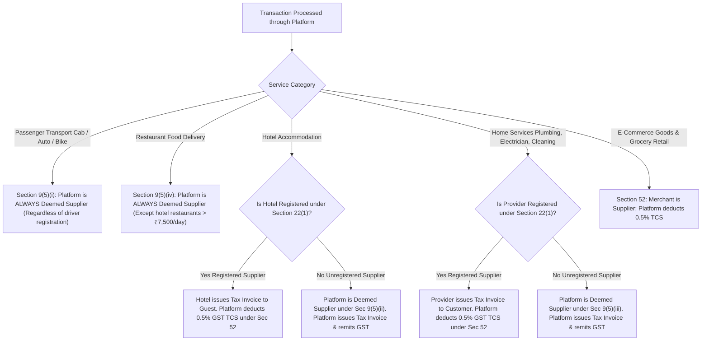
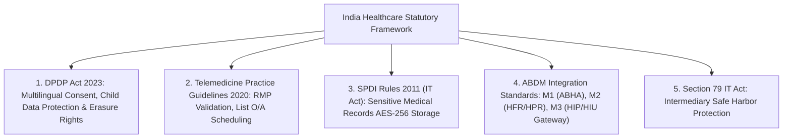
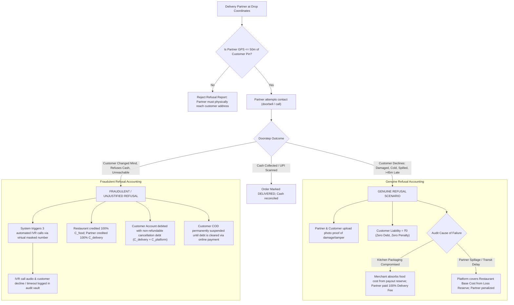
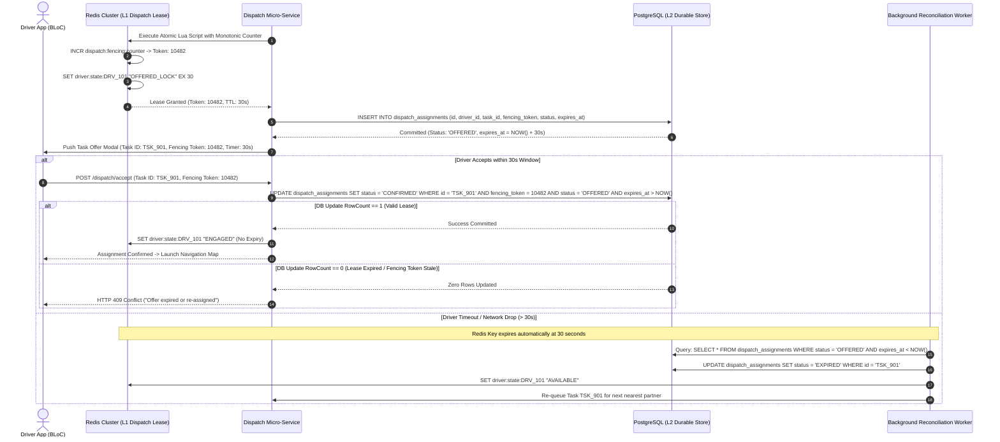
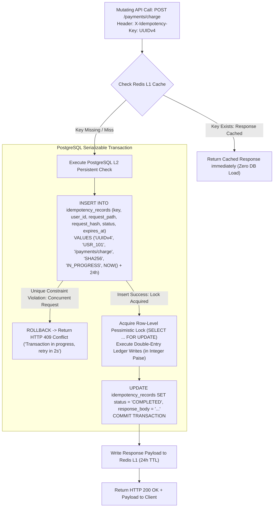
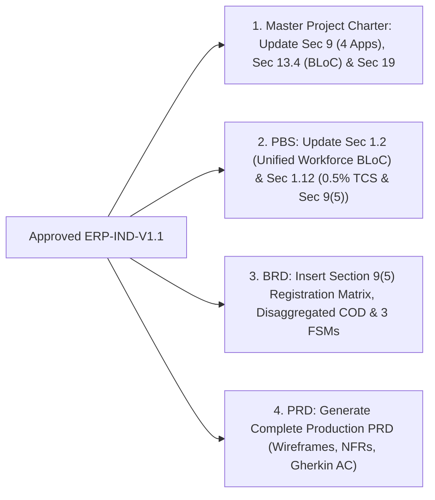

# ENTERPRISE ARCHITECTURAL REMEDIATION PLAN (REVISION 2)
## India-First Modular Super App Platform (All Verticals & Applications)

**Document Identifier:** ERP-IND-V1.1  
**Project Category:** Multi-Vertical Digital Super App Ecosystem  
**Target Market:** India (Tier 1, Tier 2, Tier 3, Semi-Urban)  
**Parent Documents:** Master Project Charter (MPC-IND-V1.0), Product Breakdown Structure (PBS-IND-V1.0), Business Requirements Document (BRD-IND-V1.0), PRD Scope Outline (PRD-SCOPE-IND-V1.0)  
**Superseded Document:** ERP-IND-V1.0 (Revision 1)  
**Document Type:** Formal Technical, Regulatory, Operational & Business Remediation Plan  
**Status:** Revision 2 Complete — Awaiting Executive Stakeholder Approval  
**Authored By:** Senior Enterprise Project Auditor, Solution Architect, Regulatory Analyst, Security Architect & QA Lead  
**Governance Directive:** Zero Modifications to Original Documents until Formal Sign-Off

---

## 1. Document Control & Revision History

| Version | Date | Author / Role | Summary of Changes & Audit Corrections | Approval Status |
|:---:|:---:|:---|:---|:---:|
| **1.0.0** | 2026-11-03 | Solution Architecture Team | Initial Remediation Plan addressing Gaps B-01 to B-04, T-01 to T-03, Q-01 to Q-03. | Superseded |
| **1.1.0** | 2026-11-03 | Enterprise Audit & Architecture Team | **Revision 2 Audit Corrections:**<br>1. Corrected Section 52 GST TCS rate to statutory 0.5% (effective July 10, 2024).<br>2. Re-evaluated Section 9(5) applicability for Hotels & Home Services based on supplier registration conditions.<br>3. Disaggregated COD accounting into 5 discrete ledgers and separated Genuine vs. Fraudulent refusal flows.<br>4. Made Hotel KYC configurable per local law and restricted Form C strictly to foreign passport holders.<br>5. Removed all US HIPAA references; grounded healthcare strictly in DPDP Act 2023, Telemedicine Guidelines 2020, SPDI Rules 2011, and ABDM integration standards.<br>6. Replaced invented WebSocket capacity figures with RFC-standard decorrelated jitter algorithms and realistic gateway capacity parameters.<br>7. Strengthened Redis assignment with Monotonic Fencing Tokens, durable PostgreSQL outbox persistence, and dead-letter recovery.<br>8. Implemented persistent PostgreSQL `idempotency_records` table with database engine constraints and row-level locking. | **Under Executive Review** |

---

## 2. Core Architectural Invariants Preserved

Throughout this remediation, the four foundational project constraints remain strictly preserved without compromise:

1. **Application Surface Invariant (4 Applications Total):**
   - **App 1 (Mobile - Flutter + BLoC):** User / Customer Mobile App
   - **App 2 (Mobile - Flutter + BLoC):** Unified Workforce App (Rider & Delivery Partner)
   - **App 3 (Mobile - Flutter + BLoC):** Merchant / Business Partner Mobile App
   - **App 4 (Web - Next.js 14+ / TypeScript):** Enterprise Super Admin & Operations Portal
2. **Workforce Single-App Invariant:** The Unified Rider & Delivery Partner App is preserved strictly as **ONE single application codebase and binary**, utilizing dynamic role-gated capabilities. Zero duplicate applications.
3. **Vertical Breadth Invariant:** All **nine business verticals** (Food, Grocery, E-commerce, Rides, Logistics, Home Services, Healthcare, Education, Hotels) are maintained.
4. **State Management Standard:** Standardized on **BLoC (`flutter_bloc`) with Strict Clean Architecture**.

---

## 3. Deep-Dive Remediation: Statutory, Tax & Regulatory Corrections

---

### Correction 1: GST Section 52 TCS Rate Correction (Effective July 10, 2024)

#### 1. Statutory Amendment Verification
* Under Notification No. 15/2024-Central Tax dated July 10, 2024, issued pursuant to the recommendations of the 53rd GST Council meeting, the rate of Tax Collected at Source (TCS) under **Section 52(1) of the Central Goods and Services Tax (CGST) Act, 2017** was formally reduced from 1% to **0.5% net**:
  $$\text{TCS Rate} = 0.25\% \text{ CGST} + 0.25\% \text{ SGST} \quad (\text{or } 0.5\% \text{ IGST for inter-state supplies})$$
* This statutory reduction applies to the net value of taxable supplies of goods and services processed through an Electronic Commerce Operator (ECO) where the ECO collects the consideration on behalf of the supplier (and where Section 9(5) does not apply).
* **Remediation:** All financial calculation engines, database schemas, settlement scripts, and GSTR-8 return export modules are updated to calculate Section 52 TCS strictly at **0.5%** on net taxable supplies.

#### 2. Assumptions Requiring CA / GST Expert Validation
> [!IMPORTANT]
> **Legal Assumption T-01:** The platform’s convenience fees, delivery fees, and merchant commission charges represent independent taxable supplies of services rendered by the platform, subject to standard 18% GST (under SAC 9985/9987), and do not partake in the tax rate of underlying supplies.  
> **Mandatory Directive:** No tax calculation rules or GSTR-8 export routines will be deployed to production without formal written certification from a qualified Chartered Accountant (CA) or indirect tax legal counsel.

---

### Correction 2: Section 9(5) Re-Evaluation for Hotels and Home Services

#### 1. Statutory Grounding & Supplier Registration Matrix
Under Notification No. 17/2017-Central Tax (Rate) dated June 28, 2017, and Notification No. 17/2021-Central Tax (Rate), Electronic Commerce Operators are deemed suppliers liable to remit GST under Section 9(5) **only under strict statutory conditions**:



#### 2. Detailed Rules by Service Category:
1. **Passenger Transport (Rides - Sec 9(5)(i)):** Platform is **always** liable to pay GST directly (5% without Input Tax Credit). Driver registration status is irrelevant.
2. **Food Delivery (Restaurant Services - Sec 9(5)(iv)):** Platform is **always** liable to pay GST directly (5% without ITC), *except* where the restaurant operates inside hotel premises with a declared room tariff $\ge ₹7,500$ per day.
3. **Hotel Accommodation (Sec 9(5)(ii)):**
   - *Condition:* If the hotel partner is **registered under Section 22(1)** (turnover exceeds ₹20 Lakhs, or ₹10 Lakhs in Special Category States): **The Hotel is the legal supplier** and must issue the tax invoice. Section 9(5) does **NOT** apply. The platform collects 0.5% GST TCS under Section 52.
   - *Exception:* If the hotel partner is **unregistered under Section 22(1)**: **The Platform is the deemed supplier under Section 9(5)(ii)**. The platform must issue the tax invoice and remit the applicable GST (12% or 18% based on tariff brackets) directly to the Government.
4. **Home Services / Housekeeping (Sec 9(5)(iii)):**
   - *Condition:* If an individual technician or service agency is **registered under Section 22(1)**: The service provider issues the tax invoice; Section 9(5) does **NOT** apply; Platform deducts 0.5% TCS.
   - *Exception:* If an individual technician (e.g. freelance plumber, electrician) is **unregistered under Section 22(1)**: **The Platform is the deemed supplier under Section 9(5)(iii)**. The platform must issue the tax invoice and pay 18% GST directly.

#### 3. Acceptance Criteria (Gherkin)
```gherkin
Scenario: Guest books a room at a Registered Hotel Partner
  Given an enrolled hotel partner has a validated active GSTIN in the Partner Registry
  When a customer books a room for ₹3,500 per night
  Then the system determines Section 9(5) does not apply
  And generates a Guest Tax Invoice bearing the Hotel's GSTIN and legal name
  And applies 12% GST under the Hotel's tax liability
  And deducts 0.5% GST TCS (0.25% CGST + 0.25% SGST) from the hotel payout escrow
  And queues the transaction for GSTR-8 monthly reporting.

Scenario: Customer books an Unregistered Independent Electrician
  Given an individual electrician has no registered GSTIN in the Partner Registry
  When the electrician completes a service call worth ₹600
  Then the system invokes Section 9(5)(iii)
  And generates a Tax Invoice with Platform GSTIN as the Deemed Supplier
  And charges 18% GST remitted directly to the Government by the platform
  And deducts zero GST TCS from the electrician's earnings.
```

---

### Correction 4: Configurable Hotel KYC & Foreign National Form-C Rules

#### 1. Statutory Delineation: Domestic vs. Foreign Guests
* **Domestic Indian Citizens:** Identity verification is governed by state-level Police Regulations and the ancient **Sarais Act, 1867**. Requirements vary significantly by state and municipal commissionerate:
  - Certain states allow digital pre-arrival KYC (Aadhaar, Driving License, Voter ID, Passport).
  - Other jurisdictions legally mandate physical verification and physical register signing upon physical arrival at the front desk.
  - **Remediation:** Pre-arrival digital ID upload in the Customer App is made **fully configurable** at the hotel property level. The app displays digital KYC as *optional* unless explicitly mandated by specific municipal police directives.
* **Foreign National Guests (Form C Mandate):** Governed strictly by the **Registration of Foreigners Act, 1939** and the **Registration of Foreigners Rules, 1992**, administered by the Foreigners Regional Registration Office (FRRO) and the Bureau of Immigration (BoI).
  - Hotels are legally mandated to submit **Form C within 24 hours of arrival** for every foreign national.
  - **Remediation:** Form C data fields (Passport Number, Nationality, Visa Number, Visa Type, Visa Expiry Date, Port of Entry in India, Next Destination) are **suppressed for domestic guests** and triggered **strictly and exclusively when a guest selects non-Indian nationality**.

#### 2. Acceptance Criteria (Gherkin)
```gherkin
Scenario: Domestic Indian citizen confirms hotel reservation
  Given a customer booking a hotel room selects 'Indian' nationality
  When navigating to the booking confirmation screen
  Then the digital ID document upload is presented as an optional expedited check-in feature
  And all Form C immigration fields remain completely hidden and suppressed.

Scenario: Foreign passport holder confirms hotel reservation
  Given a guest selects 'United Kingdom' as nationality during hotel booking
  When proceeding through guest details
  Then the app enforces mandatory Form C fields (Passport Number, Visa Number, Visa Expiry, Port of Entry)
  And transmits the structured Form C payload to the Hotelier Extranet Console for submission to the BoI FRRO portal within the statutory 24-hour window.
```

---

### Correction 5: Indian Healthcare Compliance (Removal of US HIPAA & ABHA Precision)

#### 1. Complete Removal of US HIPAA
* The Health Insurance Portability and Accountability Act (HIPAA) is United States legislation and has **zero legal force or jurisdiction in India**. All references to HIPAA compliance are formally deleted.

#### 2. Defining India-Specific Healthcare Statutory Architecture
The healthcare vertical is governed exclusively by Indian medical and data privacy jurisprudence:



1. **Digital Personal Data Protection (DPDP) Act, 2023:**
   - Explicit, multilingual consent notices prior to collecting health records.
   - Verifiable parental/guardian consent required for users below 18 years.
   - Purpose limitation: Patient data cannot be processed for advertising or third-party marketing.
   - Data principal rights: Self-service features for data access, correction, and account/record erasure.
2. **Telemedicine Practice Guidelines, 2020 (MoHFW & National Medical Commission):**
   - Teleconsultations may only be conducted by a **Registered Medical Practitioner (RMP)** enrolled in the State Medical Register or National Medical Register.
   - Mandatory display of doctor identity: Name, Medical Council Registration Number, Qualification.
   - Mandatory consultation log retention for at least **3 years**.
   - Permissible Drug Schedules: Only **List O** (OTC drugs: paracetamol, ORS) and **List A** (first-line medications for cough/cold, refills for chronic illness) may be prescribed via teleconsultation.
   - **Strict Prohibition:** Drugs listed in **Schedule X** of the Drugs and Cosmetics Rules 1945, and habit-forming substances under the Narcotic Drugs and Psychotropic Substances (NDPS) Act 1985, are **strictly prohibited** from teleconsultation prescription.
3. **SPDI Rules, 2011 (Under Information Technology Act, 2000):**
   - Electronic Medical Records (EMR) and diagnostic lab PDFs must be stored encrypted at rest using **AES-256** and encrypted in transit via **TLS 1.3**.
4. **Ayushman Bharat Digital Mission (ABDM) Integration Standards:**
   - The platform does not claim "ABHA compliant" as a broad certification. It implements the **National Health Authority (NHA) ABDM Sandbox Milestone APIs**:
     - *Milestone 1 (M1):* ABHA number creation and ABHA address verification via Aadhaar/Mobile OTP.
     - *Milestone 2 (M2):* Verification against the Health Facility Registry (HFR) and Healthcare Professionals Registry (HPR).
     - *Milestone 3 (M3):* Gateway integration as a Health Information Provider (HIP) and Health Information User (HIU) under the unified consent framework.
5. **Intermediary Safe Harbor (Section 79 of IT Act, 2000):**
   - The Super App operates strictly as a technology intermediary connecting patients with independent RMPs and accredited laboratories. The platform does not practice medicine and assumes zero clinical malpractice liability.
   - E-prescriptions are stored as cryptographically signed PDFs in the patient's health locker. If a patient opts to order medications, the prescription is routed via API to a licensed retail pharmacy partner who conducts independent telephonic pharmacist verification.

#### 3. Legal Assumptions Requiring Medico-Legal Sign-Off
> [!IMPORTANT]
> **Legal Assumption H-01:** Cryptographic asymmetric key signing of e-prescriptions satisfies Section 5 of the Information Technology Act 2000 for electronic medical records.  
> **Legal Assumption H-02:** Intermediary safe harbor under Section 79 holds valid provided the platform exercises due diligence under the Information Technology (Intermediary Guidelines and Digital Media Ethics Code) Rules, 2021.

---

## 4. Deep-Dive Remediation: Operational & Financial Corrections

---

### Correction 3: Disaggregated Cash on Delivery (COD) Accounting & Fraud Allocation

#### 1. Disaggregated Financial Component Accounting
A doorstep COD refusal or cancellation cannot be recorded as an opaque write-off. The platform enforces five discrete accounting ledgers (all maintained in 64-bit integer **Paise**):

$$\text{Total Order Value} = C_{\text{food}} + C_{\text{delivery}} + C_{\text{packaging}} + C_{\text{convenience}} + \text{Taxes}$$

* **$C_{\text{food}}$ (Food Base Cost):** Payable to the restaurant for raw materials and food preparation.
* **$C_{\text{delivery}}$ (Delivery Compensation):** Payable to the delivery partner for transit time and distance.
* **$C_{\text{platform}}$ (Platform Fee & Packaging):** Revenue component of the platform and merchant.
* **$L_{\text{platform}}$ (Platform Operating Loss):** Net negative write-off absorbed by the platform's Risk Reserve Pool.
* **$D_{\text{customer}}$ (Customer Outstanding Debt):** Recoverable receivable booked against the customer’s identity.

#### 2. Differentiated Operational Workflows: Genuine vs. Fraudulent Refusal



#### 3. Dispute Resolution & Collusion Defense
* **Driver False Claims:** If a delivery partner falsely claims "Customer Refused" without waiting, the telemetry system audits partner stationary dwell time. If dwell time at drop coordinates is $< 3\text{ minutes}$, the claim is rejected.
* **Customer False Claims:** If a customer claims "Driver never arrived", the system cross-references the driver's GPS breadcrumb trace and the automated IVR call duration log.
* **Acceptance Criteria (Gherkin):**
```gherkin
Scenario: Customer refuses delivery due to spilled food (Genuine Refusal)
  Given a delivery partner reaches the customer drop pin (distance <= 50m)
  When the customer rejects the order due to broken container and food spillage
  And the partner uploads photographic evidence confirming compromised transit packaging
  Then the order is transitioned to CANCELLED_GENUINE_DAMAGE
  And customer liability is recorded as exactly 0 paise
  And the delivery partner is credited with 100% delivery fee compensation
  And the food base cost is debited from the restaurant's quality holdback reserve.

Scenario: Customer refuses delivery because they changed their mind (Fraudulent Refusal)
  Given a delivery partner is at the customer doorstep with an intact food order
  When the customer states "I don't want it anymore" and refuses to pay cash
  And the automated IVR system attempts 3 calls and logs customer verbal refusal
  Then the order is transitioned to CANCELLED_UNJUSTIFIED_REFUSAL
  And the restaurant is credited with 100% Food Base Cost from the Platform Loss Reserve
  And the delivery partner is credited with 100% Delivery Compensation
  And a debt of (Delivery Fee + Platform Fee) is posted to the customer's account ledger
  And Cash on Delivery is immediately disabled for all future orders under that customer profile.
```

---

## 5. Deep-Dive Remediation: Technical, Concurrency & Infrastructure Rigor

---

### Correction 6: WebSocket Jitter Algorithms & Realistic Gateway Capacity

#### 1. Correction of Jitter Algorithms (Eliminating Invented Figures)
* Rather than arbitrary uniform delays, client reconnection must follow the **Decorrelated Jitter / Full Jitter Algorithm** (standardized in network architecture literature and RFC specifications) to prevent packet harmonics:
  $$\text{sleep} = \min\left(T_{\text{max}}, T_{\text{base}} \times 2^{\text{attempt}}\right)$$
  $$T_{\text{reconnect}} = \text{Uniform}\left(0, \text{sleep}\right)$$
  Where $T_{\text{base}} = 200\text{ ms}$ and $T_{\text{max}} = 5,000\text{ ms}$. This distributes reconnect events over a non-harmonic uniform continuum.

#### 2. Realistic Gateway Capacity Parameters (Zero Unverified Guarantees)
* **Operating Realities:** WebSocket connection concurrency per server node depends strictly on Linux kernel TCP buffer memory allocation:
  - Each active TCP socket allocates memory via `rmem` and `wmem` buffers (typically 8KB to 32KB per connection).
  - A server node with 16GB RAM can safely support approximately 30,000 to 50,000 idle persistent connections before risk of kernel socket buffer exhaustion.
* **Remediation Architecture:**
  - **Gateway Throttling:** Kong / NGINX WebSocket upgrade endpoints enforce an **Adaptive Token Bucket** algorithm.
  - **HTTP/2 Delta-Sync Priority:** When the app resumes from the background, the UI does NOT block waiting for the WebSocket connection. It immediately issues an HTTP/2 multiplexed delta-sync call:  
    `GET /api/v1/sync/delta?last_event_id=EVT_88291&since=1730592800`
  - The delta response retrieves missed state changes from Redis Streams ($O(1)$ query). If the WebSocket gateway is saturated or experiencing backoff, the user sees up-to-date data immediately.
  - **Load Testing Assumption:** Gateway node sizing and connection limits must be empirically baselined during Phase 6 stress testing using Distributed Locust / k6 test harnesses.

---

### Correction 7: Redis Concurrency Hardening with Fencing Tokens, DB Outbox & Lock Recovery

#### 1. Vulnerability of Pure In-Memory Locking
In-memory Redis locks are volatile. If Redis experiences a failover, network partition, or client-side GC pause, two dispatch workers can execute concurrent assignments. Furthermore, if a driver accepts after their lease expired, a classic split-brain assignment occurs.

#### 2. Hardened Architecture: Monotonic Fencing Tokens + PostgreSQL Outbox



#### 3. Key Technical Safeguards:
1. **Monotonic Fencing Tokens:** Every dispatch lease increments a persistent 64-bit integer counter. If a delayed acceptance packet arrives after lock expiry, the database update fails atomically because the fencing token or expiry timestamp is invalid.
2. **PostgreSQL Outbox Durability:** Every offer is durably written to PostgreSQL in an `OFFERED` status inside an ACID transaction.
3. **BullMQ Lock Recovery Worker:** A dedicated background worker executes every 10 seconds querying for expired `OFFERED` records, preventing drivers from ever becoming stuck in orphaned states due to Redis failures.

---

### Correction 8: Persistent PostgreSQL Idempotency Records & Database Financial Protection

#### 1. Inadequacy of Purely Redis-Based Idempotency
Relying exclusively on a 120-second Redis cache for idempotency creates critical financial vulnerabilities: if Redis evicts keys under memory pressure or restarts, duplicate requests can cause double debits or double payouts.

#### 2. Database-Level Persistent Idempotency Engine
The platform implements a **Dual-Layered Persistent Idempotency Architecture**:



#### 3. Database Schema Specification:
```sql
CREATE TABLE idempotency_records (
    id UUID PRIMARY KEY DEFAULT gen_random_uuid(),
    idempotency_key VARCHAR(128) NOT NULL,
    user_id UUID NOT NULL,
    request_path VARCHAR(255) NOT NULL,
    request_hash CHAR(64) NOT NULL,
    status VARCHAR(32) NOT NULL CHECK (status IN ('IN_PROGRESS', 'COMPLETED', 'FAILED')),
    response_code INTEGER,
    response_body JSONB,
    created_at TIMESTAMPTZ NOT NULL DEFAULT NOW(),
    expires_at TIMESTAMPTZ NOT NULL,
    CONSTRAINT uq_idempotency_user UNIQUE (idempotency_key, user_id)
);
CREATE INDEX idx_idempotency_lookup ON idempotency_records(idempotency_key, user_id);
```

#### 4. Financial Ledger Row-Level Safeguards:
* All monetary mutations execute inside `READ COMMITTED` or `SERIALIZABLE` transactions with explicit row-level locks:  
  `SELECT balance FROM user_wallets WHERE user_id = :id FOR UPDATE;`
* Database table constraints enforce balance sanity at the engine level:  
  `ALTER TABLE user_wallets ADD CONSTRAINT chk_wallet_non_negative CHECK (balance >= 0);`
* **Zero Floating-Point Math:** All values are represented as 64-bit `BIGINT` in minor units (**Paise**).

---

## 6. Document Consistency Alignment Roadmap

Upon formal executive sign-off, the corrections in this document (**ERP-IND-V1.1**) will be systematically synchronized across all project documents:



---

## 7. Master List of Decisions Requiring Executive Approval

Before foundational documents are updated or final PRD drafting initiates, the following **7 Strategic Decisions** require formal executive approval:

| Decision ID | Domain | Strategic Decision Item | Recommended Action / Baseline | Status |
|:---:|---|---|---|:---:|
| **DEC-01** | **Taxation** | Section 52 GST TCS rate set to 0.5% (Notification 15/2024); Section 9(5) dual-invoicing applied with supplier registration exceptions. | **Approve subject to formal written Chartered Accountant (CA) sign-off** prior to production deployment. | **Awaiting Approval** |
| **DEC-02** | **Healthcare** | Complete deletion of US HIPAA; healthcare grounded strictly in DPDP Act 2023, Telemedicine Guidelines 2020, SPDI Rules 2011, and ABDM sandbox standards. | **Approve zero-dispensing intermediary model** (signed PDF health locker + external pharmacy API). | **Awaiting Approval** |
| **DEC-03** | **Operations** | Disaggregated COD accounting with distinct financial ledgers for food cost, delivery fee, platform loss, and customer debt. | **Approve differentiated genuine vs. fraudulent refusal workflows** ($\le 50\text{m}$ GPS + mandatory IVR call log). | **Awaiting Approval** |
| **DEC-04** | **Hospitality** | Hotel guest KYC made configurable per state police law; Form C fields triggered exclusively for declared foreign passport holders. | **Approve configurable KYC and foreign-only Form C workflow**. | **Awaiting Approval** |
| **DEC-05** | **Workforce** | Single Unified Workforce App (Flutter + BLoC) utilizing dynamic role-gated shells (Mobility Shell vs. Specialist Shell). | **Approve single codebase and deployment binary** (zero duplicate applications). | **Awaiting Approval** |
| **DEC-06** | **Real-Time Tech** | Full Jitter Decorrelated backoff algorithm for WebSocket reconnects; HTTP/2 delta-sync priority; capacity targets subject to Phase 6 load testing. | **Approve network backoff and delta-sync resilience architecture**. | **Awaiting Approval** |
| **DEC-07** | **Data Concurrency** | Redis Lua leases hardened with Monotonic Fencing Tokens, durable PostgreSQL outbox persistence, and PostgreSQL `idempotency_records` table with row-level locking. | **Approve two-tier durable concurrency and financial ledger protection**. | **Awaiting Approval** |

---

## 8. Governance Stop Notice

* **Document Status:** Revised Remediation Plan Complete (**ERP-IND-V1.1**)
* **Compliance Verification:**
  - Zero original foundational documents have been altered.
  - Final PRD generation is strictly paused.
  - No code has been written.
  - All 8 audit corrections are fully addressed.
* **Standing Directive:** **STOPPING HERE.** Awaiting your formal executive approval on Decisions **DEC-01 through DEC-07** before proceeding.
