# HIGH-LEVEL VISUAL HIERARCHY & SYSTEM FLOW BLUEPRINT
## India-First Modular Super App Platform (All Verticals & Applications)

**Document Identifier:** VHB-IND-V1.1  
**Project Category:** Multi-Vertical Digital Super App Ecosystem  
**Target Market:** India (Tier 1, Tier 2, Tier 3, Semi-Urban)  
**Parent Documents:** Master Project Charter (MPC-IND-V1.0), Product Breakdown Structure (PBS-IND-V1.0), Business Requirements Document (BRD-IND-V1.0), Remediation Plan V1.1 (ERP-IND-V1.1)  
**Document Type:** Exhaustive Visual Architecture, Functional Hierarchy & End-to-End Operational Flow Blueprint  
**Status:** Authoritative Visual Specification (100% GitHub Markdown & Mermaid Compatible)  

---

## 1. Document Overview & Visual Architecture Scope

This document provides the complete, authoritative visual blueprint of the **India-First Modular Super App Platform**. It visually breaks down every shared foundation service, application component, vertical operational lifecycle, financial ledger movement, high-concurrency guard, and anti-fraud pipeline into structured diagrams.

All diagrams are designed to render natively on GitHub with zero syntax conflicts (no semicolons in sequence diagrams, no raw line breaks, and no unescaped arrow tokens inside labels).

---

## 2. Master System Visual Topology (6-Tier Macro Architecture)

```mermaid
graph TD
    subgraph Tier1["1. CLIENT APPLICATION SURFACES (Flutter & Next.js)"]
        App1["Customer Mobile App<br/>(iOS and Android - Flutter + BLoC)"]
        App2["Unified Workforce Mobile App<br/>(ONE Single App: Rider, Driver, Specialist)"]
        App3["Merchant Partner Mobile App<br/>(KDS, Inventory, Clinic Token, Extranet)"]
        App4["Enterprise Super Admin Web Portal<br/>(Next.js 14+ App Router / TypeScript)"]
    end

    subgraph Tier2["2. EDGE GATEWAY & SECURITY PERIMETER"]
        WAF["Cloudflare Edge WAF & DDoS Shield"]
        Kong["API Gateway & Reverse Proxy<br/>(Kong / NGINX Cluster)"]
        RateLimit["Adaptive Token Bucket Rate Limiter<br/>(Sliding Window in Redis)"]
        AuthGuard["JWT Access Token & Device Fingerprint Validator"]
    end

    subgraph Tier3["3. SHARED FOUNDATIONAL PLATFORM ENGINES"]
        IAM["Unified Indian IAM & Multi-Persona Manager<br/>(Mobile OTP, WhatsApp Fallback, RBAC)"]
        Treasury["Double-Entry Treasury Engine<br/>(64-bit Integer Paise Precision Ledger)"]
        Geo["H3 Spatial Indexing & Telemetry Hub<br/>(Uber H3 Res 7/9, Dead Reckoning)"]
        Events["Omnichannel Notification & Event Bus<br/>(FCM Priority Data Messages, DLT SMS)"]
        TaxEng["Cart, Checkout & GST Split-Invoicing Engine<br/>(Sec 9(5) vs Sec 52 Dual Invoicing)"]
        Loyalty["Universal Super Coins & Promo Subsystem<br/>(Cross-Vertical Earn and Burn)"]
        Safety["Trust, Safety & Emergency SOS Dispatcher<br/>(4-Tier Anti-Spoofing, Telemetry Anomaly)"]
        Support["Centralized Helpdesk & Dispute Arbitrator<br/>(Automated Refund Authority Matrix)"]
    end

    subgraph Tier4["4. 9 BUSINESS DOMAIN MICRO-MODULES"]
        V1["Food Delivery Vertical<br/>(Menus, KDS 15m Sync, Hot-Bag, FSSAI)"]
        V2["Grocery Delivery Vertical<br/>(Dark Stores, 10m Hold, Produce Tolerance)"]
        V3["E-Commerce Marketplace Vertical<br/>(Multi-Seller Cart, 3PL AWB, 7-Day Escrow)"]
        V4["Ride Booking & Mobility Vertical<br/>(Upfront Dynamic Fare, 4-Digit OTP, FASTag)"]
        V5["Logistics & Parcel Vertical<br/>(Hyperlocal & Inter-City, Volumetric Weight)"]
        V6["Home Services Vertical<br/>(Standard Rate Cards, In-App Extra Quotes)"]
        V7["Healthcare Services Vertical<br/>(Doctor Queue Tokens, ABDM M1-M3, Safe Harbor)"]
        V8["Education & Tutoring Vertical<br/>(Demo Classes, UPI Autopay Recurring Mandates)"]
        V9["Hotel Booking Vertical<br/>(10m Room Hold, Configurable KYC, Form C)"]
    end

    subgraph Tier5["5. PERSISTENT STORAGE, CACHE & ASYNC QUEUES"]
        DB[(PostgreSQL 16 Cluster<br/>Isolated Domain Schemas, ACID Ledger, Row Locks)]
        Redis[(Redis 7 In-Memory Cluster<br/>Lua Script Leases, Streams, Proximity GeoSets)]
        Queue["BullMQ Distributed Job Queues<br/>(Dead-Letter Workers & Outbox Recovery)"]
        S3["Object Storage<br/>(Cloudflare R2 / AWS S3 AES-256 Encrypted)"]
    end

    subgraph Tier6["6. EXTERNAL INDIAN INTEGRATIONS & REGULATORY RAILS"]
        PG["Payment Rails: Razorpay, Cashfree<br/>(UPI Intent, UPI Autopay, RuPay, NetBanking)"]
        Telecom["Telecom Rails: MSG91, Gupshup<br/>(DLT-Registered SMS, WhatsApp Business API)"]
        Maps["Geo Rails: MapmyIndia Mappls, Google Maps<br/>(Indian Landmark Parsing, Matrix Routing)"]
        Logi["3PL Logistics: Delhivery, Shiprocket<br/>(Automated Waybill Generation & Freight)"]
        Govt["Statutory APIs: GST Portal GSTR-8, BoI FRRO<br/>(GSTIN Verification, Form C Foreign Export)"]
    end

    Tier1 --> Tier2
    Tier2 --> Tier3
    Tier3 --> Tier4
    Tier4 --> Tier5
    Tier3 --> Tier6
    Tier4 --> Tier6
```

---

## 3. The 4 Client Applications: Detailed Component & Screen Topologies

---

### 3.1 Customer Mobile App (Flutter + BLoC)
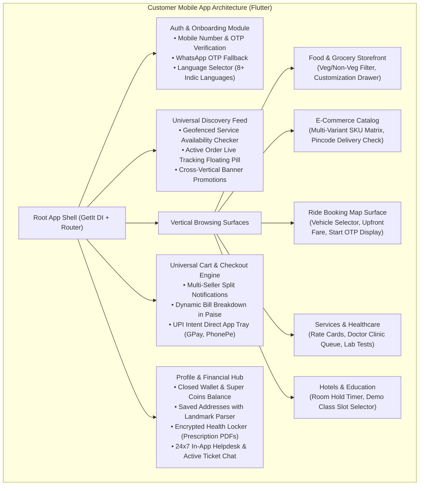

---

### 3.2 ONE Unified Workforce Mobile App (Flutter + BLoC)
Preserved strictly as **ONE single application binary** with dynamic capability gating:

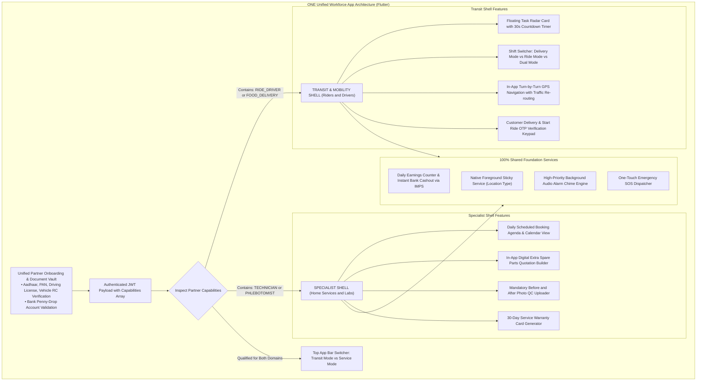

---

### 3.3 Merchant Partner Mobile App (Flutter + BLoC)
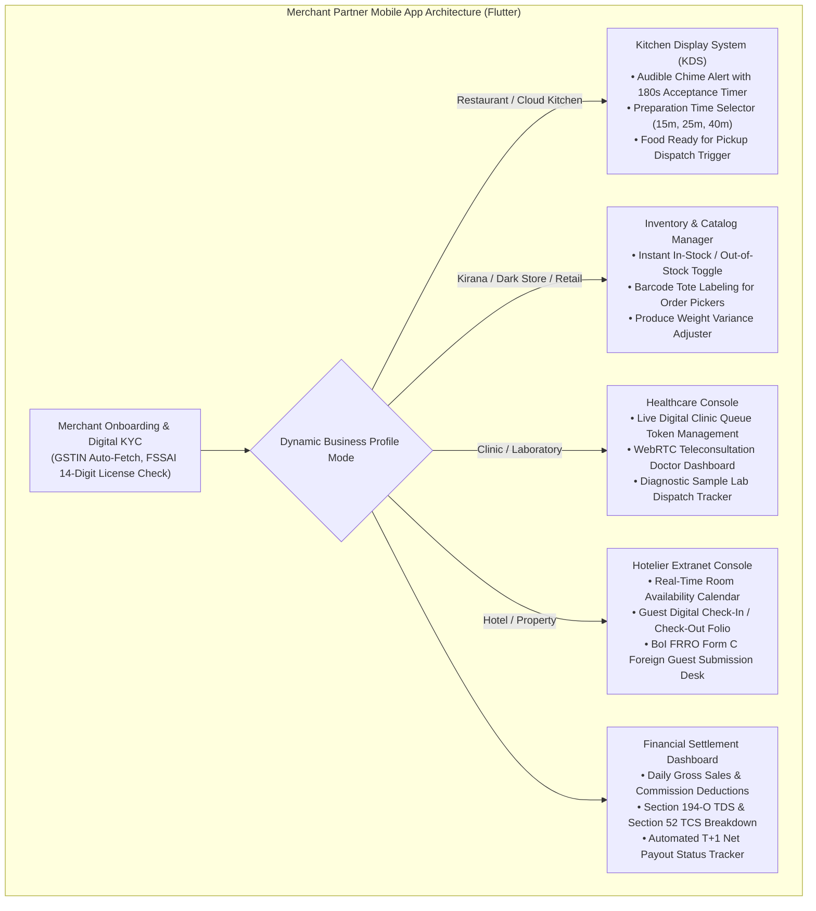

---

### 3.4 Enterprise Super Admin Web Portal (Next.js 14+ / TypeScript)
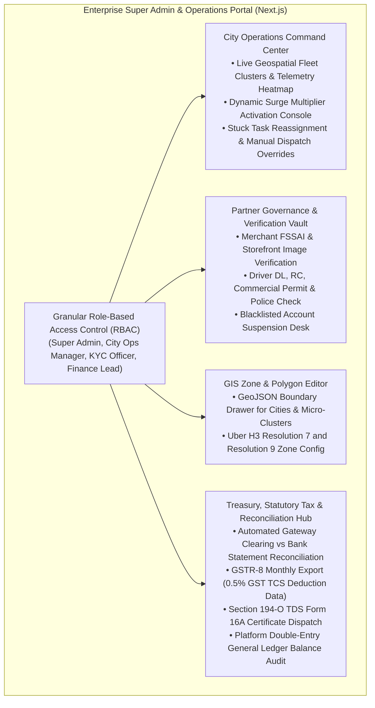

---

## 4. Clean Architecture & BLoC Reactive Event Flow (Flutter Mobile Layer)

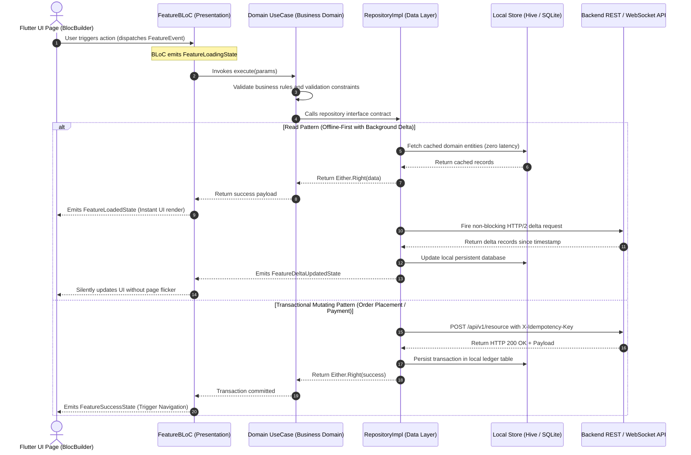

---

## 5. End-to-End Operational Workflows Across the 9 Verticals

---

### 5.1 Vertical 1: Food Delivery Operational Workflow
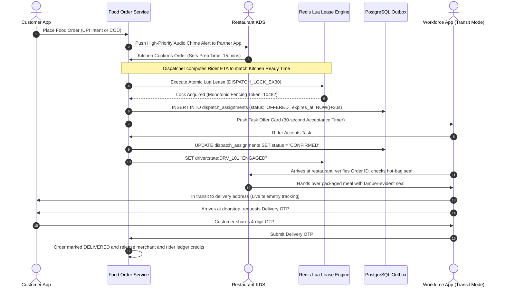

---

### 5.2 Vertical 2: Grocery Delivery (Dark Store & Kirana) Workflow
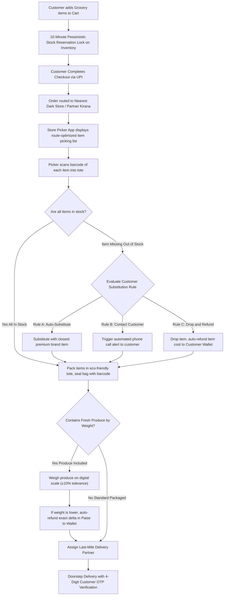

---

### 5.3 Vertical 3: E-Commerce Marketplace Workflow
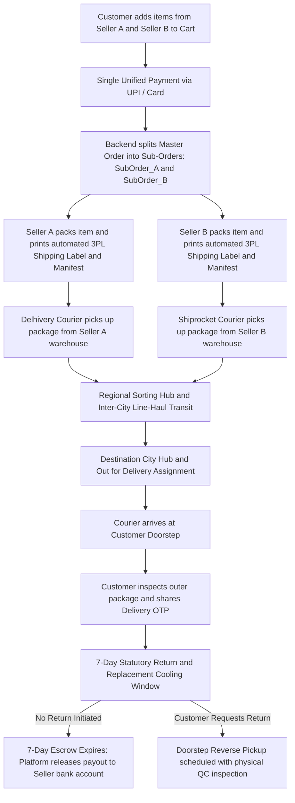

---

### 5.4 Vertical 4: Ride Booking & Mobility Workflow
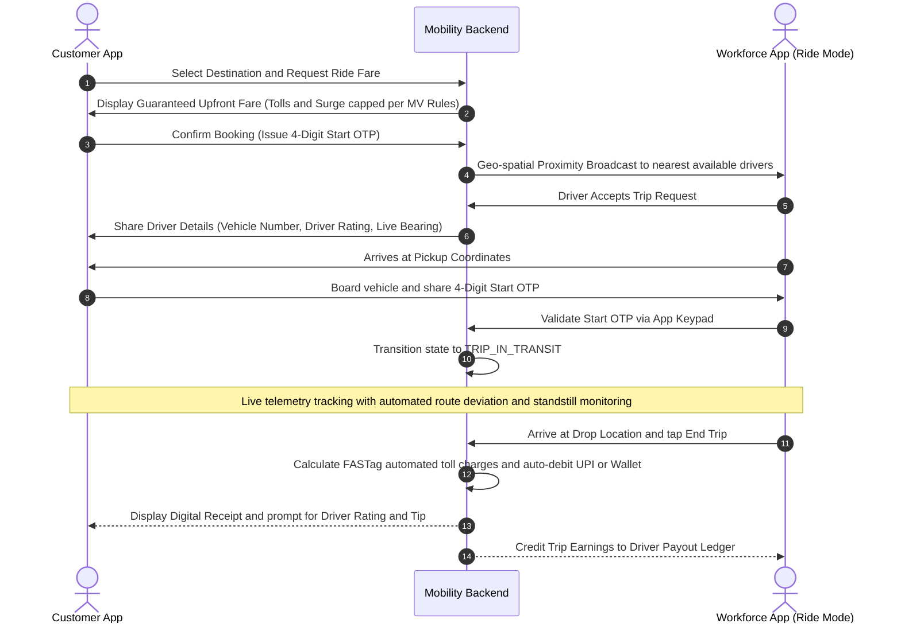

---

### 5.5 Vertical 5: Logistics & Parcel Delivery Workflow
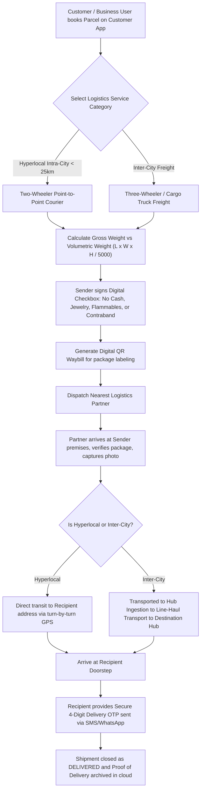

---

### 5.6 Vertical 6: On-Demand Home Services Workflow
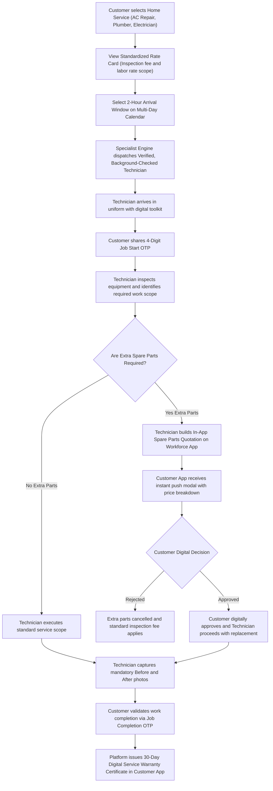

---

### 5.7 Vertical 7: Healthcare Services Workflow
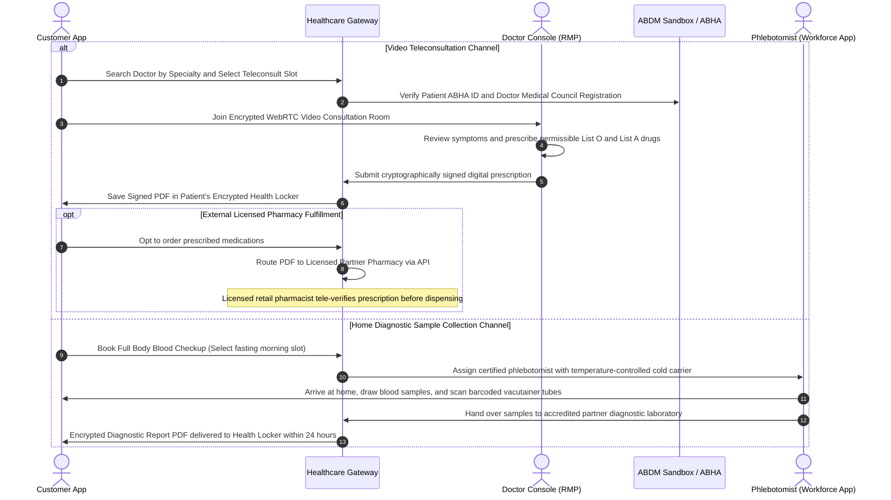

---

### 5.8 Vertical 8: Education & Tutoring Enrollment Workflow
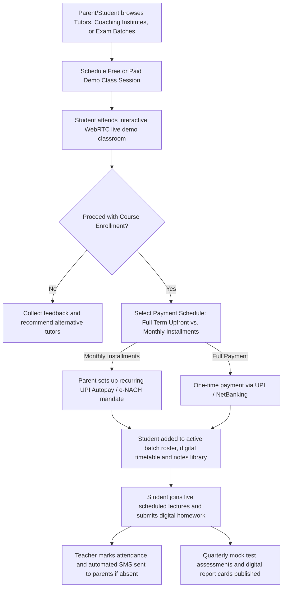

---

### 5.9 Vertical 9: Hotel & Accommodation Booking Workflow
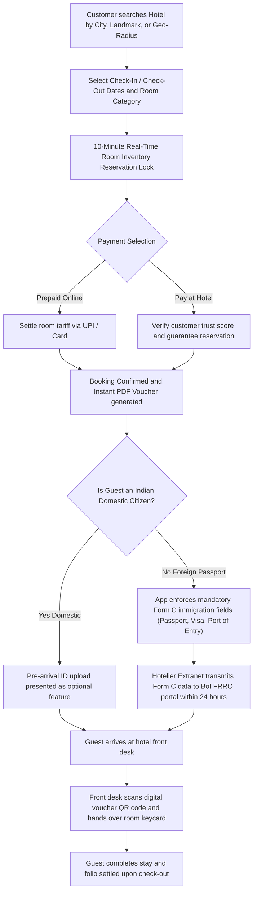

---

## 6. Financial Treasury, Double-Entry Ledger & Split-Invoicing Flow

Every transaction enforces 64-bit integer minor unit (**Paise**) arithmetic and automatic tax entity bifurcation:

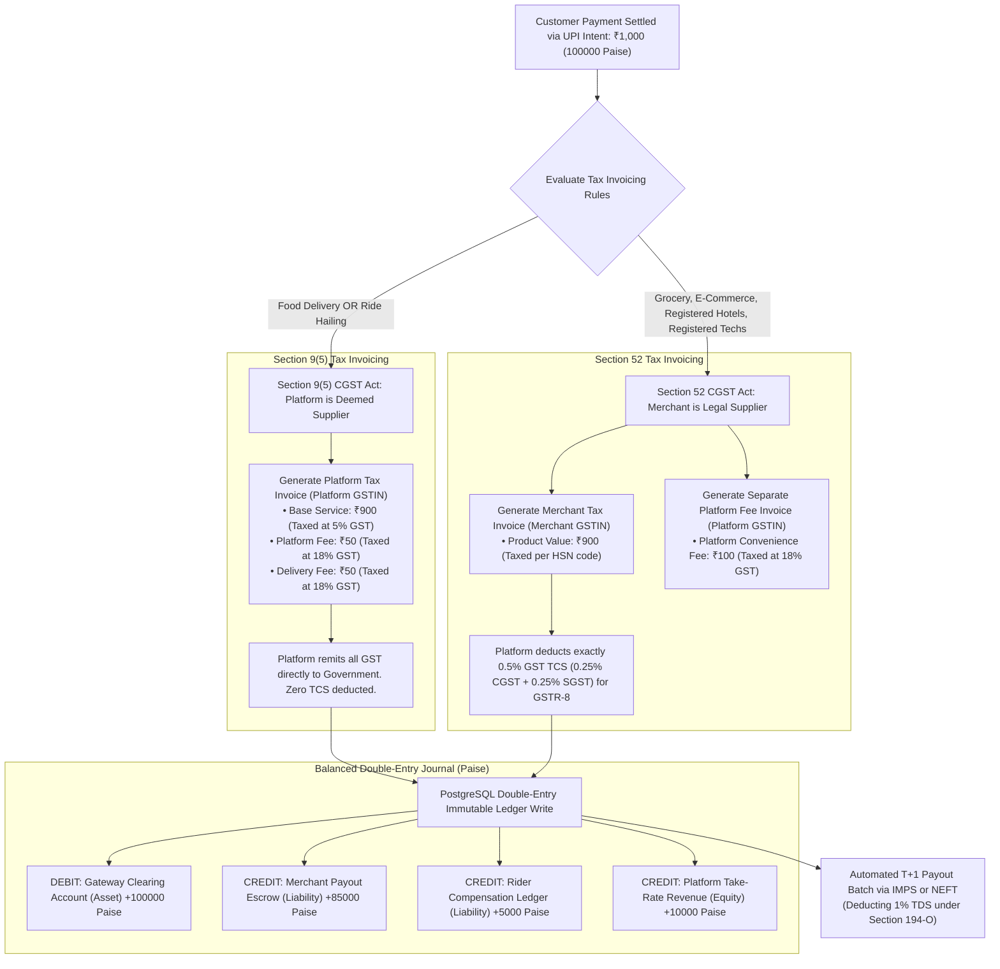

---

## 7. High-Scale Concurrency, Anti-Spoofing & Persistent Idempotency Flow

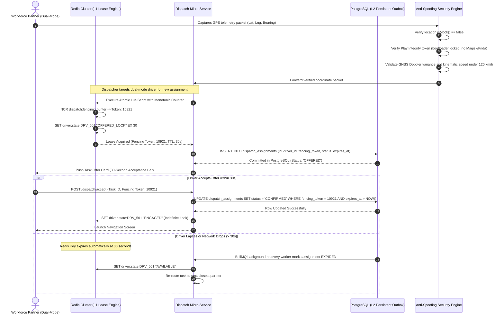

---

## 8. Master Visual Document Index & References

This visual hierarchy blueprint coordinates directly with the complete project documentation suite:

| Document Reference | Full File Path | Primary Visual & Architectural Coverage |
|:---|:---|:---|
| **Master Project Charter** | [`docs/01_project_charter/master_project_charter.md`](file:///Users/firozmohammad/DigiEmperor/all_in_one/docs/01_project_charter/master_project_charter.md) | Ecosystem Business Objectives & 9 Verticals Scope |
| **Product Breakdown Structure** | [`docs/02_product_breakdown_structure/product_breakdown_structure.md`](file:///Users/firozmohammad/DigiEmperor/all_in_one/docs/02_product_breakdown_structure/product_breakdown_structure.md) | 4-Level Deliverable Hierarchy & App Traceability |
| **Business Requirements Document** | [`docs/03_business_requirements_document/business_requirements_document.md`](file:///Users/firozmohammad/DigiEmperor/all_in_one/docs/03_business_requirements_document/business_requirements_document.md) | Commercial Take Rates, Commission Matrices & NFRs |
| **Remediation Plan V1.1** | [`docs/05_remediation_plan/enterprise_remediation_plan_v1.1.md`](file:///Users/firozmohammad/DigiEmperor/all_in_one/docs/05_remediation_plan/enterprise_remediation_plan_v1.1.md) | Authoritative Statutory GST, COD & Concurrency Remediations |
| **Repository README** | [`README.md`](file:///Users/firozmohammad/DigiEmperor/all_in_one/README.md) | Master 5-Step Execution Roadmap & Document Index |

---

## 9. Document Sign-Off Notice

* **Document Identifier:** VHB-IND-V1.1
* **Syntax Validation:** All Mermaid diagrams utilize GitHub-native compatible syntax (clean labels, ` ` line breaks, zero semicolons, zero unescaped arrows).
* **Next Action:** Awaiting executive approval on Remediation Decisions `DEC-01` through `DEC-07` to begin foundational document updates and Final PRD authoring.
