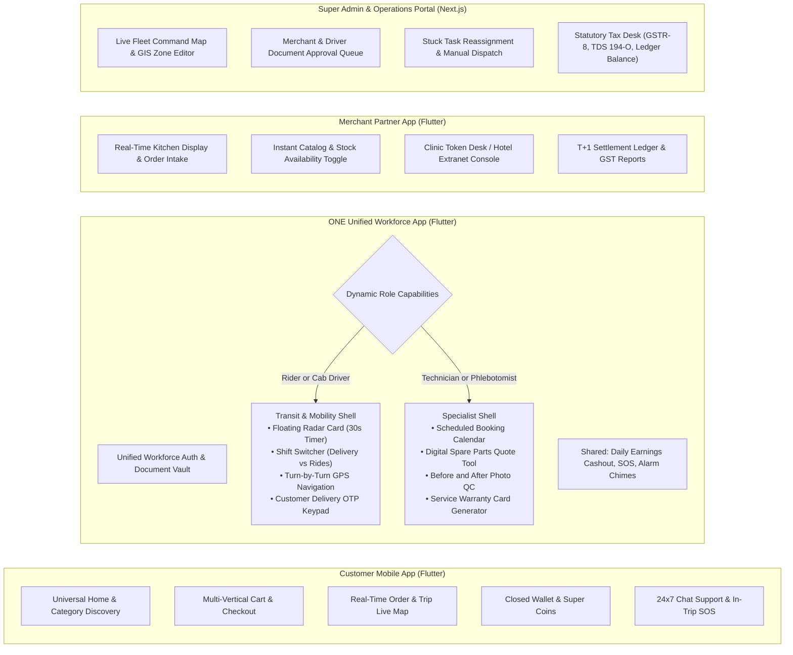
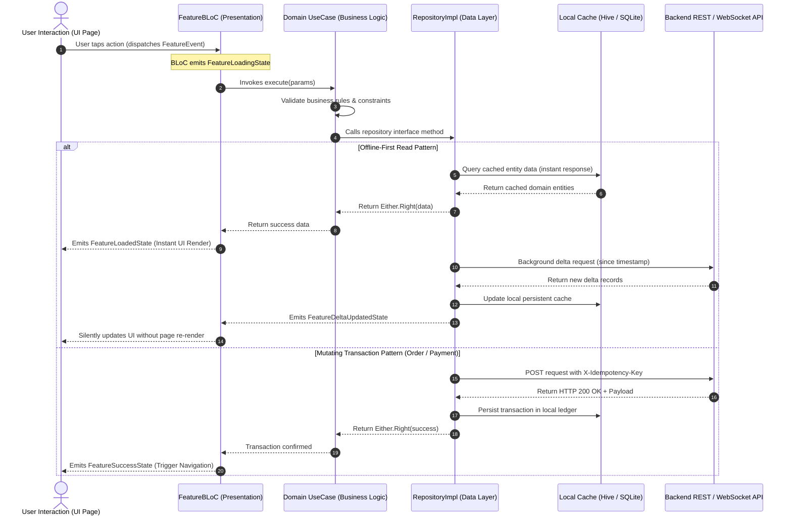
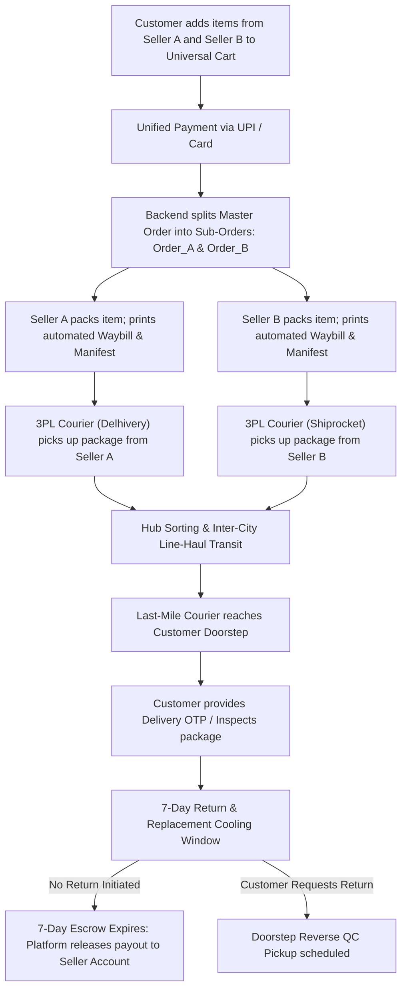
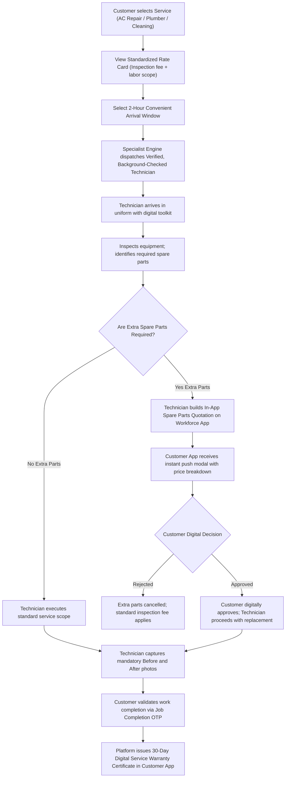
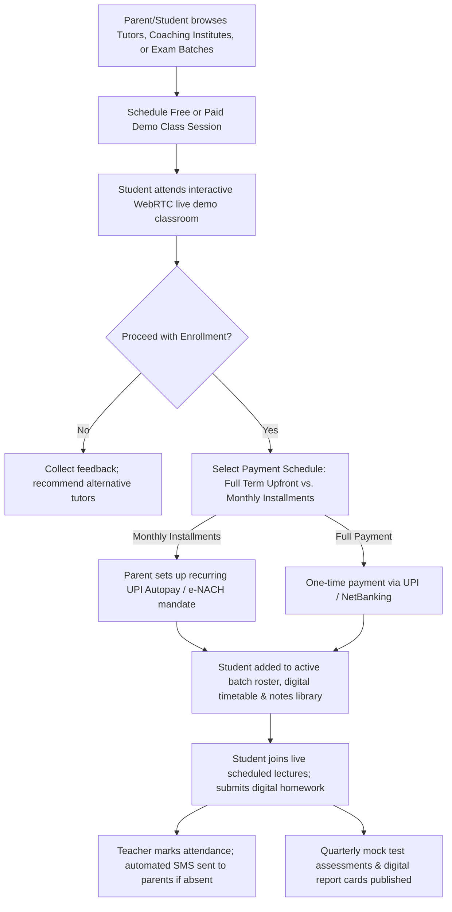
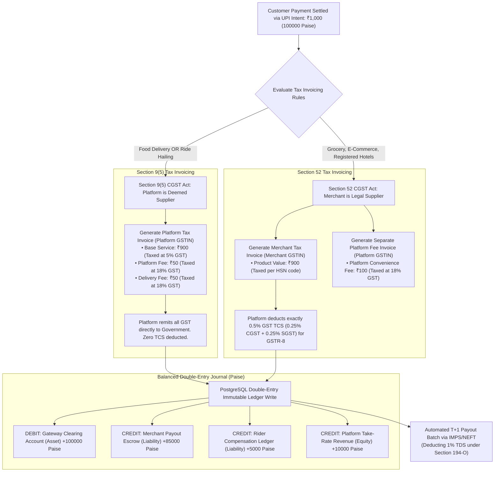
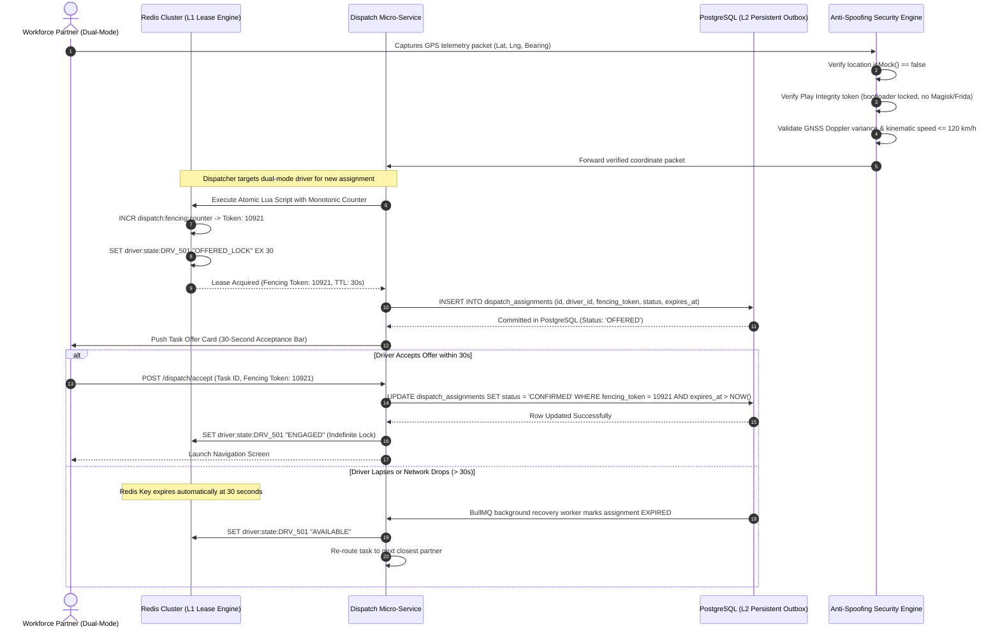

# HIGH-LEVEL VISUAL HIERARCHY & SYSTEM FLOW BLUEPRINT
## India-First Modular Super App Platform (All Verticals & Applications)

**Document Identifier:** VHB-IND-V1.0  
**Project Category:** Multi-Vertical Digital Super App Ecosystem  
**Target Market:** India (Tier 1, Tier 2, Tier 3, Semi-Urban)  
**Parent Documents:** Master Project Charter (MPC-IND-V1.0), Product Breakdown Structure (PBS-IND-V1.0), Business Requirements Document (BRD-IND-V1.0), Remediation Plan V1.1 (ERP-IND-V1.1)  
**Document Type:** Visual Architecture, System Topology & Operational Flow Blueprint  
**Status:** Baseline Visual Reference (GitHub Markdown Compatible)  

---

## 1. Executive Master Visual Architecture (End-to-End Topology)

This diagram illustrates the macro-level visual hierarchy of the platform: from client applications and edge gateways down to core engines, vertical micro-modules, data stores, and external Indian integrations.

```mermaid
graph TD
    subgraph Clients["1. CLIENT APPLICATIONS LAYER (Flutter & Next.js)"]
        App1["Customer Mobile App<br/>(Flutter + BLoC)"]
        App2["Unified Workforce App<br/>(Rider, Driver, Specialist)"]
        App3["Merchant Partner App<br/>(KDS, Inventory, Extranet)"]
        App4["Super Admin Web Portal<br/>(Next.js 14+ / TypeScript)"]
    end

    subgraph Edge["2. EDGE GATEWAY & SECURITY LAYER"]
        GW["API Gateway & Reverse Proxy<br/>(Kong / NGINX with Rate Limiting)"]
        WAF["WAF & Anti-DDoS Shield"]
        SecCheck["Token Authentication & Request Verification"]
    end

    subgraph CorePlatform["3. CORE SHARED PLATFORM ENGINES"]
        IAM["Unified IAM & Multi-Role Identity<br/>(Mobile OTP & Device Control)"]
        Treasury["Double-Entry Treasury Engine<br/>(64-bit Integer Paise Precision)"]
        Geo["H3 Spatial & Telemetry Engine<br/>(Uber H3 Res 7/9 & Dead Reckoning)"]
        Events["Notification & Event Hub<br/>(Priority FCM Data & WhatsApp API)"]
        CartEng["Cart, Split-Invoicing & GST Engine<br/>(Sec 9(5) vs Sec 52 Dual Invoicing)"]
        Loyalty["Universal Super Coins & Rewards"]
        Support["24x7 Helpdesk & In-Trip SOS Engine"]
    end

    subgraph Verticals["4. 9 BUSINESS VERTICAL MICRO-MODULES"]
        V1["Food Delivery<br/>(KDS, Prep Timer, FSSAI)"]
        V2["Grocery Delivery<br/>(Stock Lock, Produce Tolerance)"]
        V3["E-Commerce Marketplace<br/>(Multi-Seller Cart, 3PL AWB)"]
        V4["Ride Booking & Mobility<br/>(Upfront Fare, 4-Digit OTP)"]
        V5["Logistics & Parcel<br/>(Volumetric Weight, QR Waybill)"]
        V6["Home Services<br/>(Rate Cards, Extra Quotes)"]
        V7["Healthcare Services<br/>(Clinic Token, Signed PDF Locker)"]
        V8["Education & Tutoring<br/>(Demo Class, UPI Autopay)"]
        V9["Hotel Booking<br/>(Inventory Hold, Foreign Form C)"]
    end

    subgraph DataStorage["5. DATA, QUEUE & CACHE TIER"]
        DB[(PostgreSQL Primary & Replicas<br/>Domain Schemas with ACID Guards)]
        Redis[(Redis In-Memory Cluster<br/>Lua Leases & Geo Proximity)]
        Queue["BullMQ Job Queue<br/>(Dead-Letter & Reconciliation)"]
        Storage["Object Storage<br/>(Cloudflare R2 / S3 Encrypted)"]
    end

    subgraph Integrations["6. EXTERNAL INDIAN INTEGRATIONS"]
        PayRail["Payments: Razorpay, Cashfree<br/>(UPI Intent, RuPay, Autopay)"]
        SMSWA["Messaging: MSG91, Gupshup<br/>(DLT SMS, WhatsApp Business)"]
        MapAPI["Maps: Mappls, Google Maps<br/>(Indian Landmark Geocoding)"]
        Logi3PL["Logistics: Delhivery, Shiprocket<br/>(Inter-City AWB Freight)"]
        GovAPI["Statutory: GSTIN Verification<br/>(ABDM Sandbox, BoI FRRO Portal)"]
    end

    Clients --> Edge
    Edge --> CorePlatform
    CorePlatform --> Verticals
    Verticals --> DataStorage
    CorePlatform --> Integrations
    Verticals --> Integrations
```



---

## 2. The 4 Client Applications & Internal Feature Topologies



---

## 3. Clean Architecture & BLoC Reactive Event Flow (Flutter)

Every mobile feature strictly adheres to Clean Architecture, completely separating UI, state management, business rules, and network datasources:



---

## 4. End-to-End Operational Workflows Across the 9 Verticals

---

### 4.1 On-Demand Food Delivery Workflow
```mermaid
sequenceDiagram
    autonumber
    actor Cust as Customer App
    participant Back as Core Backend
    actor Rest as Restaurant KDS
    participant Redis as Redis Lua Lease
    actor Rider as Workforce App

    Cust->>Back: Place Order (Online UPI / COD)
    Back->>Rest: Push High-Priority Audio Chime Alert
    Rest->>Back: Restaurant Accepts (Set Prep Time: 15 mins)
    
    Note over Back,Redis: Dispatcher computes Rider ETA to match Kitchen Food-Ready Time
    Back->>Redis: Acquire Atomic Lease (DISPATCH_LOCK_EX30)
    Redis-->>Back: Lock Granted (Fencing Token: 10842)
    Back->>Rider: Push 30s Task Offer Modal
    Rider->>Back: Rider Accepts Offer
    
    Rider->>Rest: Arrives at Restaurant; verifies Order ID & Hot-Bag
    Rest->>Rider: Handover food package with tamper-evident seal
    Rider->>Cust: In transit to delivery address (Real-time telemetry)
    
    Rider->>Cust: Arrives at doorstep; requests Delivery OTP
    Cust->>Rider: Customer shares 4-digit OTP
    Rider->>Back: Submit OTP verification
    Back->>Back: Order marked DELIVERED; Release restaurant & rider credits
```

---

### 4.2 Mobility & Ride Hailing Workflow
```mermaid
sequenceDiagram
    autonumber
    actor Rider as Customer App
    participant Back as Mobility Backend
    actor Driver as Workforce App (Ride Mode)

    Rider->>Back: Select Destination; Request Fare Quote
    Back->>Rider: Display Guaranteed Upfront Fare (Tolls & Surge included)
    Rider->>Back: Confirm Booking (Issue 4-Digit Start OTP)
    
    Back->>Driver: Geo-spatial Broadcast to nearest available drivers
    Driver->>Back: Driver Accepts Trip Request
    Back->>Rider: Share Driver Details (Vehicle Number, Live Bearing, ETA)
    
    Driver->>Rider: Arrives at Pickup Coordinates
    Rider->>Driver: Board vehicle; share 4-Digit Start OTP
    Driver->>Back: Validate Start OTP via App Keypad
    Back->>Back: Transition state to TRIP_IN_TRANSIT
    
    Note over Driver,Rider: Live route monitoring with automated route deviation anomaly detection
    
    Driver->>Back: Arrive at Drop Location; tap End Trip
    Back->>Back: Calculate FASTag automated toll charges; auto-debit UPI / Wallet
    Back-->>Rider: Display Receipt; prompt for Driver Rating & Tip
    Back-->>Driver: Credit Trip Earnings to Driver Payout Ledger
```

---

### 4.3 Multi-Seller E-Commerce Marketplace Workflow


---

### 4.4 On-Demand Home Services Workflow


---

### 4.5 Healthcare Telemedicine & Diagnostic Sample Workflow
```mermaid
sequenceDiagram
    autonumber
    actor Patient as Customer App
    participant Back as Healthcare Gateway
    actor Doctor as Doctor Portal (RMP)
    participant ABDM as ABDM Sandbox / ABHA
    actor Phleb as Phlebotomist (Workforce App)

    alt Video Teleconsultation Channel
        Patient->>Back: Search Doctor by Specialty; Select Teleconsult Slot
        Back->>ABDM: Verify Patient ABHA ID & Doctor Medical Council ID
        Patient->>Doctor: Join Encrypted WebRTC Video Consultation Room
        Doctor->>Doctor: Review symptoms; prescribe permissible List O / List A drugs
        Doctor->>Back: Submit cryptographically signed digital prescription
        Back->>Patient: Save Signed PDF in Patient's Encrypted Health Locker
        
        opt External Pharmacy Fulfillment
            Patient->>Back: Opt to order prescribed medications
            Back->>Back: Route PDF to Licensed Partner Pharmacy via API
            Note over Back: Licensed retail pharmacist tele-verifies prescription before dispensing
        end
    else Home Diagnostic Sample Collection Channel
        Patient->>Back: Book Full Body Blood Checkup (Select fasting morning slot)
        Back->>Phleb: Assign certified phlebotomist with temperature-controlled cold carrier
        Phleb->>Patient: Arrive at home; draw blood samples; scan unique barcoded vacutainer tubes
        Phleb->>Back: Hand over samples to accredited partner diagnostic lab
        Back->>Patient: Encrypted Diagnostic Report PDF delivered to Health Locker within 24 hours
    end
```

---

### 4.6 Education & Tutoring Enrollment Workflow


---

### 4.7 Hotel & Accommodation Booking Workflow


---

## 5. Double-Entry Financial Treasury & Split-Invoicing Flow

Every transaction enforces 64-bit integer minor unit (**Paise**) arithmetic and automatic tax entity bifurcation:



---

## 6. High-Scale Concurrency, Anti-Spoofing & Idempotency Flow



---

## 7. Master Visual Document Index & References

This visual hierarchy blueprint coordinates directly with the complete project documentation suite:

| Document Reference | Full File Path | Primary Visual Coverage |
|:---|:---|:---|
| **Master Project Charter** | [`docs/01_project_charter/master_project_charter.md`](file:///Users/firozmohammad/DigiEmperor/all_in_one/docs/01_project_charter/master_project_charter.md) | Ecosystem Business Objectives & 9 Verticals Scope |
| **Product Breakdown Structure** | [`docs/02_product_breakdown_structure/product_breakdown_structure.md`](file:///Users/firozmohammad/DigiEmperor/all_in_one/docs/02_product_breakdown_structure/product_breakdown_structure.md) | 4-Level Deliverable Hierarchy & App Traceability |
| **Business Requirements Document** | [`docs/03_business_requirements_document/business_requirements_document.md`](file:///Users/firozmohammad/DigiEmperor/all_in_one/docs/03_business_requirements_document/business_requirements_document.md) | Commercial Take Rates, Commission Matrices & NFRs |
| **Remediation Plan V1.1** | [`docs/05_remediation_plan/enterprise_remediation_plan_v1.1.md`](file:///Users/firozmohammad/DigiEmperor/all_in_one/docs/05_remediation_plan/enterprise_remediation_plan_v1.1.md) | Authoritative Statutory GST, COD & Concurrency Remediations |
| **Repository README** | [`README.md`](file:///Users/firozmohammad/DigiEmperor/all_in_one/README.md) | Master 5-Step Execution Roadmap & Document Index |

---

## 8. Document Sign-Off Notice

* **Document Identifier:** VHB-IND-V1.0
* **Syntax Validation:** All Mermaid diagrams utilize GitHub-native compatible syntax (clean labels, `<br/>` line breaks, zero unescaped arrows).
* **Next Action:** Awaiting executive approval on Remediation Decisions `DEC-01` through `DEC-07` to begin foundational document updates and Final PRD authoring.
