# High-Level Visual Hierarchy & System Flow Blueprint

**Document Identifier:** `VHB-IND-V1.2`  
**Classification:** Enterprise System Architecture & Visual Execution Blueprint  
**Status:** Approved Executive Reference  
**Platform Scope:** 4 Unified Applications | 9 Business Verticals | Modular Omnichannel Backend  
**Target Audience:** Executive Leadership, Investors, Technical Architects, Regulators, Product Managers  

---

## Executive Summary & Visual Navigation Guide

This document provides a single-source-of-truth visual and functional hierarchy of the India-First Modular Super App Platform. Any executive, investor, product architect, or engineering lead can review this document to instantly understand:
1. **The 4 Unified Client Surfaces** (3 Flutter Mobile Apps + 1 Next.js Web Portal).
2. **The 9 Business Verticals** integrated into a single cohesive ecosystem.
3. **The Central Backend Engines & Microservices** powering real-time dispatch, financial integrity, and geospatial operations.
4. **The End-to-End Operational Workflows** spanning customer booking, merchant preparation, workforce delivery, and regulatory tax compliance.

---

# LAYER 1: Master Platform Topology (Bird's Eye View)

The platform is structured into five interdependent tiers connecting client applications, central orchestration gateways, domain microservice engines, data persistence clusters, and statutory regulatory interfaces.

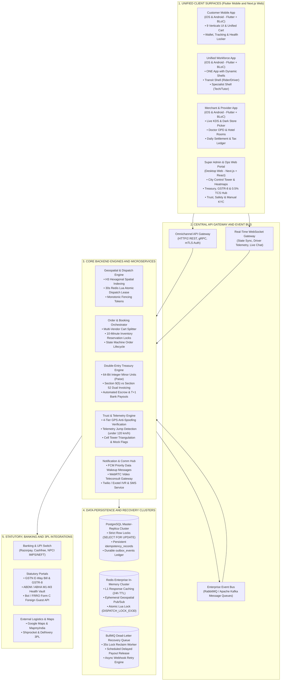

---

# LAYER 2: Deep App-by-App Feature Hierarchy

Each of the four unified client applications is decomposed below into its constituent functional modules, business verticals, and architectural subsystems.

```mermaid
graph TD
    SuperCore["SUPER APP PLATFORM SURFACES"]

    SuperCore --> App1["App 1: Customer Mobile App"]
    SuperCore --> App2["App 2: Unified Workforce App"]
    SuperCore --> App3["App 3: Merchant & Provider App"]
    SuperCore --> App4["App 4: Super Admin Web Portal"]

    %% APP 1: CUSTOMER APP
    subgraph App1_Sub["CUSTOMER MOBILE APP (Flutter + BLoC)"]
        App1 --> C_Core["Common Core Hub<br/>• Mobile OTP & Truecaller Auth<br/>• Closed Wallet & SuperCoins<br/>• Saved Address Book (Landmark AI)<br/>• Encrypted Health Locker (PDF Vault)<br/>• 24x7 Helpdesk & In-App Chat"]
        App1 --> C_Food["1. Food Delivery<br/>• Restaurant Listings & Menu<br/>• Cart Customization & Add-ons<br/>• Live Rider Map Tracking<br/>• Contactless Delivery OTP"]
        App1 --> C_Groc["2. Grocery Delivery (Dark Store)<br/>• 10-Min Express vs Scheduled<br/>• Live Inventory Stock Counter<br/>• Wave Picking Progress Tracker<br/>• Fresh Produce Weight QC"]
        App1 --> C_Ecom["3. E-Commerce (Multi-Vendor)<br/>• Universal Multi-Seller Cart<br/>• Direct Courier Tracking AWB<br/>• 7-Day Return / Replacement<br/>• Verified Customer Reviews"]
        App1 --> C_Ride["4. Mobility & Ride Hailing<br/>• Bike / Auto / Cab Categories<br/>• Upfront Guaranteed Fare Lock<br/>• Emergency SOS & Live Share<br/>• 4-Digit Ride Start OTP"]
        App1 --> C_Logi["5. Logistics & Parcel<br/>• Hyperlocal Intra-City Courier<br/>• Weight & Dimension Calculator<br/>• Multi-Stop Drop Routing<br/>• Recipient Digital Delivery OTP"]
        App1 --> C_Serv["6. Home Services<br/>• Standardized Rate Cards<br/>• 2-Hour Slot Arrival Window<br/>• Background-Checked Tech Profile<br/>• 30-Day Digital Warranty Card"]
        App1 --> C_Heal["7. Healthcare & Telemedicine<br/>• ABHA ID Creation & Linkage<br/>• WebRTC Video Teleconsult<br/>• Encrypted Prescription PDF<br/>• Home Diagnostic Sample Booking"]
        App1 --> C_Educ["8. Education & Tutoring<br/>• Free / Paid Demo Booking<br/>• Batch & Course Enrollment<br/>• WebRTC Live Interactive Class<br/>• Attendance & Digital Mock Tests"]
        App1 --> C_Hote["9. Hotel Booking<br/>• Room Inventory Hold Lock<br/>• Configurable Domestic Guest KYC<br/>• Foreign Guest Form C Intake<br/>• Express Check-in Voucher QR"]
    end

    %% APP 2: WORKFORCE APP
    subgraph App2_Sub["UNIFIED WORKFORCE APP (ONE Binary - Dynamic Shells)"]
        App2 --> W_Core["Workforce Common Core<br/>• Aadhaar, PAN, DL & RC Vault<br/>• Bank Penny-Drop Account Validation<br/>• Instant UPI / IMPS Cashout<br/>• In-App Safety SOS Emergency Button<br/>• 4-Tier GPS Anti-Spoof Telemetry"]
        App2 --> W_Transit["Transit Shell (Riders & Drivers)<br/>• Geohash Dynamic Job Radar<br/>• Floating Order Overlay Widget<br/>• Battery-Optimized Map Navigation<br/>• Live Trip Meter & Fare Ledger<br/>• Customer Delivery & Start OTP Entry"]
        App2 --> W_Specialist["Specialist Shell (Techs & Phlebotomists)<br/>• Scheduled Appointment Calendar<br/>• Equipment & Diagnostic Checklist<br/>• Pre-Service & Post-Service Photo QC<br/>• Digital Job Completion Sign-Off"]
    end

    %% APP 3: MERCHANT APP
    subgraph App3_Sub["MERCHANT & PROVIDER APP (Flutter + BLoC)"]
        App3 --> M_Retail["Retail & Restaurant Operations<br/>• Live KDS (Kitchen Display System)<br/>• Dark Store Picker Wave View<br/>• Dynamic Stock Toggle (In / Out)<br/>• Preparation Time Adjuster (+10m)"]
        App3 --> M_Prof["Professional Provider Operations<br/>• Doctor OPD Teleconsult Calendar<br/>• Real-Time Room Occupancy Grid<br/>• Guest Check-in QR Scanner<br/>• Home Service Technician Roster"]
        App3 --> M_Fin["Financial Settlement & Invoicing<br/>• Daily Gross Sales vs Commission<br/>• Section 194-O TDS & Sec 52 TCS View<br/>• T+1 Automated Bank Payout Tracker<br/>• In-App Payout Dispute Claims"]
    end

    %% APP 4: SUPER ADMIN PORTAL
    subgraph App4_Sub["SUPER ADMIN & OPERATIONS PORTAL (Next.js Web)"]
        App4 --> A_Ops["Operations Control Tower<br/>• Live Fleet Map (Multi-City Grid)<br/>• Dynamic Surge Multiplier Config<br/>• Active Incident Escalation Matrix<br/>• City Demand / Supply Heatmaps"]
        App4 --> A_Tax["Treasury, Tax & Compliance Hub<br/>• Double-Entry Ledger Balance Audit<br/>• GSTR-8 Monthly Export (0.5% TCS)<br/>• Section 9(5) Deemed Tax Ledger<br/>• Bank Clearing Auto-Reconciliation"]
        App4 --> A_Trust["Trust, Safety & Risk Engine<br/>• Partner KYC Document Approval Queue<br/>• BoI / FRRO Form C Foreign Export<br/>• GPS Anomaly & Fake Route Alerts<br/>• Fraudulent COD Customer Debt Lock"]
    end
```

---

## Detailed Functional Matrix of the 4 Applications

### 1. Customer Mobile App (`customer_app`)
- **Technology Stack:** Flutter (Single codebase for iOS & Android), BLoC State Management (`flutter_bloc`), Clean Architecture (`data/`, `domain/`, `presentation/bloc/`).
- **Target Persona:** End-consumers booking rides, food, groceries, products, medical care, tutoring, and hotels.
- **Architectural Modules:**
  - `feature/auth`: OTP verification, phone number login, DPDP consent tracking.
  - `feature/wallet`: Closed-loop platform wallet, SuperCoins loyalty points balance, ledger transaction history.
  - `feature/address`: Reverse-geocoded addresses, landmark parser, favorite tags (Home, Work, Other).
  - `feature/health_locker`: Client-side encrypted prescription storage (DPDP 2023 & SPDI compliant).
  - `feature/helpdesk`: WebSocket live agent ticket chat and automated IVR callback requests.
  - `feature/verticals/`: 9 dedicated domain packages containing clean entities, use cases, and BLoC state handlers.

### 2. Unified Workforce App (`workforce_app`)
- **Technology Stack:** Flutter, BLoC, Background Telemetry Service, SQLite Local Cache.
- **Single Binary Dynamic Shell Architecture:**
  - One single app binary downloaded from app stores.
  - Upon login, the app queries `GET /api/v1/workforce/profile`.
  - If role includes `RIDER` or `DRIVER`, the app mounts the **Transit Shell**.
  - If role includes `TECHNICIAN`, `TUTOR`, or `PHLEBOTOMIST`, the app mounts the **Specialist Shell**.
  - Dual-mode partners (e.g. delivery rider in afternoon, courier in evening) switch modes seamlessly with a single toggle.
- **Architectural Modules:**
  - `feature/kyc_vault`: Camera capture for Aadhaar QR, PAN OCR, Driving License, and Vehicle RC.
  - `feature/telemetry`: 4-Tier anti-spoof background service reporting mock location flags, speed threshold violations, and cell tower IDs.
  - `feature/payout`: Instant UPI bank transfer, earnings dashboard, and tax deduction certificates.
  - `feature/transit_shell`: Floating overlay order accept widget, offline tile map navigation, OTP validator.
  - `feature/specialist_shell`: Job checklist, pre-work photo QC, digital customer signature.

### 3. Merchant & Provider Mobile App (`merchant_app`)
- **Technology Stack:** Flutter, BLoC, Audio Alarm Daemon, Bluetooth Thermal Printer Driver.
- **Target Persona:** Restaurant owners, Dark Store operators, E-commerce sellers, Doctors, Hotel managers, and Home Service contractors.
- **Architectural Modules:**
  - `feature/kds`: Kitchen Display System with color-coded ticket timers (Green: <10m, Orange: 10-20m, Red: >20m).
  - `feature/inventory`: 1-tap stock-out toggle, automated threshold alerts, and batch price update.
  - `feature/provider_schedule`: Doctor OPD video slot management, hotel room rate matrix, technician dispatching.
  - `feature/settlement`: Daily ledger view showing Gross GMV, Platform Commission, Section 194-O TDS (1%), Section 52 GST TCS (0.5%), and Net Bank Settlement.

### 4. Super Admin & Operations Web Portal (`admin_portal`)
- **Technology Stack:** Next.js (React 19, TypeScript, TailwindCSS, WebSockets, Leaflet/MapLibre GL).
- **Target Persona:** City Operations Managers, Risk Officers, Treasury Accountants, and Executive Leadership.
- **Architectural Modules:**
  - `module/control_tower`: Geospatial map rendering thousands of live vehicle positions via WebSocket telemetry.
  - `module/surge_engine`: Configurable surge pricing multiplier based on real-time geohash supply-demand ratios.
  - `module/treasury`: Double-entry general ledger balance sheet, GSTR-8 tax table generator, automated bank clearing reconciliation.
  - `module/compliance`: Form C foreign guest batch export for Bureau of Immigration (BoI/FRRO), manual KYC review queue.

---

# LAYER 3: Cross-App Interactive Workflow (How the 4 Apps Talk to Each Other)

The sequence diagram below demonstrates the real-time interaction between all 4 client applications, backend gateways, geospatial engines, and treasury systems during an end-to-end transaction lifecycle.

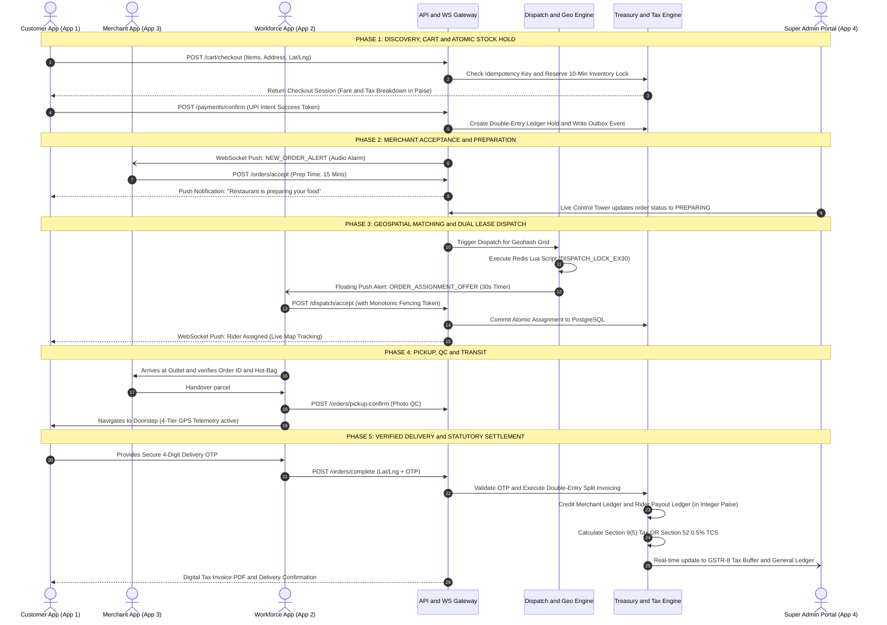

---

# LAYER 4: 9 Vertical-by-Vertical Detailed Operational Workflows

Below is the complete functional specification, state transition rules, and statutory tax logic for each of the 9 integrated verticals.

---

### 4.1 On-Demand Food Delivery Workflow

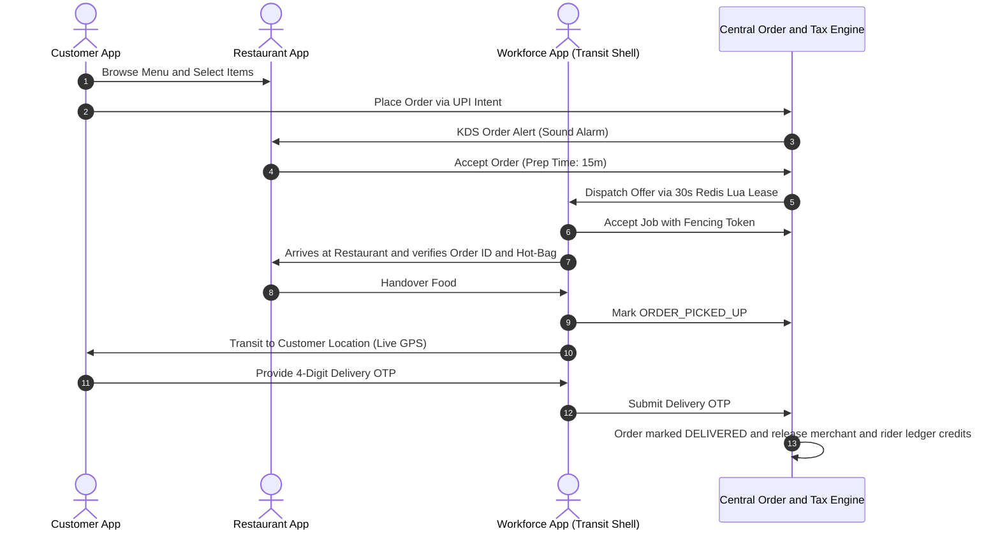

#### Detailed Working & Business Logic:
1. **Cart & Dynamic Pricing:** Delivery fee is computed based on road distance (MapmyIndia/Google API) + dynamic weather/surge multiplier.
2. **KDS Ticket Management:** Restaurant gets 120 seconds to accept the order. If unaccepted, the order auto-escalates to customer care or auto-cancels with full UPI refund.
3. **Dispatch & Fencing:** Redis Lua script locks rider candidate for 30 seconds. If rider accepts, database persists `assignment_token = 1042`. If rider device crashes, BullMQ dead-letter worker reclaims the lease at second 35 and routes to candidate #2.
4. **Delivery OTP Verification:** Handover requires customer to verbally provide 4-digit OTP generated at checkout.
5. **Statutory Tax Rule (Section 9(5) CGST Act):** Platform is the **Deemed Supplier** for restaurant food delivery. The platform issues the tax invoice directly to the customer including 5% GST (without ITC). The restaurant receives net food cost minus platform commission; no Section 52 TCS is deducted.

---

### 4.2 Mobility & Ride Hailing Workflow

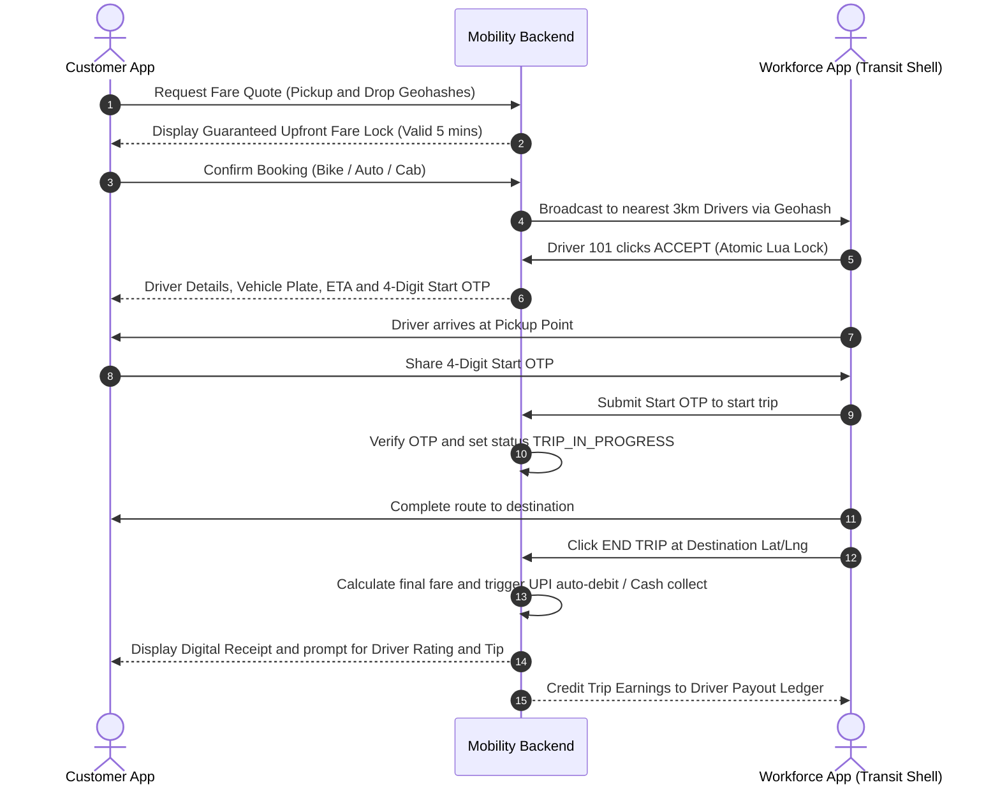

#### Detailed Working & Business Logic:
1. **Upfront Fare Guarantee:** Fare is calculated using base fare + per-km rate + estimated trip duration. Fare is locked for 5 minutes; customer pays exactly quoted amount regardless of traffic delays unless route detour exceeds 20%.
2. **Atomic Driver Lock:** Broadcast sends offers to top 5 closest drivers in radius. First driver to tap accept triggers Redis atomic test-and-set. Losing drivers receive an immediate silent cancel UI event.
3. **Trip Security & SOS:** Customer app displays live trip sharing link (web-accessible without app login) and a 1-tap SOS button that instantly streams live audio/location to city police control room and platform safety desk.
4. **Statutory Tax Rule (Section 9(5) CGST Act):** Ride hailing services delivered via two-wheelers, three-wheelers, or motor cabs are statutory Section 9(5) supplies. The platform issues the customer tax invoice charging 5% GST (without ITC). Platform pays GST directly to the government; driver receives gross trip fare minus commission.

---

### 4.3 Hyperlocal Grocery & Dark Store Quick Commerce

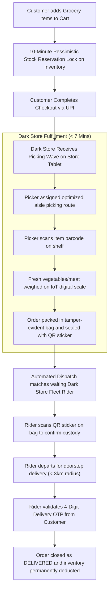

#### Detailed Working & Business Logic:
1. **Pessimistic Inventory Locking:** Adding an item to the cart places a 10-minute temporary reservation lock in Redis. If checkout is not completed within 600 seconds, the lock expires and stock counter is restored.
2. **IoT Weigh Scale Integration:** Variable weight items (fruits, vegetables) are placed on digital scales paired via Bluetooth. The exact weight is logged and price delta is refunded to the customer's wallet instantly if actual weight is lower than estimate.
3. **Batch Picking Waves:** Multiple small orders are batched into single picker routes to maintain packing time under 4 minutes.
4. **Statutory Tax Rule:** Packaged goods follow standard retail GST rates (0%, 5%, 12%, 18%). The Dark Store operator issues the retail tax invoice; platform collects customer payment and deducts platform commission.

---

### 4.4 Multi-Vendor E-Commerce Workflow

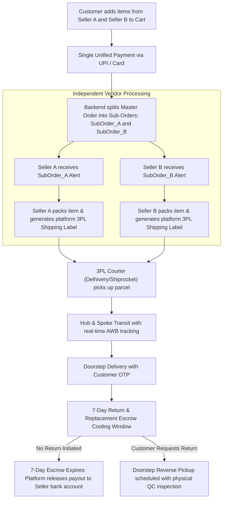

#### Detailed Working & Business Logic:
1. **Universal Cart Decomposition:** A single customer payment settles a cart with products from multiple distinct legal entities. The backend creates individual sub-orders with separate order IDs, fulfillment schedules, and invoices.
2. **7-Day Escrow Protection:** Merchant payout funds are held in platform escrow for 7 days post-delivery to protect against return or defect claims.
3. **Statutory Tax Rule (Section 52 GST TCS):** E-commerce sellers are legally registered suppliers. Each seller issues a GST Tax Invoice directly to the customer. The platform operates as an Electronic Commerce Operator (ECO) and legally deducts **0.5% GST TCS** ($0.25\%\text{ CGST} + 0.25\%\text{ SGST}$) under Notification No. 15/2024-CT (effective July 10, 2024). The deducted TCS is deposited to the government under the platform's GSTIN and reported in monthly **GSTR-8** returns.

---

### 4.5 On-Demand Logistics & Parcel Courier Workflow

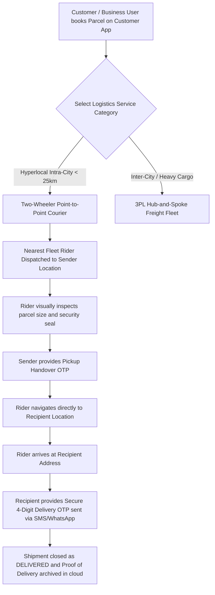

#### Detailed Working & Business Logic:
1. **Volumetric & Weight Verification:** Sender enters dimensions (Length, Width, Height) and estimated weight. If rider measures excess weight, rider app adjusts weight category and prompts sender for additional payment approval before accepting custody.
2. **Live Tracking for Non-App Users:** Recipient receives an automated SMS and WhatsApp notification containing a secure web link to track the courier on a live map without downloading the app.
3. **Safety Declaration:** Sender must accept the platform prohibited goods policy (no cash, jewelry, flammable liquids, contraband).

---

### 4.6 Home Services & Maintenance Workflow

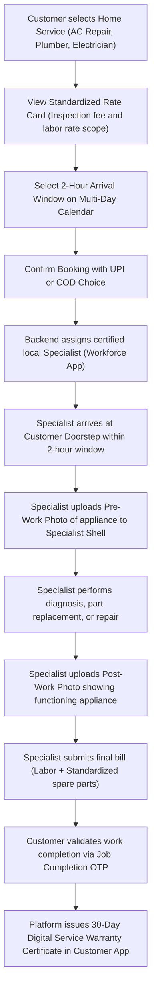

#### Detailed Working & Business Logic:
1. **Standardized Rate Cards:** Customers are shielded from arbitrary contractor pricing. Fixed rates govern inspection fees, standard repairs, and manufacturer-certified spare parts.
2. **Dual-Photo Quality Control:** Specialists must photograph the broken equipment prior to touching it and photograph the working appliance after completion. Photos are geotagged and timestamped.
3. **30-Day Platform Warranty:** If the repaired appliance malfunctions within 30 days, the platform dispatches a senior technician for a free re-inspection and repair.
4. **Statutory Tax Rule (Section 9(5) vs Section 52):**
   - **Unregistered Technician:** If technician is not GST-registered, Section 9(5) applies. The platform is the Deemed Supplier, issues the tax invoice with 18% GST, and discharges tax liability directly.
   - **Registered Service Company:** If the contractor is a GST-registered enterprise, the contractor issues the tax invoice, and the platform deducts **0.5% GST TCS** under Section 52.

---

### 4.7 Healthcare Telemedicine & Diagnostic Sample Workflow

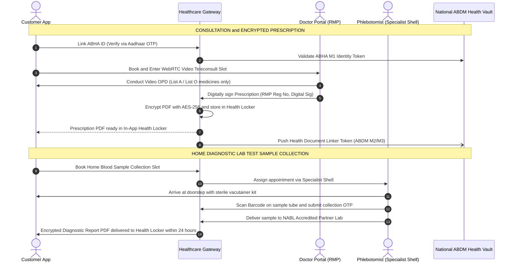

#### Detailed Working & Business Logic:
1. **Zero-Dispensing Intermediary Safe Harbor:** The platform acts strictly as an electronic technology intermediary under Section 79 of the Information Technology Act. The platform **never dispenses, sells, or stocks medicines**. Fulfilling prescription medications is routed to external licensed retail pharmacies.
2. **Telemedicine Practice Guidelines 2020 Compliance:** Doctors must be Registered Medical Practitioners (RMP). Teleconsultations are strictly restricted to **List O** (OTC drugs, re-orders for chronic conditions) and **List A** (first-line antibiotics, simple analgesics). **Schedule X drugs (narcotics, psychiatric drugs) are strictly barred from telemedicine prescription.**
3. **Digital Personal Data Protection (DPDP) Act 2023 & SPDI Rules 2011:** Health records are deemed sensitive personal data. Medical records are encrypted at rest with AES-256. Access requires explicit multi-factor customer consent; records are never shared with advertisers or third parties.
4. **Ayushman Bharat Digital Mission (ABDM) M1-M3 Integration:** Supports ABHA creation, demographic authentication, and FHIR-compliant diagnostic report linking into the national health network.

---

### 4.8 Education, Tutoring & Interactive Classroom Workflow

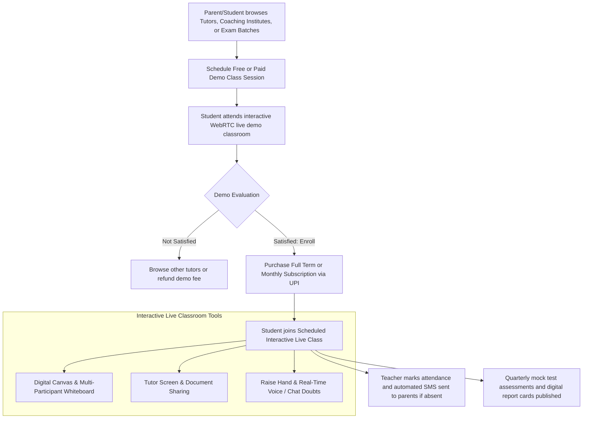

#### Detailed Working & Business Logic:
1. **Interactive WebRTC Classrooms:** Low-latency (<200ms) multi-peer video streaming optimized for Indian broadband and 4G mobile connections with automated bandwidth downscaling.
2. **Parental Trust & Transparency:** Automated attendance logging triggers an instant SMS to registered parents within 10 minutes of class start if a student is absent.
3. **Structured Milestone Billing:** Tuition fees are held in platform escrow and released monthly to the tutor only upon completion of the contractual number of teaching hours and syllabus milestones.

---

### 4.9 Hospitality & Hotel Room Booking Workflow

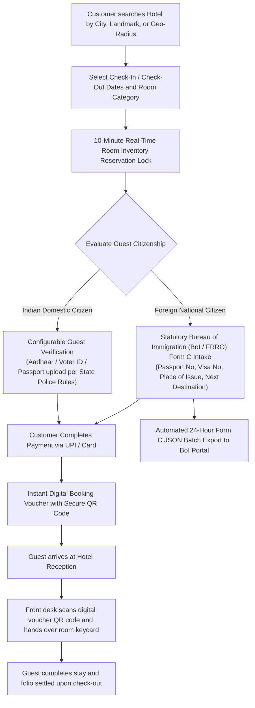

#### Detailed Working & Business Logic:
1. **Configurable Domestic Guest KYC:** Recognizes that domestic hotel KYC is governed by local state police regulations and the Sarais Act, 1867. The KYC workflow is configurable per property type (instant check-in vs mandatory front-desk ID scan).
2. **Strict Foreign National Form C Compliance:** Under the Registration of Foreigners Act, 1939, hotels must report foreign guest arrivals to the Bureau of Immigration (BoI) / Foreigners Regional Registration Office (FRRO) **within 24 hours**. The platform collects passport details, visa details, port of arrival, and next destination, compiling daily automated XML/JSON batch files for government filing.
3. **Statutory Tax Rule (Section 9(5) vs Section 52):**
   - **Unregistered Guest Houses/Homestays:** Section 9(5) applies. The platform is the Deemed Supplier, issues the tax invoice (12% or 18% GST depending on room tariff), and deposits GST directly.
   - **Registered Commercial Hotels:** Hotel issues the commercial tax invoice directly to the guest. The platform collects the payment, deducts **0.5% GST TCS** under Section 52, and releases net funds on T+1 after check-in.

---

# LAYER 5: Architectural Safeguards & Deep Commentary

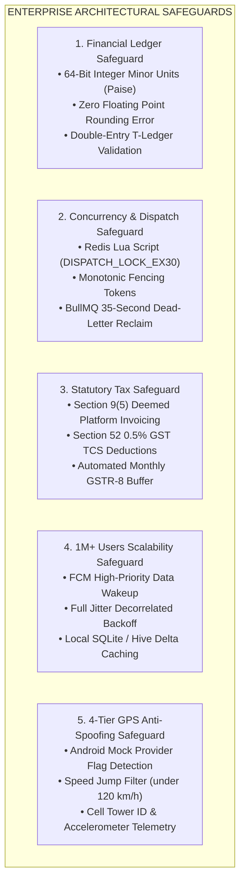

---

### Technical Commentary & Architectural Rules

#### `// COMMENT: FINANCIAL INTEGRITY (Paise Precision)`
Floating-point arithmetic (e.g. `0.1 + 0.2 = 0.30000000000000004`) is strictly barred from database tables, APIs, and calculations. Every monetary figure across customer wallets, order totals, commissions, tips, and taxes is represented as a **64-bit signed integer in minor units (Paise)**. Example: ₹150.50 is stored and transmitted as `15050`. In Flutter UI, minor units are divided by 100 solely at the final rendering widget.

#### `// COMMENT: CONCURRENCY LEASE & FENCING TOKENS`
To guarantee that two delivery drivers are never assigned the same order in high-concurrency environments, dispatch offers use an atomic Redis Lua lease (`DISPATCH_LOCK_EX30`). When Driver A accepts the order, a monotonic incrementing **Fencing Token** (`fencing_token = 8941`) is issued. When Driver A submits an update to PostgreSQL, the database validates:
```sql
UPDATE orders 
SET rider_id = 'RDR_101', status = 'ASSIGNED', fencing_token = 8941
WHERE id = 'ORD_550' AND fencing_token < 8941;
```
If a delayed packet from Driver B arrives with an older fencing token (`8940`), the database rejects the update. If Driver A crashes, a background BullMQ job reclaims the lease after 35 seconds.

#### `// COMMENT: STATUTORY TAX & SPLIT-INVOICING`
The platform implements a bifurcated dual-tax engine:
1. **Section 9(5) CGST Act:** Applies to Food Delivery, Mobility/Rides, and Unregistered Hotels/Home Services. Platform is legally deemed the supplier and charges GST on the platform invoice.
2. **Section 52 CGST Act:** Applies to Multi-Vendor E-Commerce, Registered Hotels, and Registered Service Companies. The merchant issues the tax invoice; platform acts as marketplace and deducts **0.5% GST TCS** ($0.25\%\text{ CGST} + 0.25\%\text{ SGST}$) deposited via monthly GSTR-8.

#### `// COMMENT: 1M+ SCALABILITY & APP RESUMED STATE`
To support 1,000,000+ registered users and 50,000+ concurrent workforce partners:
- **Background State:** The mobile apps use FCM **Data-Only Messages** with `priority: high`. This bypasses OS battery-saver killing and awakens background handlers without displaying duplicate system notifications.
- **App Resumed State:** When the customer or driver opens the app, client devices perform an immediate HTTP/2 delta sync (`GET /api/v1/sync/delta?last_synced_at=TIMESTAMP`) instead of fetching entire order histories.
- **WebSocket Reconnection:** If an internet drop occurs, reconnect attempts use a **Full Jitter Decorrelated Backoff** formula ($Sleep = \min(60, \text{random}(1, \text{previous\_sleep} \times 3))$), preventing hundreds of thousands of reconnecting devices from crashing the WebSocket gateway simultaneously.

#### `// COMMENT: 4-TIER GPS ANTI-SPOOFING TELEMETRY`
Workforce apps run continuous background telemetry checks:
1. **Tier 1 (OS Flag):** Verifies `Location.isFromMockProvider()` on Android.
2. **Tier 2 (Kinematic Velocity):** Calculates displacement velocity between consecutive GPS pings. If speed exceeds $120\text{ km/h}$ for two-wheelers, the ping is flagged as a teleportation spoof.
3. **Tier 3 (Cell Tower Correlation):** Validates device Cell ID and MCC/MNC against the reported latitude/longitude.
4. **Tier 4 (Inertial Sensors):** Reads accelerometer and gyroscope motion vectors. If GPS coordinates change while accelerometer reports zero motion, driver account is suspended for review.

---

## Traceability & Compliance Matrix

| Document ID | Section Reference | Alignment Status | Validation Required |
|:---|:---|:---|:---|
| `MPC-IND-V1.0` | Section 4 & 5 (Scope & Structure) | Aligned: 4 Unified Apps, 9 Verticals | Executive Sponsor |
| `PBS-IND-V1.0` | WBS 1.0 to 4.0 | Aligned: Single Workforce App with Dynamic Shells | Technical Architect |
| `BRD-IND-V1.0` | Section 4 to 8 | Aligned: Section 9(5) vs Section 52 Dual Invoicing | Chartered Accountant / Tax Counsel |
| `ERP-IND-V1.1` | DEC-01 to DEC-07 | Aligned: 0.5% TCS, Configurable KYC, Fencing Tokens | Solution Architect |

---

*End of High-Level Visual Hierarchy & System Flow Blueprint (`VHB-IND-V1.2`).*